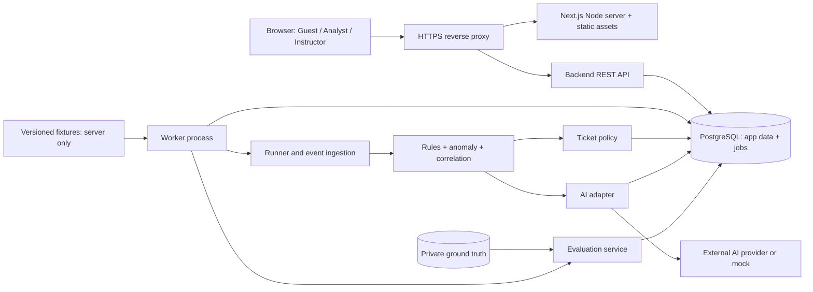
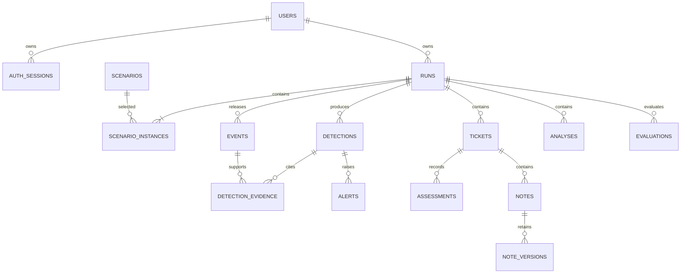

# SOC Platform — Architecture

วันที่ปรับปรุง: 12 ตุลาคม 2026 · สถานะ: ข้อเสนอสำหรับพัฒนา ยังไม่ใช่ระบบที่ติดตั้งแล้ว

อัปเดตข้อ 01: frontend/API health/worker entrypoint มี scaffold แล้ว ดู [คู่มือ](getting-started.md)
ข้อ 02 เพิ่ม DB และข้อ 04 เปิด auth/me/Guest snapshot แล้ว ดู [คู่มือ auth](auth-development.md)
domain features ที่เหลือยังไม่พร้อม; [SRS](srs.md) กำหนด exam boundary และ lock order เพิ่มเติม
generic finish/completed/truth ในเอกสารนี้หมายถึง training; exam submit freeze run + answer,
Instructor อ่านเฉลยสอบหลัง submit เท่านั้น และ learner ได้เฉพาะ rubric feedback ไม่มีเฉลยเต็ม

อ่านร่วมกับ [ขอบเขตโครงการ](soc-simulation.md), [Learning path](learning-path.md), [API contract](api.md) และ [แผนพัฒนา](development-plan.md)

แบบออกแบบเพิ่มเติม: [Database](database.md) ลงรายละเอียดตาราง/constraints/transactions และ [CI/CD](ci-cd.md) ระบุ checks, build, deployment, migration และ recovery ทั้งสองเป็นแผน ยังไม่ได้ติดตั้งจริง

## 1. สถานะและแนวทาง

`prototype/` เป็นเว็บต้นแบบ HTML/CSS/JavaScript ใช้ localStorage และ AI fixture เก็บไว้เป็น reference
ปัจจุบัน frontend/backend มี auth/DB/Guest snapshot ตามข้อ 04 แล้ว ส่วน runner/detection/exam ยังไม่ implement
สิทธิ์และข้อมูลจริงอยู่ฝั่ง server ไม่ย้ายเฉลยไป frontend

เอกสารนี้เติมรายละเอียดทางเทคนิคจาก `soc-simulation.md` โดยไม่ขยายไปสู่การโจมตีจริง README ที่ root เป็นทางเข้าและวิธีเปิดต้นแบบ ส่วนข้อกำหนดระบบเต็มอยู่ใน docs

เสนอ **modular monolith**: backend codebase เดียว แบ่งโมดูลตามหน้าที่ รันเป็น API process และ worker process แยกกัน ใช้ PostgreSQL ร่วมกัน เริ่มจาก REST และ polling ก่อน ไม่จำเป็นต้องเพิ่ม microservices, Redis, Elasticsearch หรือ WebSocket ใน MVP

## 2. เทคโนโลยีที่เสนอ

| ส่วน | แนวทางเริ่มต้น | เหตุผล / ขอบเขต |
|---|---|---|
| Frontend | Next.js App Router + React + TypeScript | แยก page, form และ API client จาก prototype |
| API | Python + FastAPI + Pydantic + Uvicorn | request/response models เป็นฐานของ validation และ OpenAPI |
| Database | PostgreSQL + Alembic migrations | transaction, constraints และการค้นข้อมูลรอบฝึก |
| Data access | SQLAlchemy async + asyncpg | explicit transactions; ใช้ bound parameters สำหรับ SQL เฉพาะทาง |
| Queue | ตาราง jobs ใน PostgreSQL | ลดจำนวนบริการที่ต้องดูแลในช่วงเริ่มต้น |
| Worker | Python process จาก backend codebase | runner, detection, AI, evaluation และ retention; แยกจาก Uvicorn |
| AI | Adapter รองรับ mock และ provider จริงหนึ่งราย | provider/model ยังรอเลือกจากผลทดสอบ ราคา และงบที่ทีมกำหนด |
| RAG | LangChain Python + pgvector ใน PostgreSQL | ค้น approved knowledge ก่อนตอบ; แยก evidence กับ knowledge citations ตาม [RAG design](rag-langchain.md) |
| Tests | pytest + HTTPX สำหรับ backend; Vitest/Testing Library สำหรับ frontend; Playwright สำหรับ E2E | prototype ยังใช้ Node test runner เดิม |
| Deploy | HTTPS reverse proxy + API + worker + managed PostgreSQL | API และ worker restart แยกกันได้ |

Next.js และ FastAPI เป็น stack ที่ผู้ใช้เลือกแล้ว เครื่องมือประกอบเป็นข้อเสนอ ยังไม่ได้ติดตั้ง dependencies เลือกเวอร์ชันที่เข้ากันและยังได้รับการสนับสนุนตอนเริ่ม Phase 0 บันทึก Node/Python versions และ lockfiles ใน repository

Deploy Next.js เป็น Node server ด้วย standalone output และ FastAPI เป็น Uvicorn container แยกกัน ดู [Next.js deployment](https://nextjs.org/docs/app/getting-started/deploying) และ [FastAPI containers](https://fastapi.tiangolo.com/deployment/docker/)

Next.js รับผิดชอบ UI ส่วน FastAPI เป็นเจ้าของ authentication, authorization, domain logic และ `/api/v1` ทั้งหมด Reverse proxy ส่ง `/api/v1/*` และ `/health/*` ไป FastAPI ส่วนหน้าเว็บไป Next.js ภายใต้ origin เดียวกัน รวม local dev proxy ด้วย ไม่สร้าง API domain ชุดซ้ำใน Next.js Route Handlers/Server Actions

หน้า investigation ใช้ Client Components เรียก API พร้อม session cookie ตาม contract; ถ้าใช้ Server Components อ่านข้อมูลสมาชิก ต้องส่งเฉพาะ cookie ที่จำเป็นไป trusted backend และปิด shared caching (`no-store`) ห้าม cache ข้อมูลสมาชิกข้าม session Worker ใช้ durable PostgreSQL jobs เดิม ไม่ใช้ FastAPI BackgroundTasks แทน queue และไม่เริ่ม runner ใน startup ของทุก Uvicorn worker

## 3. ภาพรวมระบบ



Frontend เรียกเฉพาะ API ของแอป ไม่เรียก AI provider โดยตรง และไม่รับ event อนาคตหรือ ground truth ใน bundle Guest อ่านข้อมูลตัวอย่างผ่าน `/demo/*` ซึ่งไม่มี endpoint เขียน

## 4. โมดูลและขอบเขตความรับผิดชอบ

| โมดูล | รับผิดชอบ | ห้ามทำ |
|---|---|---|
| auth | register, session, login, logout, CSRF, account status | รับ role สูงจาก registration payload |
| learning | บทเรียน versioned, ความคืบหน้า, gate ของระดับ และคำแนะนำหลัง login | เชื่อ completion/level unlock ที่ client ส่งมาโดยไม่ตรวจ server |
| exams | เลือกข้อสอบแยกจาก demo, สร้าง attempt/run, freeze คำตอบและประเมินผล | ส่งเฉลย, severity ตั้งต้นหรือ AI brief ที่ใบ้ผลก่อน submit |
| runs | เจ้าของรอบ เวอร์ชัน scenario นาฬิกา โควตา และสถานะ | รับเวลาจำลองหรือ owner จาก client |
| ingestion | ตรวจ fixture และบันทึก event ที่ถึงเวลาปล่อย | รับ URL เป้าหมายให้ยิง request จริง |
| detection | rule/anomaly และ correlation พร้อม evidence | อ่าน ground truth หรือเหตุการณ์ที่ยังไม่ปล่อย |
| analysis | redact, snapshot หลักฐาน, adapter, validate output | ใช้ AI สั่ง block/disable หรือแก้หลักฐาน |
| tickets | CRUD, assessment, notes, versions, soft delete | แก้ log ดิบหรือเขียนทับผล AI เดิม |
| evaluation | เฉลย, matching, metrics, blind assessment snapshot | ส่งเฉลยให้ Analyst ก่อน completed |
| administration | ปิดบัญชี โควตา instructor review | เขียนทับ assessment/note ของผู้เรียน |
| audit | append-only change history | เปิด public mutation endpoint |

Middleware ตรวจ session → account status → role → run ownership ก่อนส่งเข้า service ตรวจซ้ำใน service สำหรับ worker/internal calls ที่ไม่มี HTTP middleware

Learning และ exam ใช้ runner/evidence เดิมได้ แต่ต้องมี **exam serializer/policy** ทุก endpoint ที่อ่าน run: ก่อนส่งคำตอบไม่ให้คืนข้อมูลช่วยตอบ, private label หรือเฉลย แม้ผู้ใช้เรียก API ตรง Demo/ตัวอย่างฝึกต้องใช้ fixture คนละชุดกับข้อสอบ การตัดสินผ่านและปลดล็อกเป็น transaction ฝั่ง server จากผลประเมินที่ versioned; AI+RAG เป็นผู้ให้เหตุผลประกอบพร้อม citation และส่ง `needs_review` เมื่อไม่มั่นใจ ไม่ให้โมเดลเปลี่ยน ground truth หรือปลดล็อกโดยตรง

## 5. โครงสร้าง repository ที่จะพัฒนา

```text
frontend/
  src/app/                 routes, session, layouts
  src/features/            dashboard, runs, events, tickets, evaluation, admin
  src/components/          table, form, dialog, status, evidence viewer
  src/api/                 generated client types + request wrapper
backend/
  app/main.py              FastAPI application, exception handlers
  app/api/                 routers, Pydantic schemas, auth dependencies
  app/modules/             auth, runs, detection, analysis, tickets, evaluation
  app/worker/              __main__.py, job handlers, scheduler
  app/db/                  SQLAlchemy models, sessions, repositories
  app/adapters/ai/          Python provider protocol, mock, real adapter
  migrations/              Alembic env.py and versioned revisions
  pyproject.toml           Python dependencies and tool configuration
  uv.lock                  reproducible Python dependency resolution
  fixtures/events/         versioned release schedule; never served statically
  fixtures/ground-truth/   evaluator-only seed input
  tests/                   unit, integration, contract
docs/
  architecture.md
  api.md
  development-plan.md
  openapi.yaml             approved implemented routes + draft domain inventory
prototype/                 เก็บเป็น reference และงานนำเสนอเดิม
```

## 6. แบบจำลองข้อมูล

ทุก primary key ใช้ UUID เวลาใช้ UTC `timestamptz`; JSON API ใช้ ISO 8601 ส่วน simulation time ใช้ integer milliseconds แยกจากเวลาจริง ตารางที่แก้ได้มี `version` สำหรับ optimistic concurrency

| ตาราง | ฟิลด์ / ข้อกำหนดสำคัญ |
|---|---|
| users | id, normalized_email UNIQUE, display_name, password_hash, role, status, created_at |
| auth_sessions | id, user_id, token_hash UNIQUE, csrf_hash, expires_at, revoked_at; ไม่เก็บ token ดิบ |
| scenarios | id, stable_key, version, public_title, difficulty, duration_ms; UNIQUE(stable_key, version) |
| scenario_instances | id, run_id, scenario_id, ordinal; เก็บหลายสถานการณ์ในรอบเดียว |
| runs | id, owner_user_id, status, seed, elapsed_ms, resumed_at, release_cursor, version, expires_at, completed_at |
| run_versions | run_id, rule_version, baseline_version, correlation_version, ticket_policy_version, prompt_version, model_id, fixture_hash |
| events | id, run_id, scenario_instance_id, fixture_event_key, release_seq, event_time, ingested_at, source, asset_id, username, src_ip, request_json, response_json, log_json |
| detections | id, run_id, detector_type, detector_version, correlation_key, evidence_snapshot_hash, severity, explanation |
| detection_evidence | run_id, detection_id, event_id; composite FK ต้องอยู่ในรอบเดียวกัน |
| alerts | id, run_id, detection_id, severity, created_at; ไม่ใช่ข้อยืนยันผลกระทบ |
| analyses | id, run_id, correlation_key, evidence_hash, attempt_group, mode, model_id, prompt_version, status, result_json, error_code, usage_json, latency_ms |
| analysis_evidence | run_id, analysis_id, event_id; snapshot คงที่สำหรับแต่ละ analysis |
| tickets | id, run_id, origin, correlation_key NULL สำหรับ manual, title, severity, status, version, deleted_at, deleted_by, delete_reason |
| ticket_events / ticket_alerts / ticket_analyses | ตารางเชื่อมแยกชนิด พร้อม composite FK ของ run_id; ไม่ใช้ FK แบบ polymorphic ที่ตรวจไม่ได้ |
| assessments | id, ticket_id, run_id, author_user_id, disposition, reason, created_at; append-only revisions |
| notes / note_versions | note owner, body, evidence refs, version, deleted_at; เก็บเนื้อหาเก่าก่อนแก้ |
| instructor_comments | run_id, instructor_user_id, body, created_at; แยกจาก note ของผู้เรียน |
| audit_logs | run_id nullable, actor_user_id nullable, actor_role, action, entity_id, before_json, after_json, reason, request_id |
| jobs | id, type, dedupe_key UNIQUE, payload, status, attempts, available_at, lease_expires_at, locked_by, last_error |
| quota_ledgers | user_id/system scope, period_start, reserved_tokens, consumed_tokens, run_count; atomic update |
| evaluations | id, run_id, revision, release_cutoff, assessment_cutoff, ground_truth_version, status, metrics_json |
| experiment_batches / experiment_arms | immutable event dataset, A/B/C configs, job status, outputs, metric snapshots |
| private.ground_truth | scenario version, incident key, threat label, expected evidence; ให้ evaluator อ่านเท่านั้น |



ER นี้แสดงความสัมพันธ์หลัก ดูตารางเชื่อมและ constraints เพิ่มเติมใน [Database design](database.md) แล้วแปลงเป็น migrations และ schema ใน SRS ก่อนเริ่ม CRUD รวมตารางสนับสนุน idempotency, quota reservations, pre-auth CSRF และ Instructor assignments ที่ใช้รองรับ API

Constraints ที่ต้องมี:

- UNIQUE(run_id, scenario_instance_id, fixture_event_key) ป้องกัน event ซ้ำ
- UNIQUE(run_id, correlation_key) เฉพาะ ticket ที่ origin=automatic **รวมรายการที่ soft delete**; หลักฐานใหม่ยังผูกเคสเดิมและไม่คืนรายการโดยพลการ
- UNIQUE(run_id, detector_type, detector_version, correlation_key, evidence_snapshot_hash) ป้องกันผลตรวจเดิมซ้ำ
- UNIQUE(run_id, correlation_key, evidence_hash, model_id, prompt_version, attempt_group) สำหรับงาน AI หนึ่ง logical request; retry ของ worker ใช้ logical request เดิม
- ทุกตารางที่ใช้ composite FK ต้องมี UNIQUE(run_id, id) ที่ parent เพื่อป้องกันผูกหลักฐานข้ามรอบ
- Index events(run_id, event_time, id), events(run_id, release_seq), tickets(run_id, deleted_at, status, severity, id), runs(owner_user_id, created_at, id), jobs(status, available_at)

## 7. นาฬิกาและสถานะรอบ

```text
created → running ↔ paused
running → reviewing                 เมื่อปล่อย fixture ครบ
created/running/paused/reviewing → completing → completed
created/running/paused/reviewing/completing → failed
```

`reviewing` หมายถึงปล่อยครบแล้วแต่ยังไม่เปิดเฉลย `completing` หยุด event ใหม่และล็อก assessment snapshot ขณะรอ pipeline ปิดงาน ส่วน `completed` เปิดเฉลยและผลที่ผูกกับ snapshot นั้น

- เวลา effective = elapsed_ms + ช่วงตั้งแต่ resumed_at เฉพาะ running; คำนวณด้วยเวลาฐานข้อมูล
- Runner จับ lock ของ run อ่าน effective time แล้ว insert event, detection job และขยับ cursor ใน transaction เดียว
- Pause/finish จับ lock เดียวกัน: หลัง API ตอบสำเร็จ runner ปล่อย event เพิ่มไม่ได้ งาน AI ของ evidence ที่มีอยู่แล้วทำต่อได้
- Browser ปิดหรือ logout ไม่หยุด runner; ผู้ใช้กลับเข้ามาเห็นเวลาฝั่ง server เดิม ซึ่งต่างจาก prototype
- Restart worker แล้ว catch up เฉพาะ event ที่ถึงเวลาตาม server clock ด้วย unique keys; ไม่เร่งข้าม schedule
- Finish บันทึก release cutoff ทันที รอ detection/AI ที่เกี่ยวข้องไม่เกิน 60 วินาที จากนั้น evaluation ระบุ pending/failed ตรงจริง งาน AI ที่มาทีหลังไม่แก้ metric snapshot เดิม
- เมื่อ completed ให้ round เป็น read-only ยกเว้น instructor comments; ถ้าจะฝึกใหม่สร้าง run ใหม่ ข้อเสนอนี้ป้องกันคำตอบหลังเห็นเฉลยปะปนผลฝึกก่อนเห็นเฉลย

## 8. Detection, queue และความทนทาน

Run ใหม่ตรึง `rules-v2` / `baseline-v2` / `correlation-v2` และ config snapshot ไว้ใน `run_versions`; run เก่าที่ตรึง v1 ยังอ่านด้วย implementation v1 เดิม. Rules v2 แจ้ง login failed อย่างน้อย 10 ครั้งภายใน 5 นาที และ scanner อย่างน้อย 4 ครั้งภายใน 5 นาที; blocked request สร้าง low-severity alert ที่ระบุชัดว่าไม่มีหลักฐานการเข้าถึงสำเร็จ. Anomaly v2 ต้องมี baseline ที่ปล่อยแล้ว, records-read อย่างน้อย 3 เหตุการณ์ใน 60 วินาที และปริมาณ records อย่างน้อย 8 เท่าของ baseline (baseline reads/min × 100 records/read). การพบ flag ในชื่อ scenario ไม่ถือว่าเป็นการตรวจจับจริง

Correlation v2 จำกัดด้วย scenario instance, account, session, asset และ time window; IP อย่างเดียวไม่เพียงพอ. Detection query อ่านเฉพาะ released events ภายใน run ที่กำลังตรวจ และ composite foreign keys กัน evidence ข้าม run. แสดงเหตุผลและ evidence refs ทุกครั้ง; การพบ request ที่ถูกปฏิเสธสร้าง ticket ได้โดยไม่อ้างว่าถูกเจาะสำเร็จ

เก็บ jobs ร่วม transaction ของข้อมูลต้นทาง ทำให้ API ไม่บันทึกข้อมูลแล้วลืม enqueue Worker claim งานด้วย row lock และ lease ที่หมดอายุได้ ใช้ `FOR UPDATE SKIP LOCKED` สำหรับคิวเท่านั้น ไม่ใช้เป็น query เพื่อคำนวณผลประเมินที่ต้องครบทุกแถว ดู [PostgreSQL SELECT](https://www.postgresql.org/docs/current/sql-select.html)

ค่าเริ่มต้นที่เสนอ: lease 60 วินาที, heartbeat 15 วินาที, AI timeout 30 วินาที, retry สูงสุด 3 attempts พร้อม backoff+jitter แยก transient errors ออกจาก validation errors เมื่อครบ attempts ไป failed/dead-letter และแสดงให้ดูแลระบบทราบ

ฐานข้อมูลรับประกันผลลัพธ์ฝั่งแอปไม่ซ้ำด้วย unique keys และ transaction; ไม่อ้าง exactly-once ของการเรียก provider ภายนอก หาก process ล่มหลัง provider รับงานแต่ก่อนบันทึกผล อาจมีค่าใช้จ่ายซ้ำได้ ต้องใช้ provider idempotency เมื่อรองรับและกำหนดเพดาน retry

## 9. AI integration และ external API ที่ต้องใช้

External integrations ของ AI ประกอบด้วย chat model และ embedding model สำหรับ RAG เลือก provider เดียวกันได้ถ้ารองรับทั้งสองหน้าที่ แต่ยังต้องเลือก model/dimension/ราคา ส่วนอีเมล reset password, threat intelligence, SIEM และ EDR ไม่อยู่ใน MVP

เพิ่ม LangChain 2-step RAG ตาม [แบบออกแบบ RAG](rag-langchain.md): worker ค้น approved learner knowledge จาก pgvector ก่อนประกอบ prompt กับ released evidence ใช้ custom SQL retriever เพื่อคุม release/สิทธิ์/revocation, structured output และ citation validation ไม่มี agent tools หรือการค้นเฉลย Knowledge release ถูก pin ต่อ run; คำถามและ triage ใช้ quota, jobs และ Analysis resource ร่วมกัน

Interface ภายในที่เสนอ:

```python
from typing import Protocol

class AnalysisProvider(Protocol):
    async def analyze(
        self, input: "AnalysisInput"
    ) -> "ProviderAnalysisResult": ...
```

AnalysisInput/ProviderAnalysisResult เป็น Pydantic models ที่จะสร้างใน backend โดย input มี request_id, released/redacted evidence, asset/baseline context, prompt_version และ max_output_tokens รวม kind, question (เมื่อถาม), retrieved knowledge snapshot และ retrieval config ตาม RAG design; worker คุม timeout/cancellation ด้วย asyncio และ HTTP client timeout

ก่อนต่อ provider จริงต้องเลือก model, SDK/API path, ราคา และรูปแบบ structured output จากเอกสารของ provider แล้วเติมลง adapter ไม่ hardcode API key ใน frontend และไม่ใส่ endpoint ที่ยังไม่ได้เลือกไว้เหมือนใช้งานได้แล้ว

1. เลือกเฉพาะ event ที่ปล่อยแล้ว สร้าง evidence hash และ redact secret
2. Reserve โควตาบัญชีและระบบแบบ atomic ก่อน enqueue; งานที่ยังไม่ส่งให้ provider ยกเลิกแล้วคืน reservation ได้
3. ส่ง log เป็นข้อมูลที่ไม่น่าเชื่อถือ ไม่ใช้เป็นคำสั่ง ไม่มี tools สำหรับปฏิบัติการภายนอก
4. ตรวจ JSON schema, enum และ evidence refs ว่าเป็น subset ของ snapshot ของ request นี้
5. เก็บผลและ usage จริง; cost ที่ provider ไม่รายงานให้เป็น null ไม่สมมติว่า 0
6. แสดง mock, succeeded, failed, invalid_output, quota_exceeded หรือ timed_out แยกกัน

Rule/anomaly policy เปิด ticket โดยไม่ต้องรอ AI ผล AI เป็นคำแนะนำและอาจชี้ให้ตรวจเพิ่ม แต่ไม่ปิด ticket หรือเปลี่ยน human assessment อัตโนมัติ หากหลักฐานเปลี่ยนสร้าง analysis revision ใหม่และเก็บของเดิม

## 10. Authentication, deployment และการปฏิบัติการ

- Deploy UI และ `/api/v1` ภายใต้ origin เดียว ใช้ HTTPS; local dev proxy ไป API
- ใช้ opaque session token ใน cookie `HttpOnly; Secure; SameSite=Lax; Path=/` เก็บเฉพาะ hash ฝั่ง DB พร้อม rotation ตอน login และ session expiry
- Hash password ด้วย Argon2id ผ่านไลบรารีที่ดูแลอยู่ ปรับพารามิเตอร์โดยวัดบนเครื่อง deploy ไม่เขียน hashing algorithm เอง
- ทุกคำขอเปลี่ยนข้อมูลตรวจ CSRF token และ Origin รวม login/register; token อ่านได้จาก auth bootstrap endpoint
- ตรวจ disabled account ทุก authenticated request; logout/revoke ลบสิทธิ์ session ทันทีแต่ไม่ลบประวัติรอบ
- API schema ใช้ allowlist และ response projection; ไม่ serialize password_hash, token_hash, future events หรือ private.ground_truth
- API/runner/detector ใช้ DB role ที่ไม่มี SELECT private schema; evaluator ใช้ credential แยกในโมดูลประเมินและ admin ground-truth handler เท่านั้น
- runtime audit role มีสิทธิ์ INSERT แต่ไม่มี UPDATE/DELETE audit; retention role แยกต่างหาก
- Production ต้องมี backup และทดสอบ restore, migration แบบ one-shot ก่อน rollout, แยก staging กับ production และ health checks

ค่าด้านล่างเป็นเป้าหมายเริ่มต้นที่ปรับได้ ไม่ใช่ผลวัดหรือข้อจำกัดที่มีโค้ดรองรับแล้ว:

| ค่า | ข้อเสนอ |
|---|---|
| Run quota | 10 รอบ/บัญชี/วัน UTC; concurrent running สูงสุด 1 รอบ |
| AI budget | 20 logical requests/บัญชี/วัน และ global token cap ที่ตั้งก่อนเปิด public |
| Retention | รอบฝึกและข้อมูลลูก 30 วัน; แจ้ง expires_at ใน UI; audit การจัดการบัญชี 90 วัน |
| Session | absolute expiry 24 ชั่วโมง; เพิกถอนเมื่อ logout/disabled |
| Input limits | JSON <=256 KB; note <=2,000 chars; title <=120 chars |
| Performance target | API read p95 <500 ms ที่ 20 concurrent users และ 10,000 events/run โดยไม่รวม AI |
| Recovery target | worker lease หมดแล้วหยิบงานคืนได้ภายใน 90 วินาที |

Retention ใช้ job ลบตาม dependency ภายใต้ transaction/batch; ไม่ใช้ปุ่ม soft delete ของผู้เรียนเป็นการลบถาวร และไม่ purge รอบที่ยังมีงานทำอยู่ ให้หยุด/ยกเลิกงานก่อน

ติดตาม request latency, error rate, queue age, worker heartbeat, duplicate conflicts, AI failures/usage และผล backup ผ่าน log ที่มี request_id/run_id โดยไม่มี password, cookie, API key หรือ raw secrets

## 11. การประเมิน A/B/C

การทดลอง RAG เพิ่มเป็น configuration ของ AI ใน arm C (rag_enabled, knowledge release, embedding/retrieval versions) เพื่อเทียบ C no-RAG กับ C RAG โดยคง detector/dataset เดิม ไม่เพิ่ม mode ใหม่ใน enum A/B/C และไม่อ้างว่าการค้นคู่มือเพิ่ม detection recall เกณฑ์คุณภาพคำตอบอยู่ใน [RAG evaluation](rag-langchain.md#10-การทดสอบและวัดว่าแม่นขึ้นจริง)

บันทึก dataset hash และเวอร์ชันทั้งหมดก่อนรัน experiment จาก **ชุด event และ cutoff เดียวกัน** หน่วยนับเป็น incident/group ใน ground truth ไม่ใช่จำนวน request และ ground truth ใช้หลังตรวจจับเสร็จเท่านั้น

- A: รัน rules จริง
- B: รัน rules + anomaly จริง
- C: รัน rules + anomaly เดียวกับ B แล้วเรียก AI จริงเพื่อสรุป/triage

MVP ไม่ให้ AI เปลี่ยนการเปิด ticket อัตโนมัติ ดังนั้น detection precision/recall ของ C ควรเท่ากับ B เมื่อ configs เหมือนกัน ให้รายงานคุณภาพคำอธิบาย หลักฐานที่อ้างได้ เวลา review และค่าใช้จ่ายเพิ่ม แทนการอ้างว่า AI เพิ่ม detection recall ถ้าจะเปลี่ยนนโยบายภายหลังต้องทำ ticket policy version ใหม่และทดลองแยก

สูตร precision=TP/(TP+FP), recall=TP/(TP+FN); ตัวหารศูนย์ส่ง null พร้อม reason กิจกรรมที่อนุญาตเป็น non-threat แม้ human label เป็น benign_positive ส่วน Undetermined รายงานแยก ไม่ทิ้งจาก denominator: candidate ที่ส่งให้คนตรวจนับเป็น detection-positive; ไม่มี candidate นับ negative

เก็บ detector metrics แยก human classification score, manual ticket และ instructor comments ไม่นำการลบ ticket มาเปลี่ยน detector result ป้องกันการเลือกเฉพาะเหตุการณ์ที่ทำคะแนนดี หากจบรอบก่อนหลักฐานครบต้องระบุ truncated dataset และห้ามเปรียบเทียบกับรอบเต็มโดยไม่บอก
