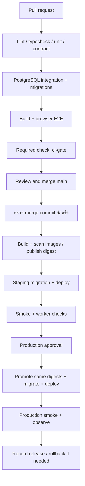

# SOC Platform — CI/CD Design

วันที่: 12 ตุลาคม 2026 · สถานะ: แบบออกแบบ ยังไม่ได้สร้าง workflow, Docker image หรือ deploy จริง

อ่านร่วมกับ [Architecture](architecture.md), [Database](database.md), [API](api.md) และ [Development plan](development-plan.md)

## 1. แนวทางที่เลือก

ใช้ GitHub Actions ตรวจโค้ด ทดสอบ และ build ทุก Pull Request เมื่อรวมเข้า `main` ให้ตรวจ commit ที่รวมแล้วอีกครั้ง สร้าง Docker images และ deploy staging อัตโนมัติ เมื่อ staging ผ่านจึงเสนอ release เดียวกันเข้า production โดยมีผู้อนุมัติก่อน ระบบทำ migration, rollout และ smoke test ต่อให้อัตโนมัติ

Docker ไม่ใช่ข้อบังคับของ CI/CD แต่เสนอใช้กับระบบจริงเพื่อให้ API/worker มี runtime เดียวกัน ใช้ PostgreSQL แบบ managed แยกจาก container ของแอป ส่วน prototype เริ่ม CI ได้ทันทีโดยไม่ใช้ Docker

สมมติให้ `main` เป็น default branch; ต้องตรวจชื่อจริงก่อนติดตั้ง workflow ผู้ให้บริการ hosting, registry visibility, domain, runtime versions และงบประมาณยังไม่เลือก แผนนี้ใช้ GHCR เป็น registry ที่เสนอ และ hosting ที่รองรับ container, process worker ต่อเนื่อง, one-shot migration และ rollback ตาม image digest

## 2. สถานะปัจจุบันและลำดับเปิดใช้

| ระยะ | ทำได้ / ต้องเพิ่ม | เงื่อนไข |
|---|---|---|
| ตอนนี้: prototype | ตรวจ syntax และ `npm test` ใน `prototype/`; ตรวจ Markdown links | ไม่มี dependency ภายนอกและไม่มี compile/build script จึงไม่อ้างว่าผ่าน production build |
| Phase 0 | frontend package.json/package-lock.json, backend pyproject.toml/uv.lock, lint/typecheck/test/build checks, Dockerfiles, Alembic, OpenAPI validation | เพิ่ม production CI เมื่อมี implementation; ห้ามใช้ optional checks เพื่อซ่อนเครื่องมือที่ขาด |
| ก่อน staging | integration/E2E, registry, deploy adapter, environment config, health/worker heartbeat | ใช้ข้อมูลจำลองและ mock AI เป็นค่าเริ่มต้น |
| ก่อน production | migration compatibility, backup/restore drill, secrets, release approval, rollback drill | ผ่านเกณฑ์ในเอกสารนี้และ SOC-016/017 |

## 3. เส้นทางส่งมอบ



Production approval เป็นนโยบายเริ่มต้นของโครงการ ไม่ใช่ข้อจำกัดว่าระบบ deploy อัตโนมัติไม่ได้ หากภายหลังต้องการ deploy production ทุก merge ให้เปลี่ยนนโยบาย release อย่างชัดเจนหลัง restore/rollback และ monitoring พร้อม

## 4. Workflow ที่จะสร้าง

ไฟล์และ scripts ในตารางนี้เป็นสิ่งที่ต้องพัฒนา ยังไม่มีใน repository

| ไฟล์ | Trigger | Jobs / ผลลัพธ์ |
|---|---|---|
| `.github/workflows/ci.yml` | `pull_request`, `push` เข้า main; เพิ่ม `merge_group` หากใช้ merge queue | checks ทั้งหมดและ `ci-gate`; ไม่มีสิทธิ์ deploy |
| `.github/workflows/release.yml` | push main, manual rerun ของ release ที่ระบุ SHA | เรียก CI สำหรับ SHA เดียวกัน → images → staging → production gate → production |
| `.github/workflows/maintenance.yml` | schedule รายสัปดาห์ + manual | dependency/image vulnerability scan, restore drill บนฐานชั่วคราว; ไม่ rollout อัตโนมัติ |
| `.github/dependabot.yml` | schedule รายสัปดาห์ | เสนอ PR อัปเดต dependencies และ Actions ผ่าน CI เดิม |

เพื่อไม่ตรวจซ้ำโดยไม่จำเป็น ใน implementation ให้รวม jobs ของ CI เป็น reusable workflow ที่ `ci.yml` และ `release.yml` เรียกใช้ หรือใช้ workflow เดียวที่มี release jobs เฉพาะ push main อย่าแยก deploy ที่เชื่อแค่ว่า PR เคยผ่าน เพราะ merge commit อาจต่างออกไป

ใช้ workflow ที่ trusted branch เท่านั้นสำหรับ publish/deploy ห้ามใช้ `pull_request_target` checkout และรันโค้ด PR พร้อม secrets และห้ามให้ privileged workflow ดาวน์โหลด artifact จาก PR ที่ไม่เชื่อถือแล้วนำไปรัน

## 5. Checks และเกณฑ์ผ่าน

| Check | สิ่งที่ตรวจ | เกณฑ์ผ่าน |
|---|---|---|
| prototype | `node --check` สำหรับ app.js/model.js/server.cjs และ `npm test` | ทุกคำสั่งสำเร็จ; model lifecycle tests ผ่าน |
| quality | frontend ESLint/TypeScript; backend Ruff/mypy; format และ Markdown links | ไม่มี error; scripts ที่บังคับต้องมีจริง |
| unit | clock/state transitions, detection, correlation, metrics, AI schema, lesson/level gate และ rubric | ทดสอบ deterministic โดยไม่เรียก provider จริง |
| contract | OpenAPI valid, generated client ไม่ drift, request/response/error shapes | API implementation ตรง contract รวมสิทธิ์และ pagination |
| integration | PostgreSQL จริงที่ล้างทิ้งได้, roles จริง, migrations, transactions | ข้ามบัญชี/ข้ามรอบหรือข้ามระดับไม่ได้, version race สำเร็จหนึ่งคำขอ, quota ไม่เกิน, submit ซ้ำไม่ให้ผลสองครั้ง |
| recovery | worker crash/retry, pause-release race, finish cutoff | events/jobs/tickets ไม่ซ้ำ, ไม่ปล่อย future events หลัง pause |
| build | Next.js standalone output, Python package/import checks, Docker build | สร้างจาก clean checkout และ lockfiles ได้; Uvicorn/worker เริ่มได้ |
| E2E | login → บทเรียนอ่าน request → exam ที่ปลดล็อก → evidence → submit → feedback/retake → ระดับถัดไป และ ticket/note/evaluation/export เดิม | รวม Guest, Instructor, error paths, ขนาดหน้าจอ 375/768/1440 |
| security | dependency/image scan, secret scan, fixture/answer-key leakage check ทุก exam endpoint | ไม่มี secret/เฉลยข้อสอบใน client bundle หรือ response ก่อน submit; ช่องโหว่ critical/high ที่ใช้โจมตี runtime ได้ต้องแก้หรือมีข้อยกเว้นพร้อมเจ้าของและวันหมดอายุ |
| ci-gate | รวมผลทุก required job | fail/cancelled/missing job ต้องไม่กลายเป็น success |

CI ใช้ mock AI เท่านั้น การทดสอบ real provider แยกเป็น manual job บน trusted branch มีงบจำกัดและป้ายผลจริง ไม่ให้ PR จาก fork ใช้ provider key หรือ production data

ฐาน integration ใช้ PostgreSQL major เดียวกับ production พร้อม pin image digest ทดสอบทั้ง migrate จากฐานเปล่าและ upgrade จาก schema release ก่อนหน้าโดย seed ข้อมูลจำลอง ไม่ใช้สำเนาข้อมูลจริง การทดสอบ authorization ต้องเชื่อมด้วย runtime roles ไม่ใช้ superuser ทุก test

ตั้ง branch protection ให้ `ci-gate` เป็น required status และมี review ก่อน merge ให้ gate รันเสมอแม้เอกสารเปลี่ยนอย่างเดียว หากใช้ path filtering ให้จำแนก jobs ภายใน workflow และ gate ต้องแยก expected skip ออกจาก failure อย่างชัดเจน

### คำสั่งที่ใช้ได้กับ prototype ตอนนี้

```text
node --check prototype/app.js
node --check prototype/model.js
node --check prototype/server.cjs
npm --prefix prototype test
```

คำสั่งเป้าหมาย Phase 0 แยกตาม runtime ด้านล่าง ยังต้องสร้าง package scripts/config ก่อนใช้:

| ส่วน / working directory | คำสั่งที่เสนอ |
|---|---|
| frontend/ | `npm ci`, `npm run lint` (ESLint), `npm run typecheck` (tsc --noEmit), `npm test` (Vitest run), `npm run build` (next build) |
| backend/ dependencies | `uv sync --frozen` ใช้ pyproject.toml และ uv.lock |
| backend/ quality | `uv run --frozen ruff check .`, `uv run --frozen ruff format --check .`, `uv run --frozen mypy app` |
| backend/ tests | `uv run --frozen pytest`; HTTPX ทดสอบ FastAPI และ integration ใช้ PostgreSQL จริง |
| backend/ migrations | `uv run --frozen alembic upgrade head` ผ่าน wrapper ที่ถือ advisory lock และตรวจ supplemental ledger |
| backend/ build | ตรวจ import `app.main:app`, สร้าง runtime image และ smoke Uvicorn/worker; Python ไม่มี next build/TypeScript compile |
| browser E2E | Playwright รันกับ Next.js + FastAPI + Python worker + PostgreSQL |

Pin Node/Python/uv versions และ commit lockfiles ให้ CI ใช้ตรงกับ local/Docker; cache แยก runtime และ lockfile hash ไม่กำหนดเวอร์ชันลอยว่า latest ตรวจ generated OpenAPI จาก FastAPI เทียบ contract และ generate TypeScript client โดยไม่ต้องมี production credentials

## 6. Container และ artifact

| Artifact | เนื้อหา | Runtime |
|---|---|---|
| `soc-web` | Next.js standalone output, public และ .next/static | Node server (`node server.js` ที่ standalone root); ingress ส่ง API/health ไป FastAPI |
| `soc-backend` | Python app, locked runtime dependencies, Alembic migrations และ server fixture | API: `uvicorn app.main:app --host 0.0.0.0 --port 8000`; worker: `python -m app.worker`; digest เดียวกัน |
| release manifest | commit SHA, image digests, schema version, fixture/config hashes, test links | เก็บเป็นหลักฐานของ release และเลือก rollback |

ใช้ multi-stage build, non-root runtime และ `.dockerignore` ไม่ส่ง `.git`, `.env`, credentials, node_modules ของเครื่องผู้พัฒนาเข้า build context ตรวจว่า web image ไม่มี backend fixtures/ground truth แม้ไฟล์เหล่านั้นอยู่ใน repository

Ground truth seed เป็น restricted artifact สำหรับ migration/evaluator เท่านั้น ไม่รวมใน web หรือ API/worker runtime image ถ้าแยก build target ให้บันทึก digest ของ seed artifact ใน release manifest ด้วย fixture schedule ฝั่ง server ต้องไม่ถูก static server เปิดอ่าน

สร้าง image เพียงครั้งเดียวจาก main SHA ที่ผ่าน CI ใช้ `sha-<commit>` เพื่อค้นหา แต่ rollout ด้วย `sha256:...` digest เสมอ Staging และ production ใช้ digest เดียวกัน ไม่ rebuild ตอน promote และไม่ใช้ `latest` เป็น release identity

Frontend ใช้ relative `/api/v1` จึงไม่ต้องฝัง staging URL ลง build หากต้องมี runtime config ให้ allowlist เฉพาะ public settings ห้ามส่ง secret ผ่าน `NEXT_PUBLIC_*` หรือไฟล์ JavaScript ค่าที่เป็น NEXT_PUBLIC ถูกฝังตอน build จึงต้องเหมือนกันระหว่าง environments เมื่อ promote digest เดิม ใช้ server-only runtime config หากต้องต่าง environment

ตั้ง `output: 'standalone'` และ copy `public`/`.next/static` เข้า web image ตาม layout ของ standalone output; ไม่ deploy เป็น static-only hosting ในแผนนี้ ตรวจ asset loading และ Next.js readiness เพิ่มจาก FastAPI health ดู [Next.js standalone deployment](https://nextjs.org/docs/app/getting-started/deploying)

## 7. Environment และสิทธิ์

| Environment | ข้อมูล / AI | Deploy policy |
|---|---|---|
| local | Compose PostgreSQL + API/worker/web, fixture seed, mock AI | นักพัฒนาเปิดเอง; disposable database |
| CI | service container PostgreSQL, mock AI | ชั่วคราวแยกทุก job/run; ไม่มี production secret |
| staging | DB และ credentials แยก, synthetic accounts, mock เป็นค่าเริ่มต้น | deploy main อัตโนมัติหลังผ่าน CI |
| production | managed PostgreSQL, budget/retention จริง, provider ที่อนุมัติ | approve release ที่ staging ผ่าน แล้ว deploy อัตโนมัติ |

ตั้ง GitHub Environments `staging` และ `production` พร้อม branch restrictions และผู้อนุมัติ production ความสามารถ required reviewers/environment secrets ขึ้นกับแผน GitHub และ repository visibility ต้องตรวจสิทธิ์จริงก่อนเปิดใช้ หากใช้ไม่ได้ ให้ใช้ protected release process ที่ตรวจบังคับได้ ห้ามทำช่อง approval หลอกที่ workflow ข้ามได้ [GitHub deployment environments](https://docs.github.com/en/actions/reference/workflows-and-actions/deployments-and-environments)

Default workflow permissions คือ `contents: read`; เฉพาะ job publish ได้ `packages: write` และเฉพาะ deploy ได้ `id-token: write` หาก hosting รองรับ OIDC ให้ใช้ token อายุสั้นและจำกัด trust ให้ตรง repository/workflow/environment ที่ใช้จริง ตรวจ claims ของ repository ก่อนตั้ง trust ไม่คัดลอก subject ตัวอย่างโดยไม่ตรวจ [GitHub OIDC](https://docs.github.com/en/actions/concepts/security/openid-connect)

Pin Actions ด้วย full commit SHA ที่ตรวจสอบแล้วพร้อม comment เวอร์ชันเพื่อดูแลภายหลัง ใช้ GitHub-hosted runner สำหรับ PR; ไม่ให้ fork code รันบน production host ให้ secrets อยู่ใน environment/hosting secret store และหลีกเลี่ยงการใส่ credentials ลงคำสั่งหรือ log [GitHub secure use](https://docs.github.com/en/actions/reference/security/secure-use)

| Config / secret | ที่อยู่ / ผู้เข้าถึง |
|---|---|
| public origin, image digests, environment name | deploy configuration; ไม่เป็น secret |
| API DB URL | API secret store; role ไม่มีสิทธิ์อ่าน private schema |
| worker DB URL | worker secret store; detection role ไม่มีเฉลย |
| evaluator DB URL | restricted evaluator connection/handler เท่านั้น |
| migration DB URL | one-shot migration job; ไม่แจกให้ runtime |
| retention DB URL | restricted purge job |
| AI provider key | worker secret store; ไม่ส่งเข้า frontend/CI ปกติ |
| registry/hosting identity | short-lived deploy identity; จำกัดเฉพาะ environment |

## 8. Deployment procedure

1. Resolve release manifest จาก SHA ที่ CI ผ่าน ตรวจ digests และผล staging ของ release เดียวกัน สำหรับ production ต้องผ่าน approval ก่อนรับ environment credentials
2. ถือ deployment lock ของ environment ตลอด migration และ rollout; CI ของ PR ยกเลิกงานเก่าได้ แต่ deploy ใช้ `cancel-in-progress: false` ป้องกันตัด migration กลางทาง ไม่อาศัยลำดับคิว GitHub เป็นลำดับ release ให้ปฏิเสธ release เก่ากว่า current ยกเว้น explicit rollback
3. Preflight ตรวจ DB connectivity, backup/PITR readiness, schema compatibility, config และพื้นที่ ตรวจ health ของ release ปัจจุบัน เก็บ previous manifest
4. รัน migration แบบ one-shot จาก backend image ใหม่ ด้วย migration role และ DB advisory lock ไม่รัน migration ทุกครั้งที่ API/worker start; timeout/failure หยุด rollout และตรวจผลก่อน retry
5. Deploy API และ worker ใหม่ด้วย graceful shutdown: worker หยุด claim งานใหม่ รอ in-flight จบในเวลาที่กำหนด จากนั้น lease หมดอายุให้ตัวใหม่รับต่อ ผล commit ต้องตรวจ lease ownership ป้องกัน worker เก่าเขียนทับ
6. รอ `/health/ready` ตรวจ DB/schema และ worker heartbeat จากนั้น deploy web asset และสลับ traffic ตาม hosting ที่เลือก readiness ห้ามพึ่ง external AI พร้อมเสมอ
7. Smoke test: public demo, health, login/CSRF, start/pause/finish รอบของ synthetic account, worker ปล่อย event, mock analysis และ evaluation/export รวม cookie หลัง reverse proxy
8. Observe อย่างน้อย 5 นาทีเป็นค่าเริ่มต้น: 5xx, latency, job lag, dead-letter, DB connections, worker heartbeat หากผ่านบันทึก release status และ URLs; ถ้าไม่ผ่านเริ่ม recovery ตามตารางด้านล่าง

Smoke บน production ใช้ synthetic account ที่กำหนดไว้ ไม่เรียก real AI หากโหมดทดสอบยังไม่รองรับให้ใช้ read-only checks และ internal worker canary ที่ไม่มีผลต่อข้อมูลผู้ใช้ ห้ามเปิด endpoint สาธารณะเพื่อ bypass quota/auth ในชื่อการทดสอบ

Concurrency group ของ deploy ต้องใช้ environment เดียวกันข้าม workflows เช่น `deploy-production` และมี lock ที่ deployment adapter/DB เพิ่มด้วย เพื่อป้องกัน manual command นอก Actions ชนกัน [GitHub deployment control](https://docs.github.com/en/actions/how-tos/deploy/configure-and-manage-deployments/control-deployments)

## 9. Migration และ rollback

ใช้ expand → migrate/backfill → contract: เพิ่ม field/table ที่ code เก่ายังทำงานได้ก่อน ย้ายข้อมูลเป็น batch แล้วลบโครงสร้างเก่าใน release ถัดไปหลังพ้น rollback window การเปลี่ยน job payload ต้องมี schema_version และ worker รุ่นใหม่อ่านงานเก่าได้

| จุดที่ล้มเหลว | การทำงาน |
|---|---|
| CI/build/scan | ไม่ publish release หรือ deploy |
| migration ก่อน rollout | คงแอปเดิม; ตรวจ migration ledger/partial DDL; retry เฉพาะเมื่อทราบสถานะ |
| API/worker readiness หรือ smoke | rollback web/API/worker กลับ previous digests เมื่อ schema ยังรองรับ; คง expanded schema |
| migration ไม่ backward compatible | ไม่ auto rollback แอปอย่างเดียว; maintenance + forward fix ตามคู่มือที่เตรียมก่อน release |
| ข้อมูลเสียหาย | หยุด writer, restore ไป DB ใหม่, ตรวจ consistency/cutoff แล้วสลับ connection; ไม่ restore ทับ live DB โดยอัตโนมัติ |

Application rollback ไม่ใช่ database rollback ไม่รัน destructive down migration อัตโนมัติ PITR เป็นแผนกู้ภัยที่อาจเสียข้อมูลหลังเวลาที่เลือก ต้องบันทึก cutoff และผลกระทบ ดู [Database backup design](database.md#11-backup-retention-และการกู้คืน)

## 10. หลักฐานและงานที่ต้องเตรียม

เก็บ test reports, E2E traces ที่ redact แล้ว, image scan, release manifest และ deployment result อย่างน้อย 14 วันใน CI; เก็บ release manifest และ image ที่ยัง rollback ได้อย่างน้อย 30 วันเป็นข้อเสนอเริ่มต้น ห้าม artifact มี cookie, API key หรือข้อมูลผู้ใช้จริง

ก่อนติดตั้ง workflow ต้องเตรียม:

- repository/default branch และ GitHub plan ที่รองรับ policy ที่เลือก
- runtime versions, lockfiles, required scripts, Dockerfiles และ Compose สำหรับ local/integration
- `scripts/deploy`, `scripts/smoke`, `scripts/rollback` หรือ provider adapter เทียบเท่า ที่รับ manifest และ environment และหยุดเมื่อขั้นตอนล้มเหลว
- hosting/registry/domain, staging/production DB และ credentials ตามบทบาท
- migration runner/ledger, advisory locks, restore drill และ alerts ที่ส่งถึงผู้ดูแลที่กำหนด

ถือว่างาน CI/CD เสร็จเมื่อ PR ที่ test fail ถูกกันไม่ให้ merge, merge ที่ผ่าน deploy staging ได้, production ใช้ digest เดียวกันหลัง approval, failure ไม่รายงาน success และทดลอง rollback/restore พร้อมหลักฐานจริงแล้ว เอกสารฉบับนี้ยังไม่ใช่หลักฐานว่าเงื่อนไขเหล่านั้นเกิดขึ้น

## 11. RAG checks และ knowledge deployment

เมื่อเริ่ม [LangChain RAG](rag-langchain.md) ให้ integration DB มี pgvector extension major/version ที่เข้ากับ production และ pin digest ตรวจ hosting support ก่อนเลือกบริการ เพิ่ม fake embeddings/model tests สำหรับ retrieval filters, snapshot refs, revocation, quota, retries และ migration 007 โดย PR ไม่เรียก provider จริง

Real retrieval/answer benchmark ใช้ trusted manual job จำกัดงบและ corpus ที่อนุมัติ เก็บ model/profile/release/config hashes และรายงาน no-RAG เทียบ RAG พร้อม quality targets ตาม RAG design ห้าม gold answers/ground truth อยู่ใน knowledge artifact

Deploy app/migrations → ingest knowledge draft → validate benchmark → publish immutable knowledge release → เปิด RAG สำหรับ run ใหม่ ทำ ingestion/reindex แยกจาก migration; knowledge rollback เปลี่ยน active pointer ส่วน run เก่ายังคง pinned release ที่ไม่ revoked เพิ่ม embedding provider key/ingestion budget ใน worker/publisher secret store ไม่ส่งให้เว็บ และทดสอบ backup/restore vector tables ด้วย
