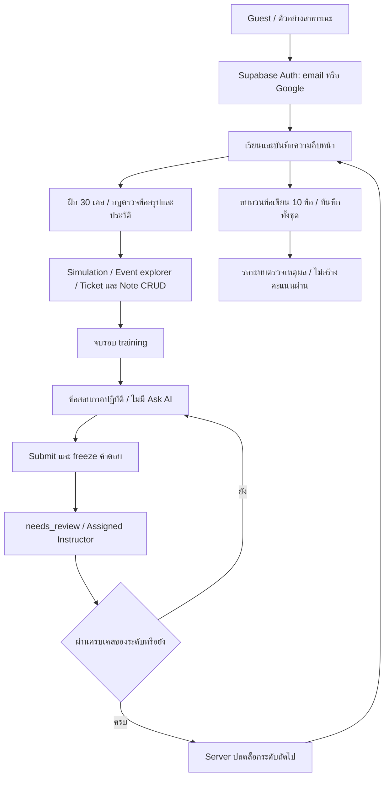
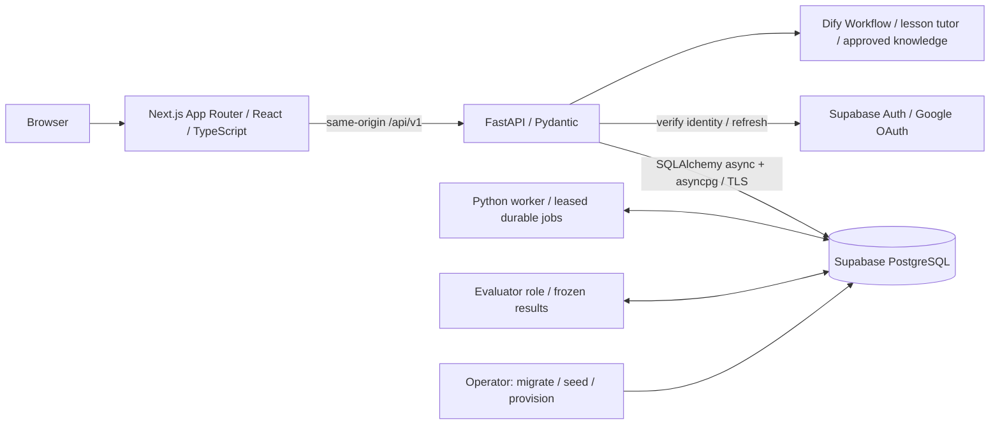
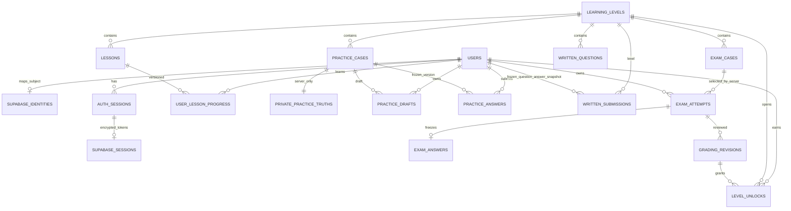
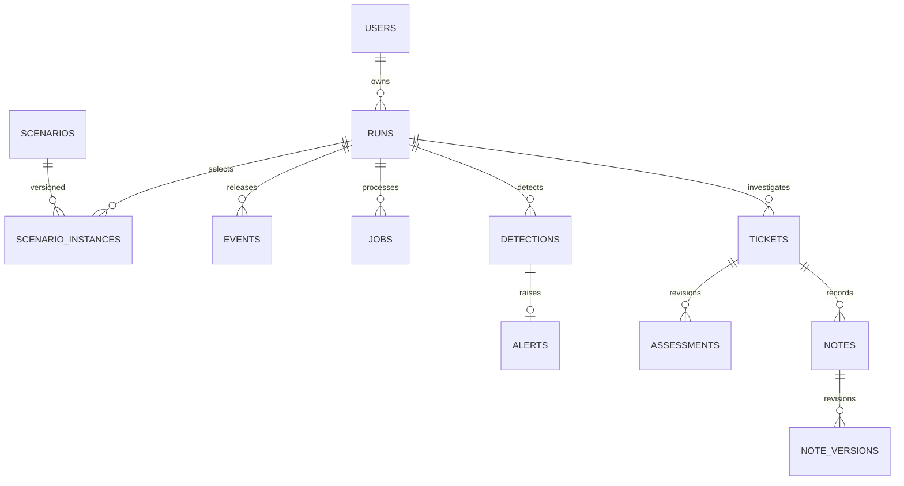

# Sentinel — ระบบปัจจุบันสำหรับพัฒนาและส่งงาน

อัปเดต 27 ต.ค. 2026 บน working tree หลัง `a1fc962` ไม่ใช่ production release
ส่วน Dify Tutor เปิดเฉพาะ lesson tutoring บน local Supabase stack แล้ว; 29 ต.ค. เพิ่มโค้ด feedback ข้อเขียนผ่าน Workflow เดียวในโหมด `grade` แต่ยังไม่เปิด dispatch จนกว่าจะ Publish/ตรวจรับสองโหมดและ activate policy ดู [ผลตรวจล่าสุด](shared-dify-workflow-verification.md)
เอกสารนี้สรุป implementation ล่าสุด; policy คะแนน/สิทธิ์ยังยึด [SRS decision register](srs.md)
และไม่ถือว่าเอกสารเก่าที่ติ๊กผ่านเป็นหลักฐานของ environment ปัจจุบัน

## ขอบเขตผลิตภัณฑ์

เว็บฝึกวิเคราะห์หลักฐาน SOC สำหรับผู้เริ่มต้น ไม่ใช่ SIEM/EDR ไม่โจมตีระบบจริง
ข้อมูล request/response/log เป็น synthetic fixtures; บัญชี ความคืบหน้า คำตอบ และประวัติเก็บบน server

| หน้า | สิ่งที่ทำงาน / ขอบเขต |
|---|---|
| `/demo` | ตัวอย่างสาธารณะอ่านจาก DB ไม่บันทึกผลเรียน |
| `/learning` | 9 บท/45 ขั้น/3 ระดับ, ordered saves, progress, practical exam และผลตรวจ |
| ผู้ช่วยสอนใน `/learning` | Dify + Groq จริง, Published-latest พร้อมตรวจ response version/citations, ประวัติใน DB, ปิดระหว่างสอบ; เปิด local policy v2 วันที่ 28 ต.ค. ดู dify-integration-verification.md |
| `/practice` | 30 เคสระดับละ 10, filter หมวด, draft/version, submit/history, feedback ตามกฎ |
| `/knowledge-check` | ข้อเขียนระดับละ 10, frozen submissions; ขอ feedback จาก Dify Workflow เดียวกับ tutor ได้หลังเปิด `grade_enabled`; ไม่ใช่ formal exam/คะแนนผ่าน |
| `/scenarios` → `/runs` | catalog 5 สถานการณ์ S01–S05, simulation worker/server clock |
| `/runs/{id}` | released events, request/response/log, alerts, pause/resume/finish |
| ticket/note | CRUD/soft delete/restore, evidence, expected_version และ revision history |
| `/instructor/exams` | เฉพาะ Instructor ที่ได้รับ assignment; review หลัง submit และ audit |

เป้าหมายข้อเขียน 10 ข้อที่ใช้สอบและ AI/RAG ตรวจเพื่อให้ผลผ่านยังเป็น requirement ค้าง; feedback ที่เพิ่มไม่เปลี่ยนผลสอบ
ชื่อ “ทบทวนข้อเขียน” ระบุความสามารถปัจจุบัน ไม่ใช่การอนุมัติยกเลิก requirement เดิม

## System flow

ต้องมีบัญชีที่เรียนครบก่อนเริ่มสอบ และจบ training run ก่อนเปิด exam
เมื่อมี active/submitted/needs_review practical exam เครื่องมือฝึก/ข้อเขียนอาจถูกล็อก
จึงควรสาธิตฝึกและ CRUD ก่อนสาธิตข้อสอบ

## Architecture ปัจจุบัน

- FastAPI เป็นเจ้าของ domain/authorization ใช้ opaque HttpOnly SOC session cookie
  ไม่ได้ใช้ Supabase SDK เป็น session authoritative อีกชุดคู่ขนาน
- API/worker/evaluator/migration ใช้ DB roles แยกกัน ไม่มี DB password/service key ใน browser
- Supabase เก็บฐานและ Auth แต่ไม่ได้ทำให้ Python worker หรือเว็บถูก deploy ตามไปด้วย
- Event fixtures ของ runner เป็น version-pinned server assets ไม่ใช่ AI-generated logs;
  released events, jobs, drafts, answers และ history เก็บใน DB
- RAG ภายในเก่าเป็น implementation ย้อนหลัง ไม่เรียกสิ่งนั้นว่า Dify
  investigation provider ยัง mock และ `SOC_KB_ENABLED=false`; lesson Tutor เป็นการเชื่อม Dify แยกที่เปิดแล้ว ไม่ใช่หลักฐานว่า investigation AI หรือ quality benchmark ผ่าน

## ER diagram ส่วนบัญชี/การเรียน/แบบฝึก/ข้อสอบล่าสุด

ชื่อ diagram เป็นชื่อแสดงผล: ตารางส่วนใหญ่ใช้ schema `app` ส่วน PRIVATE_PRACTICE_TRUTHS
คือ `private.practice_truths`; `app.demo_events` เป็น published public examples แยกจาก learner data
ข้อเขียนเก็บคำถาม/คำตอบแบบ JSON snapshot ไม่ได้อ้างว่ามี FK ต่อทุก question ใน JSON
SQL constraints/grants จริงอยู่ใน migration 0019–0022; field inventory/schema อื่นอยู่ [Database](database.md)

## ER ส่วน simulation/CRUD

แผนภาพนี้ย่อเฉพาะเส้นหลัก: evidence association tables, job leases, idempotency,
quota และ audit ดู SQL migrations/Database ไม่ใช้ภาพย่อแทน constraints จริง

## Use cases ล่าสุดสำหรับ SRS

| Use case | Preconditions / flow / postconditions | กรณีผิดพลาดสำคัญ |
|---|---|---|
| UC-L01 เรียนและกลับมาเรียนต่อ | login + level unlocked → เปิด field/อ่าน → complete step ตามลำดับ → complete lesson; progress ผูก user/version | 401 หมด session; 404 level นอกสิทธิ์; 409 order/version; 429 rate limit |
| UC-P01 ฝึกและรับ feedback | Analyst ไม่มี exam ค้าง + level unlocked → published evidence → เลือก IDs/classification/reason → submit → immutable answer+feedback | ปฏิเสธ cross-case IDs/unknown fields; CSRF/Origin; key เดิม body ต่าง 409 |
| UC-P02 บันทึกร่าง | owner+case → PATCH expected_version → บันทึก/refresh; conflict คงร่างไว้ให้เปรียบเทียบ | บัญชีอื่นไม่เห็นร่าง; ไม่ส่งเฉลยก่อน submit |
| UC-W01 ข้อเขียน | เรียนครบระดับ → 10 prompts → submit 10 unique question IDs → frozen snapshot needs_review | ไม่รับ score/passed/unlocked จาก client; ไม่มี auto-pass จากความยาวข้อความ |
| UC-E01 สอบและสอบเคสถัดไป | server ตรวจบท/สิทธิ์/quota/active attempt → เลือกเคส → released evidence → freeze → review | passed หนึ่งเคสไม่เท่ากับครบระดับ; UI ต้องเปิดทางเริ่มเคสถัดไป |
| UC-I01 ตรวจและปลดล็อก | Instructor+assignment+submitted → review revision → pass/fail/needs_review → unlock เมื่อครบ | unassigned 404; audit; ไม่เปิด answer key ให้ learner; ไม่ revoke unlock เงียบ ๆ |
| UC-T01 สืบสวนและ CRUD | mutable owner run → read evidence → create/edit/delete/restore ticket/note → history | expected_version 409 คง draft; completing/completed/failed ปิด mutation |

## Non-functional / acceptance ที่ต้องแยกจากผลทดสอบ

มี automated checks ของ ownership, CSRF/Origin, strict validation, transaction/version,
escaped logs, responsive 375/768/1440 และ durable worker; ต้องแนบผลตามวันที่/SHA/environment
Performance/load, accessibility audit เต็มรูปแบบ, public HTTPS/OAuth/cookie acceptance,
backup/restore/rollback และ Dify quality/citation/budget ไม่ถือว่าผ่านจาก local build

ผลตรวจเก่า: [Database training](database-training.md)
ผลรอบนี้: [Presentation readiness](presentation-readiness.md)
คู่มือพูดและ Demo: [Presentation guide](presentation-guide.md)
