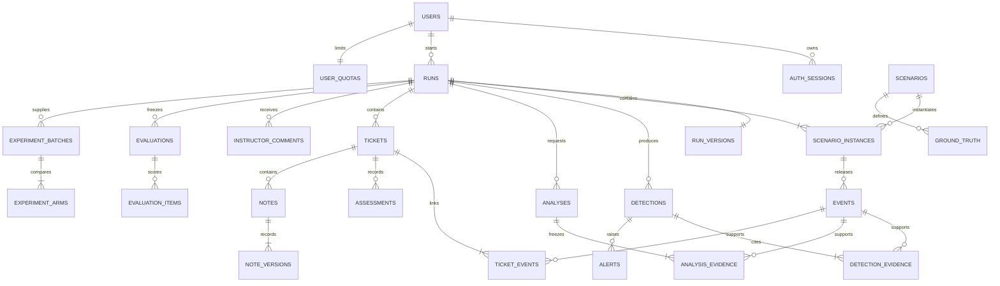

# SOC Platform — Database Design

วันที่: 12 ตุลาคม 2026 · สถานะ: Logical schema และแนวทาง physical schema ที่เสนอ ยังไม่มี database/migrations ติดตั้งจริง

อ่านร่วมกับ [Architecture](architecture.md), [API contract](api.md), [CI/CD](ci-cd.md) และ [Development plan](development-plan.md)

## 1. ฐานข้อมูลและขอบเขต

เลือก PostgreSQL เป็นฐานข้อมูลหลัก เก็บบัญชี รอบฝึก หลักฐาน ผลตรวจ ticket ประวัติคำตอบ งานเบื้องหลังและโควตาใน transaction เดียวกันตาม modular monolith ใช้ `pg` กับ parameterized SQL และ versioned SQL migrations ไม่มี Redis/Elasticsearch ใน MVP

Production ใช้ managed PostgreSQL ที่รองรับ backup/PITR; local/CI ใช้ container ที่ major version ตรงกัน Pin version/digest ตอน Phase 0 หลังเลือก hosting ไม่ใช้ image `latest` โครงสร้างด้านล่างเป็นข้อเสนอของโครงการ ไม่ใช่ schema ที่เครื่องมือได้สร้างแล้ว

แบ่ง schema เป็น `app` สำหรับข้อมูลแอป, `private` สำหรับเฉลย และ `ops` สำหรับ migration ledger ไม่มีการย้าย localStorage หรือรหัสบัญชี demo ไปเป็นข้อมูลรับรองของระบบจริง

## 2. ข้อตกลงข้อมูล

- ID หลักเป็น `uuid`; ตารางเชื่อมใช้ composite primary key ได้ ไม่ใช้รหัส TKT ที่แสดงบนจอเป็น FK
- เวลาใช้ `timestamptz` UTC; simulation offsets/elapsed เป็น `bigint` หน่วย ms และ `CHECK >= 0`; sequence ใช้ `bigint`
- ตาราง mutable ใช้ `version integer NOT NULL DEFAULT 1 CHECK (version > 0)` และ `updated_at`; append-only revision ไม่ update แถวเดิม
- JSON ใช้ `jsonb` เฉพาะ payload ที่มี schema ยืดหยุ่น; สิ่งที่ filter/join/ตรวจ FK ต้องเป็น column หรือตารางเชื่อม
- IP ใช้ `inet`; asset_id/username ในหลักฐานเป็น text สมมติ ไม่ FK ไป users เพราะไม่ใช่บัญชีแอป
- Enum ใช้ text + CHECK เพื่อเปลี่ยนแบบ migration ได้ชัดเจน ค่า public enums ตรง [API §1](api.md#1-ข้อตกลงทั่วไป)
- FK ภายใน run ใช้ `(run_id, resource_id)` → `(run_id, id)` เสมอ; parent มี `UNIQUE(run_id,id)` รวมถึง scenario instance และ retry reference
- immutable evidence/config เก็บ SHA-256 content hash ของ canonical serialization ที่ระบุ version; ไม่ hash JSON ที่ลำดับ key ไม่แน่นอน
- ตารางส่วนใหญ่มี `created_at NOT NULL DEFAULT now()`; optional fields ที่ระบุ `?` เป็น nullable ที่เหลือให้กำหนด NOT NULL ใน migration เว้นแต่ระบุเป็น conditional

Constraints/FKs ใช้คุ้มครองความสัมพันธ์และ uniqueness ส่วนกฎข้ามแถว เช่น run state/ownership ต้องใช้ transaction + lock และ service validation ไม่เขียน CHECK ที่ query ตารางอื่น [PostgreSQL constraints](https://www.postgresql.org/docs/current/ddl-constraints.html)

## 3. ER diagram



Diagram ย่อเพื่อให้อ่านง่าย ตารางเชื่อม alert/analysis, jobs, audit, quota และ idempotency มีรายละเอียดต่อไป ไม่ใช่ entity ที่ต้องฝังใน JSON ทั้งหมด

## 4. Data dictionary

### 4.1 บัญชีและการกำกับ

| ตาราง | คอลัมน์หลัก | Constraint / หมายเหตุ |
|---|---|---|
| users | id uuid, normalized_email varchar(254), display_name varchar(60), password_hash text, role text, status text, version, created_at, updated_at | email UNIQUE; role analyst/instructor; status active/disabled; password hash เท่านั้น |
| auth_sessions | id, user_id FK, token_hash text, csrf_hash text, expires_at, revoked_at?, created_at | token_hash UNIQUE; logout/disable revoke; ไม่เก็บ token ดิบ |
| auth_challenges | id, token_hash, csrf_hash, expires_at, consumed_at? | pre-auth cookie/CSRF สำหรับ register/login; อายุสั้นและล้างเมื่อหมดอายุ |
| user_quotas | user_id PK/FK, daily_runs integer, daily_ai_requests integer, version, updated_at | ค่า >=0; admin เปลี่ยน limit โดยไม่ reset usage |
| instructor_assignments | instructor_user_id FK, analyst_user_id FK, created_at | composite PK; ไม่มีสิทธิ์กำกับอัตโนมัติจาก role เพียงอย่างเดียว |

นิยาม “รอบที่กำกับ” ใน API ให้ชัดด้วย assignment: Instructor ดู/คอมเมนต์รอบของสมาชิกที่ได้รับมอบหมาย และฝึกรอบของตนได้ การมอบหมายเริ่มจาก server provisioning command ไม่เพิ่ม public endpoint เกิน contract ตรวจ role ของคู่ assignment ใน service; CI ต้องทดสอบ Instructor ที่ไม่ได้รับมอบหมายด้วย

### 4.2 Scenario และ run

| ตาราง | คอลัมน์หลัก | Constraint / หมายเหตุ |
|---|---|---|
| scenarios | id, stable_key text, version integer, public_title, difficulty, duration_ms, learning_objectives jsonb, enabled boolean, fixture_hash | UNIQUE(stable_key,version); metadata ไม่รวมเฉลย |
| scenario_instances | id, run_id FK, scenario_id FK, ordinal integer | UNIQUE(run_id,id), UNIQUE(run_id,ordinal), UNIQUE(run_id,scenario_id) |
| runs | id, owner_user_id FK, status, seed integer, elapsed_ms, resumed_at?, release_cursor bigint, duration_ms, analysis_mode, version, created_at, expires_at, completing_at?, completed_at?, failure_code? | statuses ตาม API; seed 0..2147483647; partial UNIQUE owner เมื่อ running |
| run_versions | run_id PK/FK, rule_version, baseline_version, correlation_version, ticket_policy_version, prompt_version, model_id, fixture_hash, config_snapshot jsonb | immutable; config snapshot ไม่มี secret; mock model ใช้ identifier ที่ระบุ mock ชัดเจน |
| run_completions | run_id PK/FK, revision integer, release_cutoff bigint, assessment_cutoff timestamptz, dataset_hash, truncated boolean, drain_deadline, created_at | finish freeze หนึ่งครั้ง; cutoff เป็น max release_seq และเวลาจาก DB |

1 run มี 1–5 scenario instances ตาม API ต้องสร้างใน transaction เดียว; ตรวจจำนวนและชุดไม่ซ้ำใน service Fixture schedule เป็น server-only versioned asset; `events` มีเฉพาะรายการที่ปล่อยแล้ว ไม่เก็บ future events ปนในตารางที่ API อ่าน

`resumed_at` มีค่าเฉพาะ running; pause เก็บ elapsed แล้วล้าง resumed_at; completed ต้องมี completed_at ทุก state transition lock row ของ run ก่อนเสมอ partial unique จำกัด running หนึ่งรอบ แต่ยอมให้มีหลาย paused/reviewing ตาม contract

### 4.3 หลักฐาน ผลตรวจ และ AI

| ตาราง | คอลัมน์หลัก | Constraint / หมายเหตุ |
|---|---|---|
| events | id, run_id, scenario_instance_id, fixture_event_key, release_seq, event_time, ingested_at, source, asset_id?, username?, src_ip inet?, request_json?, response_json?, log_json, content_hash | UNIQUE(run_id,release_seq), UNIQUE(run_id,scenario_instance_id,fixture_event_key); payload redact ก่อนเก็บ |
| detections | id, run_id, detector_type, detector_version, correlation_key, evidence_snapshot_hash, severity, explanation, created_at | detector_type rule/anomaly; unique logical detection ตาม §5 |
| detection_evidence | run_id, detection_id, event_id | PK(detection_id,event_id); composite FKs ทั้งสองด้าน |
| alerts | id, run_id, detection_id, severity, created_at | UNIQUE(run_id,detection_id) สำหรับหนึ่ง alert ต่อ detection revision |
| analyses | id, run_id, correlation_key, evidence_hash, attempt_group uuid, retry_of?, mode, model_id, prompt_version, status, version, result_json?, error_code?, usage_json?, latency_ms?, created_at, started_at?, finished_at? | statuses ตาม API; result เมื่อ succeeded เท่านั้น; ค่า cost/usage ไม่ทราบเป็น null |
| analysis_evidence | run_id, analysis_id, event_id | PK(analysis_id,event_id); immutable snapshot |
| analysis_attempts | id, run_id, analysis_id, attempt_no, provider_request_id?, status, started_at, finished_at?, error_code?, usage_json? | UNIQUE(analysis_id,attempt_no); เก็บ worker/provider retry แยกจาก logical request |

AI output JSON validate ด้วย versioned schema ก่อนบันทึก success และทุก evidence ref ต้องอยู่ใน analysis_evidence ไม่อ้างจาก events ของ run เพียงอย่างเดียว Retry ผ่าน API สร้าง analyses แถวใหม่และ attempt_group ใหม่, retry_of ชี้แถวเดิมใน run เดียวกัน; retry ภายใน worker ใช้ analyses/attempt_group เดิมและเพิ่ม analysis_attempts

### 4.4 การสืบสวนและประวัติ

| ตาราง | คอลัมน์หลัก | Constraint / หมายเหตุ |
|---|---|---|
| tickets | id, run_id, origin, correlation_key?, title varchar(120), severity, human_severity_override boolean, status, version, created_at, updated_at, deleted_at?, deleted_by?, delete_reason? | automatic ต้องมี correlation_key; manual ต้อง null; detector/AI severity อยู่คนละ resource |
| ticket_events | run_id, ticket_id, event_id | PK(ticket_id,event_id); evidence ใน run เดียวกัน |
| ticket_alerts | run_id, ticket_id, alert_id | PK(ticket_id,alert_id); composite FKs |
| ticket_analyses | run_id, ticket_id, analysis_id | PK(ticket_id,analysis_id); composite FKs |
| assessments | id, run_id, ticket_id, revision integer, author_user_id FK, disposition, reason varchar(2000), created_at | UNIQUE(ticket_id,revision); append-only; latest revision เป็น human answer ปัจจุบัน |
| notes | id, run_id, ticket_id, owner_user_id FK, body varchar(2000), version, created_at, updated_at, deleted_at?, deleted_by?, delete_reason? | เฉพาะเจ้าของแก้ได้; ตัด mutation เมื่อ ticket ถูกลบ/run ถูกล็อก |
| note_evidence | run_id, ticket_id, note_id, event_id | PK(note_id,event_id); FK(run_id,ticket_id,note_id) ไป notes ที่มี UNIQUE ชุดเดียวกัน และ FK(run_id,ticket_id,event_id) ไป ticket_events ที่มี UNIQUE ชุดเดียวกัน |
| note_versions | id, run_id, note_id, version integer, body, change_kind, reason?, actor_user_id, created_at | UNIQUE(note_id,version); snapshot ทุก version รวม create/edit/delete/restore |
| note_version_evidence | run_id, note_version_id, event_id | evidence snapshot ของ version นั้น; ห้ามเปลี่ยนเมื่อแก้ note ล่าสุด |
| instructor_comments | id, run_id, instructor_user_id FK, body varchar(2000), created_at | append-only; ไม่แก้ assessment/note; เพิ่มได้หลัง completed ก่อน expiry |
| audit_logs | id, run_id?, actor_user_id?, actor_role, action, entity_type, entity_id?, before_json?, after_json?, reason?, request_id?, created_at | actor เป็น null ได้สำหรับระบบ; runtime insert-only; redact secret และ payload ที่ไม่จำเป็น |

Polymorphic entity_id ใน audit เป็น historical reference เท่านั้น ไม่ใช้รักษา relational integrity; evidence ใช้ตารางเชื่อมชนิดชัดเจนเสมอ ก่อนเปลี่ยน assessment ให้ lock ticket แล้วจัด revision เพิ่ม; Instructor PATCH เก็บ audit แต่ไม่สร้าง assessment ของผู้เรียน

ลบแบบ soft delete ต้องตั้ง deleted_at/deleted_by/delete_reason ครบใน transaction เดียว Restore ล้างสามช่องและเพิ่ม version แต่ประวัติ audit/note_versions ยังอยู่ ไม่ลบ evidence, AI, assessment หรือคืน automatic ticket เองเมื่อมี log ใหม่

### 4.5 Jobs, idempotency และโควตา

| ตาราง | คอลัมน์หลัก | Constraint / หมายเหตุ |
|---|---|---|
| jobs | id, run_id?, type, dedupe_key, payload jsonb, payload_version, status, attempts, available_at, lease_expires_at?, locked_by?, lease_token uuid?, last_error?, created_at, finished_at? | dedupe_key UNIQUE; status queued/running/succeeded/failed/cancelled; failed คือ dead-letter ที่ retry ครบ |
| worker_heartbeats | worker_id text PK, role, release_sha, last_seen_at | monitoring ภายใน ไม่เปิด Guest endpoint |
| idempotency_keys | id, user_id FK, method, route_key, key uuid, request_hash, status, response_status?, response_json?, resource_id?, created_at, expires_at | UNIQUE(user_id,method,route_key,key); route_key รวม resource UUID ใน path |
| quota_ledgers | id, scope_key text, user_id?, period_start date, run_count, ai_request_count, reserved_tokens bigint, consumed_tokens bigint, version | UNIQUE(scope_key,period_start); scope `user:<uuid>` หรือ `system`; counters >=0 |
| quota_reservations | id, run_id?, analysis_id?, experiment_arm_id?, ledger_id FK, reserved_tokens, actual_tokens?, status, created_at, settled_at? | มี analysis_id หรือ experiment_arm_id เพียงหนึ่งชนิด; UNIQUE(analysis_id,ledger_id) และ UNIQUE(experiment_arm_id,ledger_id); status reserved/consumed/released/unknown |

`period_start` คือวัน UTC ของการ reserve ไม่ย้าย reservation ไปวันใหม่ตอนงานเสร็จ ค่า daily_runs/daily_ai_requests อยู่ user_quotas ส่วน global token limit เป็น server config ที่ versioned ไว้ ไม่รับจาก client

Reserve account และ system ledgers ด้วย lock ลำดับเดียวกันทุกครั้ง; increment logical AI request ครั้งเดียว แม้ worker retry หลายครั้ง ถ้าไม่แน่ใจว่า provider เรียกสำเร็จก่อน crash ให้ reservation เป็น unknown และยังกันงบไว้จน reconcile ไม่คืนงบอัตโนมัติเสมือนยังไม่ใช้ การ retry provider ต้องมีงบครอบคลุมความเสี่ยงเรียกซ้ำ

Idempotency ตรวจ authorization ก่อนอ่าน cache ไม่เก็บ raw session/login response ในตารางนี้ เก็บอย่างน้อย 24 ชั่วโมงและจนงาน asynchronous terminal ก่อน purge Key/body เดิมคืน resource เดิม; key เดิม/body ต่าง 409 และ concurrent key ต้องมีผู้สร้าง domain data เพียงรายเดียว

### 4.6 Evaluation, experiments และ private data

| ตาราง | คอลัมน์หลัก | Constraint / หมายเหตุ |
|---|---|---|
| private.ground_truth | id, scenario_id FK, truth_version, incident_key, threat_label, expected_evidence_keys jsonb, explanation | UNIQUE(scenario_id,truth_version,incident_key); immutable server seed |
| evaluations | id, run_id, revision, status, release_cutoff, assessment_cutoff, ground_truth_version, dataset_hash, truncated, metrics_json?, versions_json, created_at, completed_at? | UNIQUE(run_id,revision); pending/completed/failed ภายใน; snapshot ไม่ rewrite หลังเผย |
| evaluation_items | id, run_id, evaluation_id, scenario_instance_id, incident_key, human_answer?, ground_truth_label, evidence_complete, correct?, ticket_deleted, snapshot_json | UNIQUE(evaluation_id,scenario_instance_id,incident_key); snapshot refs และคำตอบ ณ cutoff |
| experiment_batches | id, dataset_run_id FK, requested_by FK, dataset_hash, config_versions jsonb, truncated, status, created_at | dataset มาจาก completed run เท่านั้น |
| experiment_arms | id, batch_id FK, mode, status, config_snapshot jsonb, outputs_json?, metrics_json?, error_code? | UNIQUE(batch_id,mode); mode A/B/C; C ไม่มี provider ให้ unavailable |
| experiment_events | batch_id FK, event_id uuid, release_seq bigint, event_snapshot jsonb, content_hash | PK(batch_id,event_id); immutable released/redacted input copy; ไม่มี ground truth/assessment |
| experiment_outputs | id, arm_id FK, output_kind, correlation_key, evidence_ids jsonb, result_json, content_hash | isolated detector/AI outputs; validate refs เป็น subset ของ experiment_events ของ batch เดียวกัน |
| ops.schema_migrations | version text PK, checksum, applied_at, release_sha | เปลี่ยน migration ที่ใช้แล้วไม่ได้; ใช้ checksum ตรวจ drift |

evaluation_items มีเฉลย จึงต้องจำกัดสิทธิ์การอ่านเช่นเดียวกับ evaluation snapshot แม้อยู่ app schema อ่านได้ผ่าน handler ที่ตรวจ completed/ownership หรือ Instructor scope เท่านั้น ห้ามนำไป join ใน event/ticket serializer

Privileged ground-truth handler ใช้ evaluator connection แยกหลังตรวจสิทธิ์และ audit เท่านั้น Detector/AI ไม่ใช้ connection นี้ Demo ใช้ sanitized seed snapshot แยกจาก member runs เช่น static JSON ฝั่ง server ไม่ query สมาชิกเพื่อสร้างข้อมูล demo

Experiment คัดลอก released input ไป experiment_events ใน transaction ที่ตรวจ completed และ hash ตรง dataset ต้นทาง แต่ละ arm อ่านชุดเดียวกันและเขียน experiment_outputs ของตน ห้ามเขียน live detections/tickets ของรอบต้นทาง ไม่สร้าง run ฝึกใหม่และไม่กิน daily run quota; arm C ต้อง reserve AI/global budget เช่นเดียวกับงานจริง โดยเพิ่ม experiment_arm_id เป็นอีกชนิดของ reservation owner และ CHECK ว่ามี analysis_id หรือ experiment_arm_id เพียงชนิดเดียว พร้อม unique index แยกแต่ละชนิด

## 5. Constraints และ indexes ที่ต้องมี

SQL ต่อไปเป็นตัวอย่าง design ที่ต้องแปลงเป็น migration หลังสร้างตาราง ไม่ใช่ script สำหรับรันทันที:

```sql
CREATE UNIQUE INDEX one_running_run_per_owner
ON app.runs (owner_user_id) WHERE status = 'running';

CREATE UNIQUE INDEX one_automatic_ticket_per_correlation
ON app.tickets (run_id, correlation_key) WHERE origin = 'automatic';
-- ไม่ใส่ deleted_at ใน predicate: soft delete ต้องไม่เปิดทางให้เคสซ้ำ

ALTER TABLE app.events ADD CONSTRAINT events_run_id_id UNIQUE (run_id, id);
ALTER TABLE app.detections ADD CONSTRAINT detections_run_id_id UNIQUE (run_id, id);
ALTER TABLE app.detection_evidence
  ADD FOREIGN KEY (run_id, event_id) REFERENCES app.events (run_id, id),
  ADD FOREIGN KEY (run_id, detection_id) REFERENCES app.detections (run_id, id);

CREATE UNIQUE INDEX detection_logical_request
ON app.detections
  (run_id, detector_type, detector_version, correlation_key, evidence_snapshot_hash);

CREATE UNIQUE INDEX analysis_logical_request
ON app.analyses
  (run_id, correlation_key, evidence_hash, model_id, prompt_version, attempt_group);

CREATE INDEX event_time_page ON app.events (run_id, event_time, id);
CREATE INDEX job_claim ON app.jobs (available_at, id) WHERE status = 'queued';
CREATE INDEX job_reclaim ON app.jobs (lease_expires_at, id) WHERE status = 'running';
```

ทุก column ใน logical unique key ข้างต้นต้อง NOT NULL รวม model_id ใน mock mode เพื่อไม่ให้ null เปิดช่อง duplicate Index เพิ่มตาม access path:

| Query | Index เริ่มต้น |
|---|---|
| รอบของฉัน | runs(owner_user_id,created_at,id) |
| incremental events | UNIQUE events(run_id,release_seq) |
| filter asset/source/IP | events(run_id,asset_id,event_time,id), events(run_id,source,event_time,id), events(run_id,src_ip,event_time,id) |
| ticket list | tickets(run_id,status,severity,id) WHERE deleted_at IS NULL; แยก index รายการลบ |
| latest assessment / note history | UNIQUE assessments(ticket_id,revision), UNIQUE note_versions(note_id,version) |
| audit/timeline | audit_logs(run_id,created_at,id); ticket links indexes ตาม resource reverse lookup |
| sessions / retention | auth_sessions(expires_at), runs(expires_at), idempotency_keys(expires_at) |

เริ่ม q ด้วย parameterized search ใน field ที่ allowlist และจำกัดใน run/ช่วงเวลา; MVP ไม่สร้าง GIN ทุก JSON column ใช้ EXPLAIN ANALYZE บน synthetic load ก่อนเพิ่ม trigram/full-text index ตามพฤติกรรมค้นจริง

## 6. Transactions ที่เป็นข้อบังคับ

| Operation | ขอบเขต atomic transaction |
|---|---|
| create run | reserve idempotency → lock quota → increment count → insert run/instances/versions → enqueue runner → audit/response cache |
| release events | lock run → ตรวจ running/server time → insert due events → enqueue detector → advance cursor |
| pause/resume | lock run → ตรวจ expected_version/state → freeze/start clock → increment version/audit; unique index กันสอง running |
| ticket/note mutation | lock run ก่อน ticket/note → ตรวจ owner/state/version → change + history/evidence + audit |
| finish | lock run → freeze release/assessment cutoffs + snapshot input → set completing → enqueue finalize; ซ้ำคืนงานเดิม |
| finalize | drain เฉพาะงานใน cutoff จน deadline → freeze evaluation → set completed; งาน AI ช้าไม่ rewrite snapshot |
| AI enqueue | lock ledgers ตามลำดับ → reserve quota → insert analysis/snapshot/job; failure rollback ทั้งหมด |
| disable account | lock user → ตรวจ last Instructor/self-disable → set disabled/version → revoke sessions + audit |

ใช้ READ COMMITTED พร้อม explicit row locks/unique constraints เป็นค่าเริ่มต้น; retry deadlock/serialization failure แบบ bounded เฉพาะ operation ที่ idempotent ลำดับ locks ต้องคงที่ (run ก่อน resource; quota rows เรียง scope key) และ external AI/network call อยู่นอก DB transaction

Jobs claim ด้วย `FOR UPDATE SKIP LOCKED` ใน transaction สั้นแล้ว commit ก่อนทำงาน คืน lease_token ใหม่ทุก claim/reclaim; heartbeat และ completion update ต้องตรง lease_token งานที่ lease หมดอายุจึงกลับให้ worker อื่นรับได้ Dedupe key และ domain unique constraints ยังจำเป็นเพราะ queue เป็น at-least-once ไม่ใช่ exactly-once

## 7. Optimistic concurrency และการล็อกหลัง finish

```sql
UPDATE app.tickets
SET title = $1, version = version + 1, updated_at = now()
WHERE run_id = $2 AND id = $3 AND version = $4
RETURNING *;
```

ตัวอย่างนี้เป็นเพียง compare-and-swap ต้องตรวจ ownership, run state และ deleted state ภายใน transaction ที่ lock run ก่อนแล้ว 0 rows ให้แยก 404/409 ตามสิทธิ์ ไม่บอกการมีอยู่ของ resource คนอื่น การตรวจ state ใน browser อย่างเดียวไม่พอ

Assessment/note mutation ทุกเส้นทางต้อง lock run เดียวกับ finish จึงไม่เกิดคำตอบใหม่หลัง assessment cutoff ส่วน evaluator snapshot เก็บค่าที่ใช้ให้คะแนนจริงและอ้าง revision ID ไม่คำนวณคะแนนย้อนหลังจาก latest answer ทุกครั้ง

## 8. DB roles และการเข้าถึงเฉลย

| Role | อนุญาต | ไม่อนุญาต |
|---|---|---|
| migration_owner | DDL/seed/grants ผ่าน one-shot deployment | ไม่ใช้เป็น runtime credential |
| api_runtime | app tables ตาม repository needs; audit INSERT | private schema, DDL, audit UPDATE/DELETE |
| worker_runtime | events/detections/analyses/jobs/quotas ที่จำเป็น | ground truth, แก้ human assessment |
| evaluator_runtime | อ่าน private truth และ frozen input, เขียน evaluation | แก้ source evidence/คำตอบผู้เรียน |
| retention_runtime | purge ตาม retention workflow | public connection หรือใช้งานทั่วไป |
| backup_operator | backup ครบตามระบบ hosting | เปิดให้ browser ใช้ |

Runtime roles ไม่เป็น table owner/superuser และ revoke public schema privileges ที่ไม่ต้องใช้ Credential ของ evaluator แยก connection pool และ restricted module ภายใน codebase เดียว ขอบเขตนี้ลดการอ่านโดยไม่ตั้งใจ ไม่ใช่ process isolation ถ้าต้องการ isolation สูงขึ้นให้แยก evaluator process และไม่ mount credential ใน API/worker ปกติ

Ownership ของ MVP บังคับผ่าน service/repository predicates + integration tests; ไม่อ้างว่ามี row-level security อยู่แล้ว ถ้าเพิ่ม RLS ต้องออกแบบ pooled connection context, policies ของ Instructor/worker และ role bypass ให้ครบก่อนเปิดใช้

## 9. API → tables

| API กลุ่ม | ข้อมูลหลัก |
|---|---|
| auth/me | users, sessions/challenges, user_quotas, quota_ledgers |
| scenarios/runs/controls | scenarios, runs, instances, versions, completions, jobs, idempotency |
| events/alerts | events, detections/evidence, alerts; released data เท่านั้น |
| tickets/assessments | tickets, typed links, assessments, audit |
| notes/versions | notes, note_evidence, note_versions, note_version_evidence |
| analyses/retry | analyses/evidence/attempts, reservations, jobs, idempotency |
| evaluation/ground-truth/export | evaluations/items + privileged truth projection; owner/completed gate |
| admin | assignments, users/quotas, comments, audit, experiments |

ไม่เพิ่ม browser API สำหรับเขียน events/detections/jobs/ground truth จากการมีตารางเหล่านี้

## 10. Migration และ seed plan

1. `001`: schemas/roles, migration ledger, users/sessions/challenges/quotas/assignments
2. `002`: scenarios/runs/instances/versions/completions, jobs, idempotency, audit
3. `003`: events/detections/evidence/alerts และ composite FKs
4. `004`: tickets/typed links/assessments/notes/revisions/comments
5. `005`: analyses/evidence/attempts/quota reservations และ FK ของ ticket_analyses
6. `006`: private truth, evaluations/items, experiments/events/outputs, reservation FK ไป experiment_arms และ grants ที่จำกัด

ลำดับจริงต้องจัด forward references ให้ parent มีอยู่ก่อน เช่น ticket_analyses สร้างใน 005 ใช้ checksum ใน ledger และ migration advisory lock ชุดเดียว ไม่แก้ migration ที่ deploy แล้ว เขียน migration ใหม่เสมอ รวม transaction เมื่อ DDL รองรับ และแยก nontransactional operations พร้อม recovery instructions

Seed แยก public catalog, synthetic demo และ private truth versioned; repeat ต้องไม่ duplicate ไม่ฝัง Instructor password ใน SQL มี provisioning command รับ secret จาก runtime input และไม่พิมพ์ลง log

CI ต้องตรวจ fresh migration, upgrade จาก previous release, constraints ข้าม run, rollback application compatibility กับ expanded schema และ runtime role grants ดูลำดับ migration/rollout ใน [CI/CD design](ci-cd.md)

## 11. Backup, retention และการกู้คืน

ข้อเสนอเริ่มต้น: run 30 วัน และ account audit 90 วันตาม architecture; daily backup พร้อม PITR window 7 วันหากบริการรองรับ เป้าหมาย RPO ≤15 นาที, RTO ≤2 ชั่วโมงเป็นเป้าหมายที่ต้องทดลองจริง ไม่ใช่ SLA ที่รับประกันแล้ว PITR ต้องมี base backup และ WAL ต่อเนื่อง ไม่เท่ากับ SQL dump รายวัน [PostgreSQL PITR](https://www.postgresql.org/docs/current/continuous-archiving.html)

Purge run ต้องหยุด/ยกเลิก jobs และ reservations ที่เกี่ยวข้องก่อน แล้วลบ dependent rows ตาม FK ภายใน batch ที่จำกัดขนาด ใช้ retention role เท่านั้น เก็บ audit การลบแบบ minimal โดยไม่เหลือ evidence/answer payload หลังหมด retention ตาราง audit ที่ต้องเก็บนานกว่าใช้ run_id nullable และตัด payload ของ run ที่หมดอายุ

Experiment ที่อ้าง dataset_run_id ต้องหมดอายุพร้อมรอบต้นทาง หรือมี explicit retention policy ของ dataset สำเนาที่แจ้งไว้ ห้าม FK ทำให้ purge ค้างโดยไม่มีรายงาน ห้ามลบ jobs ที่ยัง running หรือ idempotency key ของงานยังไม่จบเพียงเพราะครบ 24 ชั่วโมง

Backup แยก access/encryption จาก runtime และมี expiry ของ backup ด้วย การลบข้อมูลใน live DB ไม่ลบ snapshot backup ทันที ต้องระบุช่วงเวลาที่ข้อมูลอาจคงอยู่ในคู่มือ retention

Restore drill ทุกเดือนและก่อน public launch: restore ไปฐานแยก → ตรวจ schema/checksums/row counts/constraints → ทดสอบ auth/run/worker/evaluation → วัดเวลาจริง → เก็บผล เมื่อกู้ production ต้องหยุด writer เก่า, reconcile jobs/provider usage และ session ที่อาจถูกคืนกลับมาจาก backup ก่อนเปิด traffic; revoke restored sessions เพื่อไม่คืนสิทธิ์ logout เดิม

## 12. เกณฑ์ยอมรับก่อนใช้จริง

- Unique keys กัน event/detection/automatic ticket ซ้ำได้แม้ worker crash และ soft delete
- Cross-run FK ปฏิเสธ evidence, notes, analyses และ retry_of ที่อยู่คนละ run
- Quota race/version race มีผลถูกต้องเมื่อ request พร้อมกัน; finish ไม่รับคำตอบหลัง cutoff
- Detector/worker role อ่าน private truth ไม่ได้; API ไม่คืน truth ก่อน completed หรือข้าม Instructor scope
- Metrics ใช้ snapshot รวม soft-deleted tickets; ตัวหารศูนย์เป็น null; mock ไม่กลายเป็นผล benchmark จริง
- Migrations และ restore ผ่านบน PostgreSQL version ที่เลือก พร้อมหลักฐานเวลา/ผลทดสอบและคู่มือ recovery

Physical DDL, OpenAPI และ deployment scripts เป็นงาน Phase 0–6 ต่อจากเอกสารนี้ ต้องไม่ถือว่าตารางหรือ pipeline พร้อมใช้งานจากการมีแบบออกแบบเพียงอย่างเดียว
