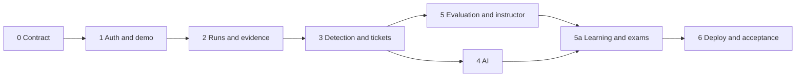

# SOC Platform — Development Plan

วันที่: 12 ตุลาคม 2026 · สถานะ: แผนเสนอ ยังไม่ได้เริ่ม implementation ตามแผนนี้

เอกสารประกอบ: [Architecture](architecture.md) · [API](api.md) · [Product scope](soc-simulation.md) · [Learning path](learning-path.md) · [Prototype](../prototype/README.md)

แบบออกแบบสำหรับลงมือพัฒนา: [Database](database.md) และ [CI/CD](ci-cd.md) ครอบคลุม schema, GitHub Actions, Docker artifacts, migration, deploy และ recovery

เพิ่ม [LangChain RAG](rag-langchain.md) หลัง core AI พร้อม: approved knowledge → pgvector retrieval → cited triage/Ask AI → quality benchmark ตาม RAG-001–005 คาดเพิ่ม 6–10 วันทำงานจากแผนฐาน 31–40 วัน ส่วน learning path และข้อสอบเลื่อนระดับพร้อม AI/RAG grading เป็นงานใหม่ประมาณ 8–12 วันทำงานอีกก้อน กรอบรวมเบื้องต้นจึงเป็น **45–62 วันทำงาน** หากทำทั้งหมดต่อเนื่อง ยังไม่รวมเวลารอ provider/งบและไม่ใช่กำหนดส่งยืนยัน ต้องประเมินใหม่หลังทำ SRS และกำหนด rubric/ข้อสอบจริง

Stack ที่เลือก: **Next.js App Router + TypeScript** สำหรับ frontend และ **Python + FastAPI** สำหรับ backend; worker ใช้ Python codebase เดียวกัน ฐานข้อมูล PostgreSQL ผ่าน SQLAlchemy/asyncpg และ Alembic เครื่องมือประกอบยังต้องติดตั้งและ pin versions ใน Phase 0

## 1. เป้าหมายและสมมติฐาน

เปลี่ยน prototype ให้เป็นเว็บใช้งานจริงที่มีบัญชี ข้อมูลถาวร สิทธิ์ฝั่ง server, runner, detection, AI และผลประเมินที่ตรวจสอบได้ ใช้ prototype เป็น reference หน้าจอ ไม่ย้าย localStorage หรือรหัสบัญชีเดโมไปเป็นกลไก production

ประมาณการสำหรับผู้พัฒนา 2 คนที่ทำงานต่อเนื่อง: แผนฐานเดิม 7–9 สัปดาห์; เมื่อรวม RAG และ learning/exam ต้องเผื่อเพิ่มตามกรอบข้างต้น เป็นกรอบวางแผน ไม่ใช่กำหนดส่งที่ยืนยัน หากทำคนเดียวหรือยังไม่คุ้น stack ต้องเผื่อเวลาเพิ่ม ผู้ใช้ยังไม่ได้ระบุทีม งบ AI หรือวันส่ง จึงระบุผู้รับผิดชอบเป็นบทบาทแทนชื่อ

## 2. ลำดับส่งมอบ

| Phase | เวลาโดยประมาณ | งานหลัก | สิ่งที่ต้องส่งมอบ / เกณฑ์ผ่าน |
|---|---|---|---|
| 0 — Contract & foundation | 3–4 วัน | ยืนยัน stack/versions, SRS, ER/schema, OpenAPI, error format, CI | frontend/API/worker เริ่มได้; DB migration ในเครื่องใหม่ผ่าน; contract ระบุสิทธิ์ทุก route |
| 1 — Identity & read-only demo | 4–5 วัน | register/login/logout, CSRF, session, roles, seed demo, responsive shell | Guest ดู demo ได้; Analyst ถูกปฏิเสธข้ามบัญชี; logout/disabled revoke session จริง |
| 2 — Runs & evidence | 5–6 วัน | scenario seed, clock, jobs, runner, pause/resume/finish, Event explorer | เล่น S02 จาก API จนเห็น event; restart ไม่ซ้ำ; paused ไม่ปล่อยอนาคต; refresh กลับรอบเดิมได้ |
| 3 — Detection & investigation | 6–7 วัน | rules/anomaly/correlation, alerts, ticket/note CRUD, audit, revisions | 5 scenarios และ normal traffic ผ่าน; S05 เข้าทาง anomaly; validation และ restore ทำงานจริง |
| 4 — AI integration | 4–6 วัน | mock adapter, schema validation, real provider, budget, retry | mock/real ติดป้าย; refs ไม่หลุด snapshot; AI ล่มหรือ quota เต็มยังสืบสวนต่อได้ |
| 5 — Evaluation & instructor | 5–6 วัน | snapshot, ground truth, A/B/C jobs, account quota, comments, export | มีผลทดลองจริง; ไม่มีเฉลยก่อนจบ; Instructor ไม่แก้ note/assessment ผู้เรียน |
| 5a — Learning & promotion exam (เพิ่ม) | 8–12 วันเบื้องต้น | onboarding, lesson progress, exam bank แยก demo, server-side gate, grading/feedback, retake, Instructor review | ผู้เริ่มต้นเรียนอ่าน request ได้; เรียก API ข้าม gate ไม่ได้; ก่อน submit ไม่มีเฉลย; ผล AI/RAG ผิด/ล่มไป needs_review |
| 6 — Deployment & acceptance | 4–6 วัน | staging/public HTTPS, restore drill, load test, accessibility, docs/video | flow ผ่าน URL จริง; restart ข้อมูลอยู่; ส่ง URL, SRS, repo และวิดีโอที่เปิดดูได้ |

เวลา 31–40 วันทำงานข้างต้นเป็นแผนฐานเดิม; Phase 5a และ RAG เป็นงานเพิ่มตามกรอบ 45–62 วันทำงาน ยังไม่รวมเวลารออนุมัติงบ/บัญชี hosting

Frontend และ backend พัฒนาร่วมกันโดยอิง OpenAPI; mock API ใช้เฉพาะ development และต้องแสดงสถานะ ไม่มีการอ้างว่า mock ผ่านเท่ากับ endpoint จริงผ่าน

## 3. Backlog ที่นำไปเปิด Issue ได้

| ID | งาน | ผู้รับผิดชอบหลัก | Dependency | เกณฑ์เสร็จที่ตรวจได้ |
|---|---|---|---|---|
| SOC-001 | SRS + API contract + schema | ทั้งทีม | — | FR/NFR, use cases, migrations plan และ API ตรงกัน |
| SOC-002 | Repo tooling + CI | Backend | 001 | lint/typecheck/test/build รันอัตโนมัติ; secrets ไม่อยู่ใน repo |
| SOC-003 | Auth/session/CSRF | Backend | 002 | register/login/logout/expiry และ 401/403 tests ผ่าน |
| SOC-004 | UI shell + auth pages + Guest demo | Frontend | 001, 003 | login error, empty/loading/error และ 375/768/1440px ใช้งานได้ |
| SOC-005 | Fixtures + private ground truth | Backend | 001 | 5 scenarios มี normal traffic และ incident labels แยกจาก detector input |
| SOC-006 | Persistent jobs + runner | Backend | 003, 005 | crash/retry ไม่สร้าง event ซ้ำ; clock lock ป้องกัน pause race |
| SOC-007 | Run controls + history | Frontend | 004, 006 | start/pause/resume/finish, quota conflict และ refresh recovery |
| SOC-008 | Event query + evidence viewer | ทั้งทีม | 006 | pagination, ช่วงเวลา, IP/asset/user/source และ raw evidence ใช้ได้ |
| SOC-009 | Rules/anomaly/correlation | Backend | 005, 006 | มี versioned config; S05 ไม่ตรง rule แต่มี anomaly; baseline limitation แสดงได้ |
| SOC-010 | Ticket/note CRUD + audit | ทั้งทีม | 008, 009 | soft delete/restore, note versions, cross-run FK, version conflict ผ่าน |
| SOC-011 | Mock AI + output schema | Backend | 009 | future/nonexistent evidence refs ถูกปฏิเสธ; mock ไม่ปนผลจริง |
| SOC-012 | Real AI + quota/retry | Backend | 011 | timeout, 429, invalid JSON, provider outage และ global budget ผ่าน |
| SOC-013 | Investigation UI | Frontend | 010, 011 | AI/evidence/human assessment แยกกัน; draft ไม่หายตอน refresh |
| SOC-014 | Evaluation + A/B/C experiment | Backend | 009, 010, 012 | exact dataset hash; ground-truth match ครั้งเดียวต่อ incident; N/A มีเหตุผล |
| SOC-015 | Instructor + export | ทั้งทีม | 003, 010, 014 | disable account, quota, comments, evidence review และ report download |
| SOC-016 | Hosting + backup/restore + observability | Backend | 006, 012 | staging restart/restore ผ่าน; readiness ตรวจ DB; queue failure สังเกตได้ |
| SOC-017 | End-to-end acceptance + delivery | ทั้งทีม | 013–016 | flow บน public URL ผ่าน; เอกสารและวิดีโอเปิดได้จากผู้ตรวจ |
| LEARN-01 | Learning UI, progress และ level gate | ทั้งทีม | SOC-003/004/005 | บทเรียน 5 ขั้น/ระดับและ server gate ผ่าน; refresh แล้วกลับมาได้ |
| LEARN-02 | Exam bank, attempt และ blind serializer | Backend | SOC-005/006/014 | แยก demo กับข้อสอบ; API ทุกทางไม่ส่ง key/AI hint/severity ก่อน submit |
| LEARN-03 | Grading, RAG feedback และ Instructor review | ทั้งทีม | LEARN-02, SOC-012/015, RAG-001–005 | rubric versioned, citations validated, needs_review/retake/override audited |

งาน RAG ใช้ dependencies SOC-006/010/011/012: เตรียม corpus/storage ด้วย mock ได้ก่อน provider พร้อม แต่ benchmark จริงต้องเลือก embedding/chat models แล้ว SOC-014 เพิ่ม config เปรียบเทียบ C no-RAG กับ C RAG; SOC-016/017 เพิ่ม pgvector deploy/restore, citation leakage/revocation และ question flow ตาม RAG design ไม่เปลี่ยน detector policy

ยังไม่ได้สร้าง Issue/PR จริง ตารางนี้เป็น backlog สำหรับทีม ห้ามนับเป็นหลักฐานการ review หรือการทำงานร่วมกันที่เกิดขึ้นแล้ว

## 4. งานเริ่มต้นที่ควรทำก่อน

1. เลือกและ pin runtime/framework versions พร้อมตัดสินใจ provider/hosting budget; provider จริงต้องพร้อมก่อน SOC-012
2. ทำ `docs/srs.md` และ `docs/openapi.yaml` จากเอกสารชุดนี้ก่อนเริ่ม screen integration
3. สร้าง FastAPI/Pydantic schemas, SQLAlchemy models และ Alembic migrations สำหรับ users, sessions, scenarios, runs, events, jobs และ audit
4. ทำ vertical slice เล็กที่สุด: login → start S02 → runner ปล่อย log → Event explorer อ่านผ่าน API
5. ทดสอบผู้ใช้ A/B และ worker restart ให้ผ่านก่อนขยาย ticket, AI และ evaluation

ไม่เริ่มด้วยการทำ dashboard ตัวเลขครบทุกช่องก่อนมีแหล่งข้อมูลจริง และไม่คัดลอกเฉลยจาก prototype ไปไว้ frontend ใหม่

### งาน Database และ CI/CD ที่ผูกกับ backlog

| งานเดิม | สิ่งที่ต้องเพิ่มจากแบบออกแบบ | หลักฐานเสร็จ |
|---|---|---|
| SOC-001 | แปลง data dictionary เป็น migrations; ยืนยัน Instructor scope, schema/contract และ runtime versions | ER/DDL/OpenAPI สอดคล้องกัน |
| SOC-002 | เริ่ม prototype CI; เพิ่ม production lint/typecheck/unit/contract/build และ required ci-gate เมื่อมีแอปจริง | PR ที่ fail ถูกกัน merge; clean checkout ตรวจผ่าน |
| SOC-003/006/010 | DB roles, idempotency, quota/lease locks, revisions และ composite FKs | integration tests กับ PostgreSQL จริงผ่าน race/cross-run/retry cases |
| SOC-012/014 | reservations, provider attempts, frozen evaluations และ isolated experiment outputs | retry ไม่ทำ logical usage ซ้ำและเฉลยไม่หลุด detector |
| SOC-016 | Dockerfiles, registry, staging/production environments, deploy/migrate/smoke/rollback adapters | staging deploy อัตโนมัติ; production promote digest เดิมตาม policy |
| SOC-017 | ทดลอง migration failure, rollback และ restore/PITR | มีรายงานผลจริงพร้อม RPO/RTO ที่วัดได้ |

ไม่เปิด deploy job จน hosting, credentials และ scripts พร้อม; Docker และ workflow files ยังไม่ได้ถูกสร้างจากการเพิ่มเอกสารนี้

## 5. แผนเปลี่ยนจาก prototype

| ของเดิม | ของใหม่ |
|---|---|
| app.js รวมทุกหน้าจอ | Next.js App Router, features/components และ typed API client |
| localStorage เป็นฐานข้อมูล | server-backed queries; เก็บเฉพาะ UI preferences ฝั่ง client |
| บัญชีเดโมรหัสคงที่ | session cookie + password hash; seed demo ที่ไม่ใช้กับ public admin |
| model.js ปล่อย event และมีเฉลย | server fixture loader + runner; ground truth เก็บ private |
| setInterval ของ browser | server clock; UI polling และวาดเวลาเพื่อแสดงผลเท่านั้น |
| mock AI summary | analysis resource จาก worker พร้อม mode/provider/status |
| JavaScript ตรวจ status | validation ฝั่ง UI เพื่อช่วยผู้ใช้ และ service/DB enforcement จริง |
| JSON export ฝั่ง client | snapshot export ที่ตรวจสิทธิ์และ redact ฝั่ง server |

คง `prototype/` ให้เปิดได้เป็น reference ไม่ย้ายไฟล์ทับหรือทำลายต้นแบบเดิมระหว่างพัฒนา frontend ใหม่

## 6. กลยุทธ์ทดสอบและเงื่อนไขพร้อมส่ง

### Unit

ทดสอบ state machine, clock, correlation window, threshold, output validation, incident matching และสูตร metrics แบบไม่ต้องเรียก network

### Integration กับ PostgreSQL จริงสำหรับทดสอบ

- ผู้ใช้ A รู้ UUID ของ B แต่ยังอ่าน/แก้/restore/export ไม่ได้
- ปฏิเสธ self-role escalation, CSRF ผิด, session revoked และ account disabled
- สอง request ใช้ version เดียวกัน: สำเร็จได้หนึ่งครั้ง อีกคำขอได้ 409
- runner ถูก kill หลัง insert ก่อน commit/หลัง commit; restart แล้ว event/job/ticket ไม่ซ้ำ
- pause และ release ชนกัน: หลัง pause ตอบสำเร็จ ไม่มี event ใหม่หลุดเข้ามา
- note/ticket ของรอบ A อ้าง evidence ของ B ถูกปฏิเสธ
- soft delete/restore ไม่ลบ evidence และไม่เปลี่ยน denominator ของผลประเมิน
- AI อ้าง ID จริงแต่ไม่อยู่ใน snapshot ปัจจุบันต้องถูกปฏิเสธ
- quota reservation พร้อมกันไม่เกินวงเงิน; timeout ไม่บันทึกว่าไม่มีภัย
- ไม่มี future event/ground truth ใน list, detail, search, export หรือ error payload

### E2E

Guest → register/login → guided request lesson → exam ที่เปิด → run → evidence → ticket → submit → feedback → retake หรือปลดล็อกระดับถัดไป รวม flow note CRUD, debrief/export และ error paths ของ AI, quota, session, access denied, validation, grading needs_review บน 375/768/1440px

### ก่อน public deployment

- Build/typecheck/tests ผ่าน และใช้ DB migration บนฐานใหม่ได้
- ทดสอบ HTTPS/session/CSRF และสิทธิ์ผ่าน URL ที่ deploy จริง
- ทดสอบ restore backup และ worker crash โดยไม่สูญเสียหรือทำหลักฐานซ้ำ
- วัด p95 ภายใต้โหลดตาม architecture แล้วแนบผลจริง ไม่เขียนตัวเลขเป้าหมายเป็นผลวัด
- กำหนด global AI budget, retention และข้อความแจ้งผู้ใช้ก่อนเปิดสมัคร
- มีภาพ/วิดีโอ ตัวอย่างรายงาน และลิงก์เอกสารสำหรับอาจารย์

## 7. ความเสี่ยงและทางลดผลกระทบ

| ความเสี่ยง | วิธีรับมือ |
|---|---|
| AI provider ยังไม่เลือกหรืองบไม่พร้อม | ทำ mock adapter กับ tests ก่อน; บล็อกเฉพาะการประเมิน AI จริง ไม่หยุด CRUD |
| Hosting ไม่รองรับ process worker ต่อเนื่อง | ตรวจความสามารถก่อนเลือกแพ็กเกจ ไม่พึ่ง request handler ยาว ๆ เพื่อเดิน simulation |
| Scope ใหญ่เกินวันส่ง | ส่ง vertical slice ก่อน ลด dashboard ตกแต่งหรือ advanced search แต่ไม่ตัด auth/ownership/validation |
| ใช้เฉลยระหว่างตรวจจับโดยไม่ตั้งใจ | แยก DB role/serializer และทดสอบ leakage; อย่าใช้ scenario label เป็น detector signal |
| ผล A/B/C ดูดีเพราะเปลี่ยน dataset | ล็อก dataset/config hash และไม่รวม mock หรือรอบ replay หลังเห็นเฉลยกับ blind trial |
| ประวัติคำตอบเปลี่ยนหลังจบรอบ | completed read-only และเก็บ evaluation snapshot; instructor feedback เป็น record แยก |

## 8. Definition of Done ของแต่ละ Issue

โค้ดและ migration ตรง API contract, มี validation/ownership, audit สำหรับการเปลี่ยนข้อมูล, UI error/loading/empty ที่เกี่ยวข้อง, tests ครอบคลุมความเสี่ยงของงาน, เอกสารอัปเดต และ PR บอกวิธีตรวจสอบ เมื่อทำงานหลายคนให้ใช้ review จริงจากสมาชิก ไม่สร้างประวัติ review สมมติ

แผนนี้ไม่ได้ deploy หรือซื้อบริการให้ การเลือกบัญชี งบ และ URL จริงเป็นงานใน phase ที่เกี่ยวข้อง ต้องบันทึกค่าที่เลือกลงคู่มือติดตั้งเมื่อพัฒนาเสร็จ
