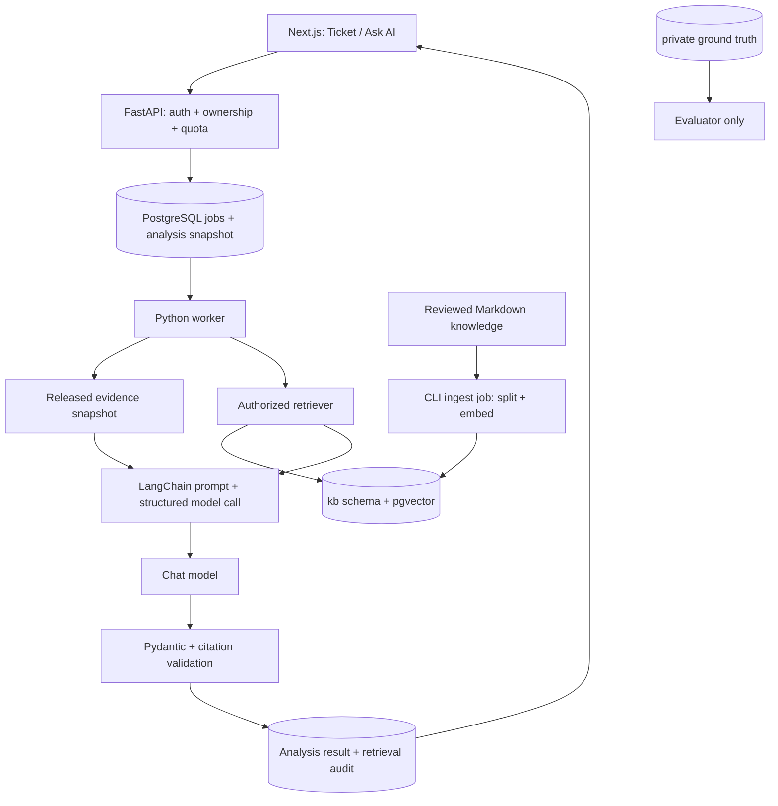

# SOC Platform — LangChain RAG Design

วันที่แบบออกแบบ: 12 ตุลาคม 2026 · implementation ข้อ 13–14 เพิ่ม pgvector/LangChain และ local Gemini opt-in แล้ว; quality acceptance ยังไม่ครบ ดู [ผลตรวจ](step-14-verification.md)

อ่านร่วมกับ [Architecture](architecture.md), [API](api.md), [Database](database.md), [CI/CD](ci-cd.md) และ [Development plan](development-plan.md)

## 1. เป้าหมายและขอบเขต

เพิ่มความสามารถให้ AI อธิบายเหตุการณ์และตอบคำถามระหว่างสืบสวน โดยอ้างทั้ง **หลักฐานที่ปล่อยแล้วในรอบของผู้ใช้** และ **เอกสารความรู้ที่ผ่านการตรวจ** เช่น playbook การตรวจ login, วิธีแยก blocked request จาก successful access และคู่มืออ่าน field ของ log

ใช้ LangChain Python ใน backend/worker ของ FastAPI ร่วมกับ PostgreSQL + pgvector ที่มีอยู่ในสถาปัตยกรรม ไม่เพิ่ม Dify หรือฐานข้อมูล vector แยกใน MVP ใช้ 2-step RAG: service ค้นข้อมูลก่อน แล้วส่ง context ที่คัดเลือกแล้วให้ model ตอบตาม schema ลำดับนี้ควบคุมสิทธิ์และจำนวนการเรียกโมเดลได้โดยไม่ให้โมเดลเลือกเครื่องมือเอง [LangChain retrieval](https://docs.langchain.com/oss/python/langchain/retrieval)

RAG ช่วยเพิ่มข้อมูลอ้างอิง แต่ไม่รับประกันว่าคำตอบถูกต้อง การเปิด ticket ยังเป็นหน้าที่ rules/anomaly และคะแนนยังมาจาก evaluator AI ไม่แก้ disposition, ปิด ticket หรือดำเนินการตอบสนองภัยแทนผู้ใช้

MVP ฐานรองรับสอง use cases; การประเมินข้อสอบเลื่อนระดับเป็นงานเพิ่มตาม [Learning path](learning-path.md) ไม่ถือว่าได้มาอัตโนมัติจากการทำ Ask AI:

| Use case | Input | Output |
|---|---|---|
| Ticket triage | analysis evidence snapshot + detector explanation | Analysis เดิม เพิ่ม knowledge citations และ retrieval status |
| ถามเกี่ยวกับ ticket | คำถามหนึ่งข้อ + snapshot ของ ticket ที่ตนมีสิทธิ์ | คำตอบ พร้อมสิ่งที่ทราบ/ยังไม่ทราบ และหลักฐาน/คู่มือที่อ้าง |

ถามได้เฉพาะรอบตนเองก่อน completing; Instructor ฝึกและถามในรอบตนเองได้ แต่การกำกับผู้อื่นเป็น read-only สำหรับ AI ผลเดิมตาม scope ไม่เพิ่มการถามหลัง completed หรือ multi-turn memory ใน MVP เพื่อคงผลฝึกก่อนเห็นเฉลยและไม่เปลี่ยน completed read-only policy

## 2. Components และ data flow



| ส่วน | เครื่องมือ / หน้าที่ |
|---|---|
| API | FastAPI/Pydantic: permission, validation, snapshot, enqueue และ polling response |
| orchestration | LangChain Core documents/prompts/runnables และ chat-model integration ที่เลือก |
| chunking | langchain-text-splitters; heading-aware Markdown แล้วแบ่งตาม token budget |
| embeddings | provider adapter ที่รองรับไทย/อังกฤษ; provider/model/dimension รอผลทดสอบ |
| retrieval | custom authorized retriever ใช้ SQLAlchemy + pgvector; ส่ง LangChain Document จากแถวที่ผ่าน filter |
| storage | PostgreSQL schema `kb`; Alembic เป็นเจ้าของ DDL/grants เช่นเดียวกับ app schema |
| generation | model ผ่าน AnalysisProvider เดิม; structured output แล้วตรวจซ้ำด้วย Pydantic |
| worker/queue | Python process + PostgreSQL jobs/lease เดิม; ไม่รัน ingestion ใน HTTP request |

เลือก custom SQL retriever เพื่อควบคุม release membership, revoked versions และ relational constraints ได้ชัดเจน จึงไม่ใช้ LangChain สร้างตารางอัตโนมัติใน production หากภายหลังเลือก PGVectorStore ให้ทำ adapter/schema migration mapping และทดสอบ filter contract ก่อนแทนที่ [LangChain PostgreSQL integration](https://docs.langchain.com/oss/python/integrations/vectorstores/pgvectorstore)

LangGraph, agent tools, web browsing, shell และ SQL ที่ให้ LLM สร้างเองไม่อยู่ใน flow นี้ LangSmith เป็นตัวเลือกภายหลัง; เริ่มจาก local structured metrics โดยไม่ส่ง prompt/log ของผู้เรียนไป tracing service เพิ่ม

## 3. ข้อมูลที่นำเข้าได้

| ข้อมูล | นโยบาย |
|---|---|
| คู่มืออ่าน logs, detection rule descriptions, generic playbooks | นำเข้าได้หลังตรวจความถูกต้อง/สิทธิ์เผยแพร่และลบ secret |
| ข้อมูลระบบสมมติที่เป็น background ของโจทย์ | นำเข้าเฉพาะสิ่งที่ผู้เรียนมีสิทธิ์ทราบตั้งแต่ต้นและไม่บอกผลลัพธ์ของ scenario |
| approved external documentation | เก็บ snapshot/แหล่งที่มา/version/license ที่ได้รับอนุญาต; ไม่ crawl URL ขณะตอบ |
| released events | โหลดตรงจาก snapshot ของ run; ไม่ใส่ knowledge index กลาง |
| notes/assessments/ผล AI ของผู้เรียน | ไม่ index เป็นแหล่งข้อเท็จจริงร่วม และไม่ใช้ฝึกโมเดลโดยอัตโนมัติ |
| ground truth, evaluation answers, future fixture schedules | ห้าม index แม้ผู้ใช้มี role Instructor |

อย่านำ `docs/` ทั้งโฟลเดอร์เข้า index เพราะ scope/spec และ prototype มีรายละเอียดเฉลยของสถานการณ์ ให้สร้าง `backend/knowledge/approved/` แยก มี manifest ของไฟล์ที่ reviewer อนุมัติอย่างชัดเจน เริ่ม Markdown UTF-8 เท่านั้น ไม่เปิด public file upload/URL ingestion; PDF/OCR เป็นงานภายหลัง

MVP มี knowledge audience เดียวคือ `learner` ที่ผู้ใช้ authenticated ทุกคนอ่านได้ ไม่มีเอกสาร confidential รายองค์กรหรือ instructor-only ใน corpus นี้ หากขยายต้องเพิ่ม ACL ก่อน retrieval และก่อนส่ง citation ไม่ใช้ prompt บอกให้โมเดลรักษาสิทธิ์แทนการตรวจ server

## 4. Ingestion และ versioning

1. ผู้ดูแลเตรียม Markdown พร้อม title, source identifier/URL, language, tags, revision, reviewer และ content hash ตรวจว่าไม่มีคำตอบโจทย์หรือ secret
2. CLI ที่มีสิทธิ์ publisher สร้าง document version แบบ draft และ enqueue `ingest_knowledge` ด้วย dedupe key ของ content hash + splitter version + embedding profile
3. Worker normalize ข้อความ คง heading/ลำดับรายการและตำแหน่งต้นฉบับ แบ่งเริ่มต้น 500 tokens/chunk, overlap 80 tokens; ปรับจากผลทดสอบภาษาไทย ไม่ถือ character count เป็น token count
4. สร้าง embeddings เป็น batch ภายใต้งบ ingestion แยก บันทึก model identifier, dimension, distance metric, chunk hash และ token usage ที่ทราบ ห้ามส่งไฟล์ที่ยังไม่ผ่านการ redact ให้ provider
5. ตรวจจำนวน chunk, vector dimension, finite values และ citation locators; ingestion ล้มเหลวไม่เปิด partial corpus ให้ผู้ใช้ค้น
6. สร้าง release แบบ immutable ระบุ document versions และ embedding profile ทดสอบ golden queries ก่อน publisher เปลี่ยน active release pointer ใน transaction เดียว
7. Run ใหม่ pin knowledge_release_id และ retrieval_config_version ใน run_versions; run เก่าใช้ release เดิมเพื่อทำซ้ำได้ จนหมด retention

เปลี่ยน embedding model/dimension ให้สร้าง profile และ embedding table/index ชุดใหม่ เช่น `kb.embeddings_<profile_key>` ผ่าน migration ไม่ผสม vector space ใน query เดียว Build ใหม่ขนาน ตรวจครบ แล้วสลับ release; เก็บของเดิมจนไม่มี run/analysis อ้างถึง ก่อน purge

การแก้คำผิดสร้าง document version ใหม่ ไม่ update chunk ที่ citation เดิมอ้าง หากต้องถอนเพราะข้อมูลไม่ควรเผย ให้ตั้ง revoked_at ที่ version และ invalidate cache ทันที ทุก query/citation read ต้องตรวจ revocation แม้ run pin release เก่า; คำตอบเก่าที่พึ่ง version นั้นต้องถูกซ่อนและแสดง withdrawn ตาม §8

## 5. Retrieval และ generation

1. FastAPI lock run ตามลำดับเดิม ตรวจ owner/state และ ticket ไม่ถูกลบ Freeze released ticket evidence IDs, payload hashes และ max release_seq; question เป็น untrusted input จำกัด 1–2,000 chars
2. Reserve โควตา/enqueue analysis ใน transaction เดียวกัน เลือก snapshot release/config จาก run_versions ไม่รับ release, prompt, model หรือ arbitrary filter จาก client
3. Worker สร้าง query จากคำถาม + event type/source + detector description ที่ไม่มีเฉลย ไม่ใช้ชื่อ S02/label ของโจทย์หรือ private label เป็น signal ไม่ใช้ LLM rewrite query ใน MVP
4. Embed query ด้วย profile เดียวกับ pinned release; query ต้อง filter audience=learner, release membership และ revoked_at ก่อนคืน document ให้ prompt builder เริ่ม exact cosine search ใน pgvector สำหรับ corpus เล็กและ bounded timeout
5. เริ่ม candidate 12 chunks เลือกสุดท้ายไม่เกิน 5 และไม่เกิน 2 ต่อ document version ลด overlap ซ้ำ กำหนด relevance threshold จาก validation set ของแต่ละ embedding profile ไม่ใช้คะแนน similarity เป็น probability/confidence ของคำตอบ
6. จัด context: system policy → คำถาม → event evidence ที่มี E-ID → knowledge chunks ที่มี K-ID แยกเป็นข้อมูลอ้างอิง ไม่ให้ log/document เปลี่ยน system instructions รวม retrieved text ไม่เกิน 3,000 tokens, evidence ไม่เกิน 4,000 และ output ไม่เกิน 1,200 เป็นค่าเริ่มต้น ต้องนับด้วย tokenizer ของ model และเผื่อ system/question ตาม context window จริง
7. เรียก chat model หนึ่งครั้งด้วย structured response model; ไม่คืน token stream ก่อนตรวจ ตรวจ types/enums/length, evidence refs, chunk refs และ statement refs ว่าอยู่ใน snapshot เดียวกัน
8. บันทึก response, retrieval snapshot, config hashes และ usage ใน transaction ที่ตรวจ lease token; frontend poll Analysis resource เดิม

หาก evidence เกิน budget ให้เลือกตาม policy ที่ versioned เช่น detector-required events ก่อน แล้วเติมบริบท พร้อม `evidence_truncated=true` และ list ของสิ่งที่ไม่ได้ส่ง ห้ามแอบตัดหลักฐานสำคัญแล้วอ้างว่าตรวจครบ

Exact search เป็นจุดเริ่มต้น ยังไม่เพิ่ม HNSW จนวัดจำนวน chunks/latency หากใช้ approximate index ต้องทดสอบ recall หลัง filter; filtered ANN อาจได้ผลน้อยกว่าที่ขอ ต้องออกแบบ iterative scan/fallback และไม่คลาย permission filter เพื่อเติม top-k [pgvector filtering](https://github.com/pgvector/pgvector#filtering)

Thai/English retrieval ต้องมี test ทั้งสองภาษา เริ่ม multilingual embeddings ไม่อ้างว่า PostgreSQL full-text search ตัดคำไทยได้ดีเอง Hybrid lexical search/reranker เป็นการทดลองถัดไปหลังมี baseline

## 6. ผลลัพธ์และ citation contract

แยก **หลักฐานของเหตุการณ์** ออกจาก **คู่มือที่ช่วยตีความ**: คู่มือ brute force ไม่ใช่หลักฐานว่าบัญชีนี้ถูกเจาะสำเร็จ ทุกข้อสรุปเกี่ยวกับรอบต้องอ้าง event; ข้อแนะนำวิธีตรวจอ้าง knowledge ได้

Triage ยังคง result schema เดิมใน API และเพิ่ม `knowledge_refs`, `retrieval`, `evidence_truncated`; question ใช้ result schema ตาม kind ดังนี้ เป็นตัวอย่างโครงสร้าง ไม่ใช่ผลรันจริง:

```json
{
  "answer": "หลักฐานการ login สำเร็จยังไม่ยืนยันว่าเป็นผู้โจมตี ควรตรวจ session และยืนยันกับเจ้าของบัญชี",
  "claims": [
    {"text": "มี session ที่ยืนยันตัวตนสำเร็จ", "evidence_refs": ["<event_uuid>"], "knowledge_refs": []},
    {"text": "ควรตรวจสอบกิจกรรมต่อเนื่องของ session", "evidence_refs": [], "knowledge_refs": ["<retrieval_item_uuid>"]}
  ],
  "unknowns": ["ยังไม่ทราบผู้ที่ใช้งาน session"],
  "answer_status": "answered",
  "evidence_truncated": false
}
```

Top-level `retrieval` ของ Analysis มี status=`matched|no_match|unavailable|revoked`, release_id, config_version และ citation list ที่ server resolve เอง เช่น retrieval_item_id, document_title, document_version, heading, excerpt, source_url? และ content_hash ไม่รับ URL/title จาก LLM มาแสดงโดยตรง

`answer_status=answered|insufficient_context`; refs ต้องเป็น subset ของ frozen evidence/retrieval items เท่านั้น Citation validator ยืนยันได้ว่าแหล่งมีอยู่และถูกส่งให้ model แต่ไม่ได้พิสูจน์ว่าข้อความอนุมานถูกต้อง จึงต้องวัด citation entailment และให้คนตรวจคุณภาพด้วย

ใช้ structured output ของ integration ที่เลือกและ validate Pydantic ซ้ำ ผลอ้างอิงปลอมหรือ schema ผิดเป็น invalid_output ไม่แสดงข้อความดิบเป็นคำตอบสำเร็จ [LangChain structured output](https://docs.langchain.com/oss/python/langchain/structured-output)

## 7. Database additions

ใช้ UUID/time/version convention เดิม เพิ่ม schema `kb` ซึ่ง runtime ห้าม DDL:

| ตาราง / ส่วนเพิ่ม | ฟิลด์สำคัญและ constraints |
|---|---|
| kb.documents | id, stable_key UNIQUE, title, source_uri?, audience=learner |
| kb.document_versions | id, document_id FK, revision, content_hash, language, status draft/ready, reviewer, revoked_at?; UNIQUE(document_id,revision); immutable content |
| kb.chunks | id, document_version_id FK, ordinal, heading, text, token_count, locator_json, content_hash; UNIQUE(document_version_id,ordinal) |
| kb.embedding_profiles | id, stable_key UNIQUE, provider, model_id, dimension, distance_metric, splitter_version; immutable |
| kb.embeddings_<profile_key> | chunk_id PK/FK, embedding vector(d) NOT NULL; fixed dimension/profile ผ่าน migration; ไม่สร้างชื่อตารางจาก client |
| kb.releases | id, manifest_hash UNIQUE, embedding_profile_id FK, created_at, published_at?; membership immutable เมื่อ publish |
| kb.release_documents | release_id + document_version_id composite PK/FKs |
| kb.active_release | singleton key PK, release_id FK, version; publisher ใช้ compare-and-swap |
| app.retrievals | id, run_id, analysis_id, release_id, embedding_profile_id, config_version, query_hash, status, latency_ms; UNIQUE(analysis_id); composite FK ไป analyses |
| app.retrieval_items | id, run_id, retrieval_id, chunk_id FK, rank, score, excerpt_snapshot, content_hash; UNIQUE(retrieval_id,chunk_id); composite FK ไป retrievals |
| analyses เพิ่ม | kind=triage/question, question_text?, question_hash?, ticket_id?, knowledge_release_id?, retrieval_config_version?, response_visibility=visible/withdrawn |
| run_versions เพิ่ม | knowledge_release_id?, retrieval_config_version?; null เฉพาะ run ที่สร้างขณะปิด RAG |
| jobs เพิ่ม type | ingest_knowledge, answer_question; pipeline triage ใช้ analyze_evidence เดิม |
| kb.ingestions | id, document_version_id, embedding_profile_id, dedupe_key UNIQUE, status, created_at, finished_at?; ผูก jobs และงบ publisher |
| app.quota_component_reservations | id, quota_reservation_id FK, component=query_embedding/generation/document_embedding, model_id, reserved_tokens, reserved_cost?, status; UNIQUE(quota_reservation_id,component,model_id) |
| app.provider_usage | id, component_reservation_id FK, attempt_key UNIQUE, model_id, input_tokens?, output_tokens?, measured_cost?, rate_card_version?, status; แยก usage แต่ละ external attempt |

Question kind ต้องมี question_text/question_hash/ticket_id; triage ไม่รับ question_text ticket FK ต้องอยู่ run เดียวกัน เพิ่ม references ของผลลัพธ์ที่เป็น authoritative ลงตารางเชื่อม `analysis_knowledge_refs(run_id,analysis_id,retrieval_item_id)` โดยตรวจ retrieval item เป็นของ analysis นั้นด้วย composite FK ไม่พึ่ง UUID ที่ model ใส่ใน JSON อย่างเดียว

quota_reservations เดิมเพิ่ม ingestion_id nullable และเปลี่ยน owner CHECK ให้ analysis_id/experiment_arm_id/ingestion_id มีค่าหนึ่งชนิดเท่านั้น เพิ่ม UNIQUE(ingestion_id,ledger_id) รวม scope `publisher:<id>` ใน ledger โดย ingestion ใช้ publisher และ system ledgers ไม่แตะ user ai_request_count Parent reservation เก็บผลรวม component tokens สำหรับ capacity cap ส่วน component rows/usage เป็นแหล่งคิด cost; อัปเดตทั้งสองใน transaction เดียว ไม่คิดเงินซ้ำจาก summary และ detail

Run freeze release/config ใน transaction สร้าง run ที่เปิด RAG; release ต้อง published และมี embeddings ครบ Pending worker รับได้เฉพาะ snapshot เดิม Ingestion chunks ซ้ำป้องกันด้วย document revision/ordinal และ embeddings PK; worker resume ต้องยืนยัน content hash/profile ก่อนใช้ผลเดิม

Logical analysis uniqueness ที่มีอยู่ยังใช้ attempt_group แยกงาน แต่ต้องเก็บ snapshot ของ release/retrieval config เพิ่ม Retry ผ่าน API สร้าง logical request ใหม่และคัดลอก frozen retrieval/evidence เดิม ไม่ retrieve corpus ปัจจุบันใหม่ ถ้ายังไม่เคย retrieval สำเร็จให้ retry ด้วย pinned release/config เดิม; version ที่ revoked แล้วให้ปฏิเสธ retry ด้วย 409 KNOWLEDGE_REVOKED

Publisher role เขียน kb content/releases; ingestion role เขียน draft chunks/embeddings แต่ publish ไม่ได้; worker retriever อ่านเฉพาะ learner/non-revoked versions และไม่มี SELECT private schema API อ่าน citation ผ่าน scoped repository และตรวจ revocation ไม่เปิด raw vector endpoint Role grants/service tests เป็นเงื่อนไขก่อนใช้งาน ไม่อ้างว่ามีสิทธิ์เหล่านี้ติดตั้งแล้ว

## 8. API และ UI เพิ่มเติม

ทุก route อยู่ใต้ `/api/v1` ใช้ cookie/CSRF, error envelope, ownership และ idempotency ตาม API เดิม ข้อนี้เป็น contract extension ที่ต้องเพิ่มใน OpenAPI ก่อน implementation

| Method | Endpoint | Input / Response |
|---|---|---|
| POST | `/runs/{run_id}/tickets/{ticket_id}/questions` | question, expected_version ของ ticket + Idempotency-Key; 202 analysis_id, kind=question, status=queued |
| GET | `/runs/{run_id}/analyses/{analysis_id}` | schema discriminated ด้วย kind; เพิ่ม retrieval/citations และ response_visibility |
| GET | `/runs/{run_id}/analyses/{analysis_id}/sources/{retrieval_item_id}` | excerpt snapshot + source metadata ของ item ที่ผูก analysis นี้เท่านั้น |
| POST | `/runs/{run_id}/analyses/{analysis_id}/retry` | ใช้ contract เดิม; retry question ต้อง preserve question/evidence/knowledge snapshot |

Create question ใช้ run lock → ticket lock, expected ticket version และตรวจ mutable state; ไม่เปลี่ยน ticket assessment หรือ version จากการถาม เริ่มได้เฉพาะ RAG enabled และมี release ที่พร้อม หากไม่มีคืน 503 KNOWLEDGE_UNAVAILABLE ไม่สร้างงานที่สัญญาว่าจะใช้ RAG ได้ Guest อ่านได้เฉพาะ demo snapshot ที่เตรียมไว้ ไม่เรียก generation

Citation read ตรวจ owner/run/analysis/item chain ทุกครั้งและแสดงผ่าน escaped text; source_url อนุญาตเฉพาะ URL ที่ publisher ตรวจแล้ว ถ้า withdrawn ให้ 410 KNOWLEDGE_REVOKED สำหรับ citation และ GET Analysis คืน metadata เดิมแต่ result=null, response_visibility=withdrawn (ไม่เปลี่ยน status ประวัติ) ใช้ projection เดียวกันใน ticket detail, export และ Instructor review ป้องกันการอ่านคำตอบที่ถูกถอนจากช่องอื่น Cache ต้องเคารพ revocation

Instructor review เพิ่ม read-only routes `/admin/runs/{run_id}/analyses/{analysis_id}` และ `/admin/runs/{run_id}/analyses/{analysis_id}/sources/{retrieval_item_id}` ใช้ assignment scope + access audit เดิม ไม่มี admin question/retry ของรอบผู้อื่น

Next.js เพิ่ม Ask AI ใน ticket detail, pending/error/insufficient context, หลักฐานเหตุการณ์และเอกสารอ้างอิงคนละส่วน เปิด citation drawer แสดงชื่อ/เวอร์ชัน/heading/excerpt และป้าย mock/real ห้ามใช้คำว่า “ยืนยันว่าถูกเจาะ” จาก knowledge เพียงอย่างเดียว ปิดปุ่มถามเมื่อ completing/completed/failed แต่ยังอ่านผลเดิมได้ก่อนหมด retention

## 9. Failure, budget และข้อมูลส่วนตัว

| กรณี | พฤติกรรม |
|---|---|
| ไม่มี chunk ผ่าน threshold | retrieval=no_match; question คืน insufficient_context แบบ template โดยไม่เรียก chat model; triage ทำ evidence-only พร้อมป้าย no_match |
| embedding/vector service ใช้ไม่ได้ | retrieval=unavailable; question เป็น failed; triage evidence-only ได้ตาม policy ที่บันทึกไว้ ไม่แอบอ้างใช้ RAG |
| LLM timeout / bad citations | timed_out / invalid_output ตาม Analysis contract; retry แบบ bounded |
| quota ไม่พอ | 429 ก่อน enqueue; หลังเริ่มงานให้ resource quota_exceeded ตามกรณีจริง |
| revoked source | ไม่ส่ง context ให้ model; ซ่อนคำตอบเดิมที่พึ่งแหล่งนั้น; ไม่แทนด้วย release ใหม่เงียบ ๆ |
| provider ล่ม | rules/ticket/note ยังทำงาน ไม่สรุปว่าไม่มีภัยเพราะ AI ตอบไม่ได้ |

20 logical AI requests/บัญชี/วันเดิมนับทั้ง triage และ question; worker retry ไม่เพิ่ม logical count แต่ต้องกัน actual provider cost ซ้ำ ใช้ค่า budget ตาม embedding/chat model แยก rate cards ห้ามรวมจำนวน tokens คนละราคาแล้วอ้างเป็นค่าใช้จ่ายเดียว

ขยาย quota reservation ให้กัน query embedding และ chat completion ใน operation เดียวก่อน enqueue เก็บ usage/cost แยก component; unknown usage ยังคง reserve จน reconcile กรณี no_match ปล่อยเฉพาะ chat reservation ที่ยังไม่ส่ง แต่ embedding usage และ logical request ที่ใช้แล้วไม่คืน การ index เอกสารใช้งบ publisher/ingestion แยกพร้อม global cap และไม่หัก daily AI request ของผู้เรียน

Default time budget ต่อ attempt: embedding 5s + retrieval 3s + chat 20s + validation/persist เผื่อ 2s รวมไม่เกิน AI attempt 30s เดิม จำกัด retry 3 attempts ภายใต้ lease/heartbeat เดิม Finish รอ pipeline สูงสุด 60s ตาม architecture; late output ไม่แก้ evaluation snapshot

Redact คำถาม/log ก่อนส่ง provider; ไม่ส่ง username/IP ที่ไม่จำเป็น ไม่เก็บ prompt เต็มใน log และไม่เปิด external tracing อัตโนมัติ Cache query embeddings ถ้าจำเป็นต้องผูก model/profile + normalized redacted query hash ส่วน response cache ข้ามผู้ใช้ปิดใน MVP

คำถาม/retrieval snapshots/citations เป็น child data ของ run อายุ 30 วันตามนโยบายเดิม KB release/chunks เก็บขณะมี run/analysis อ้าง; revoke และ purge เป็นคนละขั้นตอน ลบ embeddings/content ที่ไม่มี reference ได้ตามงาน retention พร้อม audit

## 10. การทดสอบและวัดว่าแม่นขึ้นจริง

สร้างชุดประเมินเบื้องต้นอย่างน้อย 50 คำถามไทย/อังกฤษ โดยผู้ตรวจระบุ relevant chunk IDs, expected evidence, answerable/unanswerable และ forbidden claims แยกชุดปรับ threshold ออกจาก held-out test เก็บ gold labels ใน evaluator/test assets ที่ retriever ไม่มีสิทธิ์อ่าน ไม่ index benchmark answers เข้า KB

| มิติ | วิธีวัด / เกณฑ์เริ่มต้นที่เสนอ |
|---|---|
| retrieval | Recall@5 และ MRR บน answerable queries; ตั้งเป้า Recall@5 ≥0.85 หลังผู้ตรวจยืนยัน relevance |
| citation integrity | fabricated/cross-run/revoked references ต้องถูกปฏิเสธทั้งหมดใน tests |
| answer grounding | คนตรวจสุ่ม claims ว่าแหล่งอ้างรองรับจริง; เป้าหมาย supported claims ≥90% |
| abstention | unanswerable set คืน insufficient_context ถูก ≥90%; รายงาน false abstention ด้วย |
| leakage | ground truth/future events/ผู้ใช้อื่นหลุดเป็นศูนย์ใน adversarial test set |
| latency/cost | แยก embedding/retrieval/chat, p50/p95, tokens/cost ต่อคำถาม และ failed calls |

ตัวเลขเป็น acceptance targets ไม่ใช่ผลวัดจริง ต้องรายงาน sample count, model/profile/release/config hashes และข้อจำกัด เปรียบเทียบ no-RAG กับ RAG บน evidence, model, prompt policy, seed/temperature และ budget ใกล้เคียงกัน วัดคุณภาพคำตอบ/เวลา/ต้นทุน ไม่อ้างว่า RAG เพิ่ม detector recall เพราะนโยบายเปิด ticket ไม่เปลี่ยน

Tests สำคัญ: prompt injection ในเอกสาร/log, ชื่อโจทย์ที่เผยคำตอบ, cross-run citation UUID, revoke ระหว่าง retrieve กับ generate/read, retry หลังเปลี่ยน release, no_match, context truncation, Thai retrieval, concurrent quota และ finish/question race

ก่อนส่ง prompt และก่อน persist ให้ตรวจ revocation ซ้ำ ถ้าแหล่งถูกถอนหลัง response เคยส่งแล้วไม่สามารถลบจากสิ่งที่ผู้ใช้เห็นไปแล้วได้ แต่ห้ามส่งซ้ำหรือแสดงใน export รอบถัดไป

## 11. Implementation และ CI/CD

```text
backend/
  app/modules/rag/         ingest, retrieval, context, citations, schemas
  app/adapters/embeddings/ mock + chosen provider
  app/adapters/ai/         LangChain chat adapter behind AnalysisProvider
  knowledge/approved/     reviewed Markdown + release manifest
  tests/rag/              deterministic tests, fake embeddings/model
  tests/evaluation/       held-out labels; never part of knowledge image
frontend/
  src/features/assistant/ question form, result, citation drawer
```

Pin LangChain/Core/text-splitters, provider integration, pgvector Python binding และ PostgreSQL extension compatibility ใน uv.lock/infra config หลังเลือก embedding/chat provider ใช้ provider เดียวทั้งสองหน้าที่ได้ถ้ารองรับ; หากใช้สองรายต้องบันทึก privacy/budget/config แยก ไม่ระบุ API key/model ที่ยังไม่ได้เลือกเหมือนพร้อมใช้แล้ว

CI ใช้ pgvector-enabled PostgreSQL major เดียวกับ production + fake embeddings/model เพื่อทดสอบ real SQL/filter/FK/dimension และ quota ไม่จ่าย provider ทุก PR Real retrieval/answer benchmark เป็น manual trusted job จำกัดงบก่อน publish release ตรวจ hosting ว่าเปิด extension ได้ก่อนเลือกแพ็กเกจ

เพิ่ม migration `007` สำหรับ kb/retrieval schema และ analysis/run_versions fields แบบ nullable รองรับ old rows (`kind=triage`, RAG disabled) แล้ว backfill config เท่าที่มีจริง ไม่แต่ง knowledge snapshot ย้อนหลัง Deploy app ที่อ่าน schema ใหม่ได้ก่อน ingest/publish release แล้วค่อยเปิด feature flag กับ run ใหม่

Ingestion/reindex ไม่รันใน API startup หรือ migration; rollback app ใช้ image เดิมที่ schema ยังรองรับ ส่วน knowledge rollback เปลี่ยน active pointer ไป release ที่ตรวจแล้ว มีผลกับ run ใหม่เท่านั้น ตรวจ embedding table + KB release ใน backup/restore drill ด้วย

| งานต่อจาก Phase 4 | ผลส่งมอบ |
|---|---|
| RAG-001: corpus + models | approved manifest, chunking/profile decision, golden test split |
| RAG-002: storage + ingestion | Alembic, roles, jobs, publish/revoke และ repeat ingestion ไม่ซ้ำ |
| RAG-003: retriever + triage | scoped retrieval, frozen citations, no-match/failure และ LangChain adapter |
| RAG-004: question API + UI | quota/idempotency/version handling, Ask AI/citation drawer, source withdrawal |
| RAG-005: evaluation + deploy | benchmark เทียบ no-RAG, CI gates, pgvector backup และ release runbook |

ประมาณเพิ่ม 6–10 วันทำงานหลัง core AI/worker พร้อม สำหรับทีมที่คุ้น stack; ต้องปรับ roadmap เดิมและงบ embedding ก่อนยืนยันวันส่ง นิยามเสร็จคือใช้งานผ่าน API จริงพร้อม citation/สิทธิ์/benchmark ตามเกณฑ์ ไม่ใช่แค่เพิ่ม LangChain dependency

## 12. Learning coach และการประเมินเหตุผลหลังสอบ (งานเพิ่ม)

Boundary และลำดับ transaction ใช้ [SRS §3–5](srs.md): run ก่อน attempt/resource ก่อน quota;
submit freeze ก่อน grading ผู้ใช้ยืนยันให้ Instructor อ่านเฉลยหลัง submit เท่านั้น
ผู้เรียนเห็นเฉพาะ rubric feedback ไม่ใช่ full answer key รวม citations/export/ประวัติ
rubric, feedback disclosure และ override/unlock policy ยัง pending ไม่ให้ AI ตัดสินแทน

ช่วงเรียนค้นได้เฉพาะคู่มือที่อนุมัติแล้วเกี่ยวกับวิธีอ่าน Method, Path, status, request/response และการเชื่อม event; ตัวอย่างฝึกต้องแยกจาก exam bank อย่างชัดเจน ระหว่าง exam **ห้ามเรียก triage/Ask AI ที่แสดงคำใบ้ของ attempt นั้น** และห้ามส่ง private answer key เข้า retrieval index ที่ learner role ค้นได้

หลัง submit ให้ deterministic evaluator ตรวจว่าหลักฐานครบ, evidence refs อยู่ใน frozen snapshot, disposition/severity ถูกเกณฑ์ แล้วค่อยใช้ RAG ช่วยอธิบายว่าข้อความเหตุผลเชื่อม event กับคู่มืออย่างไร ผลลัพธ์ต้องแยก `criterion`, `finding`, `evidence_refs`, `knowledge_refs`, `uncertainty` และ version ของ rubric/model/release Cite คู่มือเพื่ออธิบายหลักการ ไม่ใช้คู่มือเป็นหลักฐานว่าการโจมตีในรอบนี้สำเร็จ ความยาวข้อความเพียงอย่างเดียวไม่ใช่เกณฑ์ผ่าน

Worker ต้อง validate refs ทั้งสองชุดก่อนบันทึก grade; no-match/provider outage/invalid citation หรือความเห็น AI ขัดกับ deterministic result ให้ `needs_review` และส่ง Instructor ไม่ auto-pass หรือ auto-fail โดยโมเดลล้วน ๆ Benchmark เพิ่มชุดคำตอบผู้เรียนที่มนุษย์ให้คะแนนไว้ล่วงหน้า วัด agreement แยกตามระดับ ภาษาไทย/อังกฤษ ความกำกวม false pass และ false fail รวมถึงทดสอบ prompt injection ใน log/คำตอบ/เอกสารที่ค้นได้ ข้อมูลคำตอบผู้เรียนต้องผ่าน redaction และ retention ตามนโยบายเดียวกับ evidence

งานนี้ต้องมี issue และ estimate แยกจาก RAG-001–005 เดิม เพราะ retrieval ที่อ้างแหล่งได้ยังไม่ได้หมายความว่าประเมินคำตอบอย่างยุติธรรมและเชื่อถือได้
