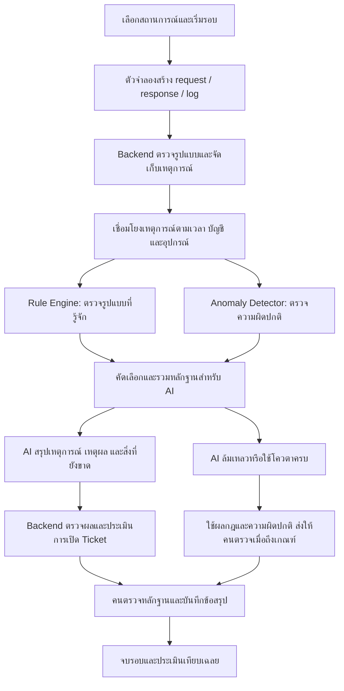

# AI-Assisted SOC Simulation Platform

ระบบจำลองงาน Security Operations Center (SOC) ที่สร้างเหตุการณ์และ request หลายรูปแบบ ส่งให้ backend ตรวจจับด้วยกฎและวิเคราะห์ด้วย AI จากนั้นเปิด ticket พร้อมหลักฐานให้มนุษย์ตรวจสอบและตัดสินใจต่อ

โปรเจกต์นี้พัฒนาสำหรับส่งอาจารย์และนำขึ้นใช้งานบนเว็บไซต์จริง ผู้เข้าชมเปิดดูเดโมแบบอ่านอย่างเดียวได้ทันที ส่วนการเริ่มรอบจำลองและจัดการ ticket ต้อง **login ด้วยบัญชีผู้ใช้** การโจมตีและผลกระทบเป็นข้อมูลจำลอง ไม่กระทบระบบจริง

> **เอกสารนี้เป็นข้อกำหนดผลิตภัณฑ์ ไม่ใช่รายงานสถานะ**: ระบบหลักมี backend, login, database, training, learning, exam และ RAG implementation ภายในแล้ว แต่ยังไม่ผ่าน acceptance ทุกข้อ. ทิศทาง RAG ที่ผู้ใช้ยืนยันคือเรียกบริการภายนอกผ่าน API ซึ่ง source ปัจจุบันยังไม่ตรงกัน และยังไม่มีหลักฐาน production acceptance ครบ ดู [checklist](implementation-checklist.md) และ [รายงานตรวจ](step-19-verification.md)

## 1. แนวคิดของระบบ

ระบบต้องการตอบคำถามว่า เมื่อมีเหตุการณ์จำนวนมากเข้ามา เราจะคัดแยกเหตุการณ์ปกติออกจากสิ่งที่น่าสงสัย ประเมินความรุนแรง และเตรียมข้อมูลให้คนวิเคราะห์ต่อได้อย่างไร

ตัวจำลองสร้างทั้งความพยายามโจมตีที่ไม่สำเร็จ การโจมตีที่มีผลกระทบ กิจกรรมปกติที่ดูน่าสงสัย และพฤติกรรมที่กฎตรวจจับเดิมไม่ครอบคลุม backend รับข้อมูลเหล่านี้ เชื่อมโยงเหตุการณ์ ตรวจด้วยกฎและตัวตรวจความผิดปกติ แล้วใช้ AI ช่วยอธิบายหลักฐาน

หากพบเหตุการณ์ที่ควรตรวจสอบ ระบบสร้าง ticket ซึ่งแสดงคำวิเคราะห์ของ AI ควบคู่กับ request, response และ log ที่เกี่ยวข้อง ผู้ทดลองรับบทนักวิเคราะห์ ตรวจหลักฐาน และบันทึกว่าเป็นภัยจริง กิจกรรมปกติ หรือยังสรุปไม่ได้

ในโปรเจกต์นี้ **ticket คือเคสสำหรับสืบสวน** ส่วน alert คือสัญญาณเตือนที่อาจนำมารวมใน ticket เดียวกันได้ การเปิด ticket ยังไม่ได้หมายความว่ายืนยันการโจมตีแล้ว

## 2. เป้าหมายและคำถามที่ต้องพิสูจน์

- สาธิตกระบวนการ SOC ตั้งแต่รับเหตุการณ์ ตรวจจับ วิเคราะห์ เปิดเคส จนถึงข้อสรุปของมนุษย์
- จำลองเหตุการณ์ที่มีผลกระทบต่างกัน พร้อมกิจกรรมปกติที่ใช้ทดสอบการแจ้งเตือนผิด
- ให้ AI สรุปสิ่งที่เกิดขึ้นโดยอ้างอิงหลักฐาน และระบุสิ่งที่ยังไม่ทราบ
- ตรวจสอบเหตุการณ์นอกขอบเขตกฎเดิม โดยไม่อ้างว่า AI ตรวจจับภัยใหม่ได้ทุกชนิด
- เปรียบเทียบผลของกฎอย่างเดียวกับกฎร่วมกับการตรวจความผิดปกติและ AI
- Deploy เว็บไซต์ให้บุคคลอื่นเปิดทดลองและอาจารย์ตรวจผลงานได้

คำถามสำคัญของการทดลองคือ ระบบตรวจพบภัยจริงมากขึ้นหรือไม่ แลกกับการแจ้งเตือนผิดเท่าไร และข้อมูลที่ AI สรุปช่วยให้คนตรวจสอบต่อได้เพียงพอหรือไม่

## 3. ความสัมพันธ์กับ SOC จริง

ระบบนี้จำลองงานหลักของ SOC ได้แก่ event ingestion, detection, triage, investigation และ case management แต่ไม่ใช่ SOC เต็มรูปแบบที่เฝ้าระวังองค์กรจริงตลอดเวลา

ขอบเขตเวอร์ชันแรกไม่รวมการเชื่อมต่อระบบ production การติดตั้ง agent บนเครื่องจริง การป้องกันเครือข่ายจริง หรือการให้ AI ระงับบัญชีและบล็อกอุปกรณ์อัตโนมัติ

การ deploy จริงหมายถึงเว็บไซต์ backend ฐานข้อมูล และบริการวิเคราะห์ทำงานจริง ส่วนแหล่งเหตุการณ์และผลกระทบยังเป็นการจำลอง

## 4. การเข้าใช้งานและสิทธิ์ผู้ใช้

ผู้เข้าชมสามารถเปิดดูตัวอย่าง dashboard, log, คำวิเคราะห์ AI และ ticket ที่เตรียมไว้ได้ทันที หากต้องการทดลองเอง ให้สมัครสมาชิกหรือใช้บัญชีที่จัดเตรียมให้ แล้ว login เพื่อเริ่มรอบของตนเอง ประวัติผูกกับบัญชี จึงกลับมาทำงานต่อได้หลัง logout หรือเปลี่ยนอุปกรณ์ ภายในระยะเวลาเก็บข้อมูล

### ลำดับการใช้งาน

1. เปิดเว็บไซต์เพื่อดูเส้นทางระดับและรอบตัวอย่างแบบอ่านอย่างเดียว
2. สมัครสมาชิกหรือ login; ระบบแนะนำหน้าจอและเปิดบทเรียนระดับเริ่มต้น
3. เรียนวิธีอ่าน request/response ทีละจุด พร้อมตัวอย่างและคำอธิบาย; ระดับใหม่มีบทเรียนใหม่ก่อนสอบ
4. เมื่อเรียนจบ จึงเปิดเคสทดสอบที่ปลดล็อก ดู event/request/response/alert/ticket โดยไม่เห็นเฉลยหรือคำวิเคราะห์ช่วยตอบระหว่างสอบ
5. เลือกหลักฐาน ประเมิน severity/disposition และส่งเหตุผลด้วยตนเอง จากนั้นดู feedback และทบทวนหรือสอบใหม่ได้
6. ผ่านทุกเคสของระดับจึงเปิดระดับถัดไป; หลังจบรอบดูผลเทียบเฉลยตามสิทธิ์และ retention

ลำดับระดับและเกณฑ์การสอน/สอบอยู่ใน [Learning path](learning-path.md) ส่วน dashboard และ ticket workflow เดิมยังเป็นส่วนหนึ่งของห้องทดลอง SOC แต่ไม่ใช้ mock AI brief เป็นคำใบ้ก่อนส่งข้อสอบ

### บทบาทและสิทธิ์

| บทบาท | สิทธิ์หลัก |
|---|---|
| Guest | ดูเดโมที่เผยแพร่แบบอ่านอย่างเดียว ไม่เริ่มงาน AI หรือแก้ข้อมูล |
| Analyst | เริ่มและควบคุมรอบของตน ค้นหลักฐาน จัดการ ticket/บันทึก และดูผลประเมินของตน |
| Admin/Instructor | บทบาทเดียวใน MVP สำหรับจัดการสถานะบัญชีและโควตา ตรวจรอบของผู้เรียน และให้ความเห็นประกอบการประเมิน |

ผู้สมัครใหม่ได้รับบทบาท Analyst เท่านั้น การสร้างบัญชี Admin/Instructor ทำผ่านขั้นตอนตั้งค่าฝั่ง server ไม่เปิดให้เลือกสิทธิ์สูงตอนสมัคร สมาชิกทีมพัฒนาและบัญชีในแอปเป็นคนละเรื่องกัน

### การแยกข้อมูลและการยืนยันตัวตน

- รอบตัวอย่างส่วนกลางเป็นข้อมูลสำหรับอ่าน ไม่ให้ผู้เข้าชมแก้ร่วมกัน
- แต่ละรอบมี `run_id` และ `owner_user_id` ผูกกับบัญชี ไม่ผูกความเป็นเจ้าของกับ browser session
- backend ตรวจ authenticated session บทบาท และเจ้าของข้อมูลทุกคำขอ การซ่อนปุ่มใน UI ไม่ทดแทนการตรวจสิทธิ์ฝั่ง server
- การรู้ `run_id` อย่างเดียวไม่ใช่สิทธิ์เข้าถึงข้อมูลรอบนั้น
- การเปลี่ยนสถานะ ticket หรือเริ่มรอบใหม่ไม่กระทบผู้ทดลองคนอื่น
- Analyst ไม่อ่านหรือแก้รอบของบัญชีอื่น ส่วน Admin/Instructor เข้าถึงรอบเพื่อกำกับการฝึกได้ตามสิทธิ์ที่กำหนดและบันทึก audit trail
- เก็บรหัสผ่านด้วยไลบรารี password hashing ที่เหมาะสม ไม่เก็บ plaintext ใช้ session cookie แบบ HttpOnly, Secure และ SameSite พร้อมป้องกัน CSRF
- logout หรือปิดใช้งานบัญชีต้องเพิกถอน session ที่เกี่ยวข้อง และ session ต้องมีอายุหมดอายุ
- จำกัดความถี่การสมัครและ login ใช้ข้อความผิดพลาดที่ไม่เปิดเผยว่ามีบัญชีใดอยู่ และไม่บันทึกรหัสผ่านหรือ token ลง log
- ประวัติกิจกรรมเก็บผู้ดำเนินการด้วย `actor_user_id` และบทบาทขณะทำรายการ ส่วนงานอัตโนมัติระบุ system actor แยกต่างหาก
- ระบบสมัคร/login/logout อยู่ใน MVP ส่วนการกู้รหัสผ่านด้วยอีเมลยังเป็นส่วนขยาย โดยช่วงเดโมสามารถจัดเตรียมบัญชีทดสอบเฉพาะบุคคลได้

## 5. ภาพรวมการทำงาน

เหตุการณ์ที่ไม่ถูกเปิด ticket ยังต้องค้นดูได้ เพื่อให้ตรวจสอบรายการที่ระบบพลาดและคำนวณผลการทดลองได้

## 6. การจำลองเหตุการณ์

เวอร์ชันแรกใช้ fixture หรือชุดข้อมูลสถานการณ์ที่เตรียมไว้ ตัวจำลองส่งข้อมูลเข้า ingestion API ตามเวลาของรอบ ไม่จำเป็นต้องยิง exploit ไปยังระบบจริง

แต่ละสถานการณ์ควรกำหนด:

- ลำดับ request, response และ log พร้อมเวลาเกิดเหตุ
- บัญชี อุปกรณ์ หรือทรัพย์สินสมมติที่เกี่ยวข้อง
- บริบท เช่น ความสำคัญของระบบและพฤติกรรมย้อนหลัง
- ผลที่เกิดขึ้นจริงในโลกจำลอง เช่น ถูกปฏิเสธ เข้าถึงสำเร็จ หรืออ่านข้อมูลได้
- เฉลยและหลักฐานที่ควรใช้ตัดสิน เก็บแยกจากข้อมูลที่ส่งให้ระบบวิเคราะห์
- เวอร์ชันและ seed เพื่อให้เล่นซ้ำและเปรียบเทียบผลได้

ใช้ข้อมูลสมมติ โดเมน `.test` และ IP สำหรับเอกสารตัวอย่าง ไม่ใช้ข้อมูลส่วนบุคคลหรือ credential จริง

### สถานการณ์เริ่มต้น

| สถานการณ์ | สิ่งที่ระบบได้รับ | สิ่งที่ต้องทดสอบ |
|---|---|---|
| 1. ลองรหัสผ่านหลายครั้งแต่ไม่สำเร็จ | login ล้มเหลวถี่ และไม่มีหลักฐานเข้าใช้งานสำเร็จ | ตรวจความพยายามโจมตีได้ โดยไม่สรุปว่าบัญชีถูกยึดแล้ว |
| 2. เข้าถึงบัญชีและอ่านข้อมูลสำคัญ | login ผิดหลายครั้ง ตามด้วยสำเร็จและเข้าถึงข้อมูลผิดปกติ | เชื่อมโยงหลายเหตุการณ์และประเมินผลกระทบที่มีหลักฐาน |
| 3. Request โจมตีเว็บที่ถูกปฏิเสธ | request มีรูปแบบน่าสงสัย พร้อม response และ log ว่าถูกปฏิเสธ | แยกเจตนาโจมตีออกจากความสำเร็จของการโจมตี |
| 4. การสแกนที่ได้รับอนุญาต | request จำนวนมาก พร้อมข้อมูลอนุญาตที่ตรงเวลาและขอบเขต | ลดการแจ้งเตือนผิดเมื่อมีบริบทสนับสนุนว่าเป็นกิจกรรมปกติ |
| 5. พฤติกรรมไม่ตรงกฎเดิม | เหตุการณ์หลายรายการรวมกันผิดจาก baseline แต่ไม่มี rule เฉพาะ | ตรวจความผิดปกติและให้ AI เสนอข้อสันนิษฐานพร้อมข้อจำกัด |

ทุกสถานการณ์ควรผสมกิจกรรมปกติ และมีชุดข้อมูลที่ครอบคลุมผลกระทบต่ำ ปานกลาง สูง และกรณีร้ายแรง ความรุนแรงต้องอิงหลักฐานและบริบท ไม่กำหนดจากชื่อสถานการณ์เพียงอย่างเดียว

การจำลอง request ไปยังเว็บเป้าหมายทดสอบจริงเป็นส่วนขยายในอนาคต หากเพิ่มต้องเป็นเป้าหมายที่แยกเฉพาะและควบคุมได้

## 7. การตรวจจับและเชื่อมโยงหลักฐาน

### 7.1 Rule Engine

ตรวจเงื่อนไขที่อธิบายได้ เช่น login ล้มเหลวเกินจำนวนที่กำหนดในช่วงเวลาเดียวกัน หรือพบ request ตรงกับรูปแบบที่เตรียมไว้ ผลต้องระบุ `rule_id` เวอร์ชันกฎ เหตุผล และ event ที่ใช้ประกอบ

กฎที่ตรวจเจอเพียงความพยายามโจมตีต้องไม่ยกระดับเป็นการโจมตีสำเร็จโดยไม่มีหลักฐานเพิ่มเติม

### 7.2 Anomaly Detector

ทำให้เหตุการณ์ที่ไม่ตรงกฎยังมีโอกาสเข้าสู่การวิเคราะห์ เช่น ปริมาณ request เพิ่มผิดปกติ การเข้าถึงข้อมูลต่างจาก baseline หรือชุดเหตุการณ์ที่ไม่คุ้นเคย

MVP เริ่มจากสถิติและ threshold ที่ตรวจสอบได้ ไม่จำเป็นต้องฝึกโมเดล machine learning ใหม่ หากข้อมูลย้อนหลังไม่พอ ต้องแสดงข้อจำกัดและไม่อ้างว่ามี baseline ที่น่าเชื่อถือแล้ว

### 7.3 Event Correlation

รวมเหตุการณ์ที่สัมพันธ์กันด้วยเวลา บัญชี อุปกรณ์ IP หรือ session ของระบบจำลอง ก่อนส่งให้ AI การพิจารณาเพียง request เดียวอาจไม่เพียงพอ โดยเฉพาะเมื่อจะยืนยันผลกระทบ

การมี IP เดียวกันอย่างเดียวไม่เพียงพอให้รวมทุกเหตุการณ์ ต้องกำหนดช่วงเวลาและบริบทที่เกี่ยวข้อง และแสดงเหตุผลของการรวม

### 7.4 การเลือกข้อมูลให้ AI

ส่งกลุ่มเหตุการณ์ที่กฎหรือ anomaly detector เลือกไว้ พร้อมบริบทและหลักฐานที่จำเป็น จำกัดขนาดข้อมูลและจำนวนครั้งเพื่อควบคุมค่าใช้จ่าย เหตุการณ์ที่ไม่ถูกเลือกยังคงจัดเก็บเพื่อค้นหาและประเมินผล

แนวทางนี้ยังอาจพลาดภัยที่ทั้งกฎและ anomaly detector ไม่ตรวจพบ ต้องรายงานข้อจำกัดดังกล่าวในการทดลอง

## 8. บทบาทของ AI

AI ช่วยสรุปว่าเกิดอะไรขึ้น หลักฐานสนับสนุนข้อสันนิษฐานใด อาจมีผลกระทบอย่างไร และควรตรวจอะไรต่อ คำวิเคราะห์เป็นข้อเสนอสำหรับคนตรวจ ไม่ใช่คำยืนยันอัตโนมัติว่ามีภัยจริง

ผลวิเคราะห์ที่ต้องการประกอบด้วย:

| ฟิลด์ | ความหมาย |
|---|---|
| `summary` | สรุปเหตุการณ์ด้วยภาษาที่อ่านเข้าใจ |
| `hypotheses` | ข้อสันนิษฐาน รวมถึงคำอธิบายที่อาจเป็นกิจกรรมปกติ |
| `evidence_refs` | รหัสหลักฐานที่รองรับแต่ละข้อสรุป |
| `observed_impact` | ผลกระทบที่มีหลักฐานแล้ว |
| `potential_impact` | ผลกระทบที่อาจเกิด แต่ยังไม่ยืนยัน |
| `suggested_severity` | ระดับความรุนแรงที่เสนอ พร้อมเหตุผล |
| `confidence` | ระดับความมั่นใจพร้อมเหตุผลและข้อจำกัด |
| `unknowns` | ข้อมูลที่ยังขาดหรือหลักฐานที่ขัดแย้งกัน |
| `recommended_checks` | สิ่งที่คนควรตรวจสอบต่อ |

backend ต้องตรวจรูปแบบผลลัพธ์และตรวจว่า evidence ที่อ้างมีอยู่จริงในรอบและถูกปล่อยแล้ว การอ้างรหัสที่ถูกต้องยังไม่ได้รับประกันว่าการตีความถูกต้อง จึงต้องให้คนเปิดดูหลักฐานต้นฉบับได้

request, header, body และ log เป็นข้อมูลที่ไม่น่าเชื่อถือ ข้อความภายในต้องถูกถือเป็นหลักฐาน ไม่ใช่คำสั่งให้ AI ทำตาม ห้าม AI เข้าถึงเฉลยหรือสั่งดำเนินการกับระบบจริง

หากใช้ mock AI สำหรับพัฒนาหรือเดโม ต้องติดป้ายให้ชัด และไม่นำผล mock มารายงานเป็นความสามารถของโมเดลจริง

## 9. ความรุนแรง ความมั่นใจ และเหตุการณ์ที่ไม่รู้จัก

ทั้งสามอย่างเป็นคนละมิติ ต้องแสดงแยกกันใน UI และข้อมูล

### ความรุนแรง (Severity)

| ระดับ | แนวทางประเมิน |
|---|---|
| Low | ความพยายามหรือความผิดปกติที่มีผลกระทบจำกัด และยังไม่มีหลักฐานผลกระทบสำคัญ |
| Medium | เหตุการณ์มีความเสี่ยงที่ควรสืบสวน แต่ขอบเขตผลกระทบยังจำกัดหรือไม่ชัดเจน |
| High | หลักฐานบ่งชี้การเข้าถึงโดยไม่ได้รับอนุญาตหรือผลกระทบต่อทรัพย์สินสำคัญ |
| Critical | มีหลักฐานผลกระทบร้ายแรง เช่น ข้อมูลสำคัญถูกเข้าถึงเป็นวงกว้าง หรือเหตุการณ์ขยายไปหลายทรัพย์สินสำคัญ |

เกณฑ์เป็นนโยบายสำหรับโปรเจกต์และปรับได้ ต้องบันทึกเหตุผลทุกครั้งที่เปลี่ยนระดับ ส่วนกิจกรรมที่สรุปว่าปกติให้แสดงผลการจัดประเภทอย่างชัดเจน ไม่ใช้ระดับ Low แทนคำว่า “ปลอดภัย”

### ความมั่นใจ (Confidence)

เริ่มจาก Low / Medium / High พร้อมคำอธิบายว่าหลักฐานเพียงพอเพียงใด ระดับที่ AI รายงานเองไม่ใช่ความน่าจะเป็นที่ผ่านการสอบเทียบ ไม่ควรแสดงตัวเลขอย่าง “แม่นยำ 95%” โดยไม่มีผลทดลองรองรับ

เหตุการณ์อาจมีผลกระทบที่เป็นไปได้สูงแต่ความมั่นใจต่ำ และยังสมควรส่งให้คนตรวจด่วนได้

### ความครอบคลุมของกฎ

- `Known`: ตรงกับกฎตรวจจับที่มีอยู่ โดยยังต้องตรวจว่ากิจกรรมนั้นเป็นภัยจริงหรือได้รับอนุญาต
- `Unrecognized`: ไม่ตรงกับกฎปัจจุบัน แต่มีสัญญาณผิดปกติที่ต้องตรวจต่อ

ข้อความที่เหมาะสมคือ “พบพฤติกรรมที่ไม่ตรงกับกฎปัจจุบัน สงสัยว่า… เนื่องจาก… และยังต้องตรวจ…” ไม่ใช้คำว่า “ค้นพบ zero-day” หรือ “ภัยใหม่ของโลก” จากการไม่ตรงกฎเพียงอย่างเดียว

## 10. Ticket และการตรวจสอบโดยมนุษย์

### เงื่อนไขเปิด Ticket

เปิดเมื่อผลตรวจถึงเกณฑ์ความเสี่ยง พบความผิดปกติที่ยังอธิบายไม่ได้ หรือหลักฐานขัดแย้งและควรให้คนตรวจ เกณฑ์ต้องกำหนดฝั่ง backend และมีเวอร์ชัน ไม่ให้ AI เป็นผู้ควบคุมการเปิดเคสเพียงลำพัง

เมื่อ AI ใช้งานไม่ได้ ผลจากกฎและ anomaly detector ยังเปิด ticket ได้ตามนโยบาย พร้อมแสดงสถานะ “ยังไม่มีผลวิเคราะห์ AI” ห้ามตีความการวิเคราะห์ล้มเหลวว่าไม่พบภัย

### ข้อมูลใน Ticket

- ชื่อเคส เวลา รอบจำลอง และสถานะ
- Severity พร้อมเหตุผล และความมั่นใจแยกกัน
- สรุป AI พร้อมเวลา รุ่นโมเดล และเวอร์ชัน prompt
- หลักฐาน request, response, log และ timeline ที่คลิกกลับไปดูต้นทางได้
- กฎที่ตรวจพบ หรือเหตุผลที่ผิดปกติทั้งที่ไม่ตรงกฎ
- ผลกระทบที่ยืนยันแล้ว ผลกระทบที่คาด และข้อมูลที่ยังขาด
- ข้อเสนอให้ตรวจต่อ บันทึกของคน และข้อสรุปสุดท้าย
- ประวัติการเปลี่ยนสถานะ ความรุนแรง และข้อสรุป

ปิดบัง password, token และข้อมูลอ่อนไหวก่อนแสดงผลหรือส่งให้ AI แม้ชุดข้อมูลตั้งต้นเป็นข้อมูลสมมติ

### สถานะและข้อสรุป

สถานะงานใช้ `Open → Investigating → Resolved → Closed` และเปิดกลับจาก `Closed` เป็น `Investigating` ได้พร้อมเหตุผล ไม่ใส่สถานะ Contained ใน MVP เพราะยังไม่มีการจำลอง response action

ข้อสรุปแยกจากสถานะงาน:

| ข้อสรุป | ความหมาย |
|---|---|
| True Positive | หลักฐานสนับสนุนว่าเป็นเหตุการณ์ความปลอดภัยจริง รวมถึงความพยายามโจมตีที่ถูกปฏิเสธ |
| Benign Positive | ตรวจพบพฤติกรรมตามที่ตั้งใจ แต่เป็นกิจกรรมที่ได้รับอนุญาต |
| False Positive | ระบบแจ้งภัยหรือพฤติกรรมที่หลักฐานไม่รองรับ |
| Undetermined | หลักฐานยังไม่พอ ต้องระบุข้อมูลที่ขาดและแนวทางตรวจต่อ |

ก่อนปิดต้องมีข้อสรุปและเหตุผล หากจบรอบโดยยังเป็น Undetermined ต้องแสดงว่ายังไม่ยืนยันผล ห้ามนับเป็นการยืนยันว่าปลอดภัย

รวม alert ที่สัมพันธ์กันเข้า ticket เดิมเพื่อไม่ให้สร้างเคสซ้ำทุก request เก็บคำวิเคราะห์ AI และความเห็นของคนแยกกัน การแก้ข้อสรุปของคนต้องไม่เขียนทับประวัติ AI

## 11. ตัวอย่างการทำงานหนึ่งรอบ

1. ผู้ทดลองเลือกสถานการณ์บัญชีถูกเข้าถึง และเริ่มรอบใหม่
2. ตัวจำลองปล่อย log การ login ล้มเหลวหลายครั้ง กฎสร้าง alert ว่ามีความพยายามลองรหัสผ่าน
3. ระบบยังไม่สรุปว่าบัญชีถูกยึด เพราะยังไม่มีหลักฐานการเข้าถึงสำเร็จ
4. เมื่อมี login สำเร็จ ตามด้วยการอ่านข้อมูลผิดปกติ backend เชื่อมเหตุการณ์เข้าด้วยกัน
5. AI วิเคราะห์หลักฐานที่ปล่อยแล้ว เสนอว่ามีความเป็นไปได้ของการเข้าถึงบัญชีโดยไม่ได้รับอนุญาต พร้อมระบุข้อมูลที่ต้องตรวจเพิ่ม
6. backend เปิดหรือปรับปรุง ticket และแสดงเหตุผลของระดับความรุนแรง
7. ผู้ทดลองเปิด request, response และ timeline แล้วบันทึกข้อสรุปพร้อมหลักฐานอ้างอิง
8. เมื่อจบรอบ ระบบเปิดเฉลยและเปรียบเทียบทั้งผลตรวจจับ คำวิเคราะห์ และข้อสรุปของคน

ระบบวิเคราะห์ต้องไม่เห็นเหตุการณ์ในอนาคตหรือเฉลยล่วงหน้า เมื่อเล่นซ้ำหลังรู้เฉลยแล้ว ควรแยกผลนั้นออกจากการทดลองครั้งแรก

## 12. หน้าจอหลัก

| หน้าจอ | สิ่งที่ผู้ใช้ทำได้ |
|---|---|
| Register / Login | สมัคร Analyst, login, logout และแสดงสถานะ session หมดอายุ |
| Learning path / Lesson | ดูระดับที่เปิด อ่าน request/response แบบมีคำอธิบายทีละจุด และทบทวนบทเรียน |
| Promotion exam | ดูเคสที่ปลดล็อก ตรวจหลักฐานเอง ส่งคำตอบ แล้วจึงเห็น feedback/ผลเลื่อนระดับ |
| Overview / Dashboard | ดูภาพรวมเหตุการณ์ ระดับความรุนแรง ticket และสถานะ AI |
| Simulation Control | เลือกสถานการณ์ เริ่ม พัก ดำเนินต่อ จบรอบ และเริ่มรอบใหม่ |
| Event Explorer | ค้น request, response และ log ตามเวลา บัญชี IP หรืออุปกรณ์ |
| Alert Queue | ดูผลกฎ ผลความผิดปกติ หลักฐาน และ ticket ที่เกี่ยวข้อง |
| Ticket Detail | รอบฝึกทั่วไปเทียบสรุป AI กับหลักฐาน; ระหว่างข้อสอบซ่อนคำวิเคราะห์/คำใบ้จนส่งคำตอบ |
| Evaluation / Debrief | ดูเฉลย ผลตรวจพบ ผลแจ้งเตือนผิด และการเปรียบเทียบวิธีตรวจจับ |
| Admin / Instructor | จัดการสถานะบัญชี โควตา และตรวจรอบของผู้เรียนตามสิทธิ์ |

UI ต้องแสดงสถานะว่าง กำลังวิเคราะห์ วิเคราะห์ล้มเหลว และโควตาครบอย่างชัดเจน ไม่แสดงข้อมูลตัวอย่างเป็นผลวิเคราะห์จริงโดยไม่มีป้ายกำกับ

## 13. สถาปัตยกรรมที่เสนอ

| ส่วนประกอบ | หน้าที่ |
|---|---|
| Frontend | หน้าจอเดโม การจำลอง การสืบสวน และรายงานผล |
| Backend API | สมัคร/login ตรวจ session บทบาทและเจ้าของข้อมูล รับเหตุการณ์ จัดการ ticket และบังคับ workflow |
| Scenario Runner | ปล่อย fixture ตามเวลาจำลองและควบคุมรอบ |
| Detection Engine | ประมวลผลกฎ baseline และการเชื่อมโยงเหตุการณ์ |
| Background Worker | เรียก AI ประมวลผลงานที่ใช้เวลา และ retry แบบจำกัด |
| Database | เก็บ user, session, run, event, alert, analysis, ticket และ audit trail |
| AI Provider Adapter | แยกการเชื่อมต่อบริการ AI เพื่อเปลี่ยน provider หรือใช้ mock สำหรับพัฒนาได้ |

สำหรับ MVP สามารถใช้ backend หนึ่งชุดกับ worker และฐานข้อมูลเดียว ยังไม่จำเป็นต้องแบ่งเป็น microservices

Stack เลือก Next.js App Router/TypeScript + FastAPI/Python + PostgreSQL แล้วตาม architecture
ข้อความในแผนส่วนนี้บันทึกช่วงเริ่มโครงการ ไม่ใช่สถานะปัจจุบัน. ปัจจุบันมี scaffold และระบบใช้งาน local แล้ว; provider/model บางส่วนมี implementation แต่ RAG service ภายนอกตามทิศทางที่ผู้ใช้ยืนยันยังไม่เชื่อม. ดู [checklist](implementation-checklist.md)
กติกา exam ใช้ [SRS](srs.md): submit แยก training finish, Instructor อ่านเฉลยหลัง submit,
ผู้เรียนได้เฉพาะ feedback ตาม rubric ไม่เปิดเฉลยเต็ม

## 14. โครงสร้างข้อมูลเบื้องต้น

| Entity | ข้อมูลสำคัญ |
|---|---|
| User | `id`, `email` แบบ unique, `display_name`, `password_hash`, `role`, `status`, `created_at` |
| AuthSession | `id`, `user_id`, ข้อมูลตรวจ session token, `created_at`, `expires_at`, `revoked_at` |
| Scenario | `id`, `version`, `name`, `description`, การอ้างอิง fixture |
| GroundTruth | เฉลยและเกณฑ์ประเมิน แยกจากข้อมูลสำหรับ detector และ AI |
| SimulationRun | `id`, `owner_user_id`, `scenario_version`, `seed`, `status`, `simulation_time` |
| Event | `id`, `run_id`, `event_time`, `ingested_at`, `source`, `asset_id`, `raw` |
| Detection | `id`, `run_id`, ประเภท detector, เวอร์ชัน, เหตุผล, `evidence_refs` |
| Alert | `id`, `run_id`, detection ที่เกี่ยวข้อง, `severity`, สถานะ |
| Analysis | `id`, `run_id`, กลุ่มหลักฐาน, model/prompt version, ผลวิเคราะห์, สถานะ error |
| Ticket | `id`, `run_id`, `title`, `severity`, `status`, `disposition`, ข้อสรุปของคน |
| TicketEvidence | ความสัมพันธ์ ticket กับ alert, event และ analysis |
| AuditLog | `run_id` เมื่อเกี่ยวกับรอบ, `actor_user_id` หรือ system actor, บทบาท, เวลา, สิ่งที่เปลี่ยน, ค่าเดิม/ใหม่, เหตุผล |
| Evaluation | `run_id`, เวอร์ชันการทดลอง, ผลเทียบเฉลย, metrics และข้อจำกัด |

ข้อมูลของแต่ละรอบต้องผูกกับ `run_id` และตรวจเจ้าของบัญชี/บทบาทฝั่ง backend เก็บเวลาเป็น UTC แยกเวลาเกิดเหตุออกจากเวลารับข้อมูล และแยกเวลาจำลองออกจากเวลาที่ AI ใช้วิเคราะห์จริง AuthSession สำหรับเข้าแอปเป็นคนละข้อมูลกับ login/session สมมติในหลักฐานการโจมตี

ตัว runner และ worker ต้องประมวลผลซ้ำได้โดยไม่สร้าง event หรือ ticket ซ้ำ การเริ่มรอบใหม่สร้าง `run_id` ใหม่ ไม่เขียนทับประวัติเดิม

## 15. การวัดผลและการทดลอง

### รูปแบบเปรียบเทียบ

ใช้ชุดเหตุการณ์และช่วงเวลาเดียวกัน พร้อมล็อกเวอร์ชันกฎ prompt โมเดล และนโยบายเปิด ticket:

| รูปแบบ | ส่วนที่เปิดใช้ | ใช้ตอบคำถาม |
|---|---|---|
| A: Rules only | กฎตรวจจับ | ระบบพื้นฐานทำได้แค่ไหน |
| B: Rules + Anomaly | กฎและการตรวจความผิดปกติ | anomaly detector เพิ่มการตรวจพบและแจ้งเตือนผิดเท่าไร |
| C: Rules + Anomaly + AI | ระบบครบ | AI ช่วยคัดกรองและอธิบายเพิ่มเติมจาก B อย่างไร |

หากเปรียบเทียบเฉพาะ A กับ C จะสรุปไม่ได้ว่าผลที่ดีขึ้นเกิดจาก AI เพียงอย่างเดียว จึงควรมี B เป็นตัวเทียบด้วย ทั้งสามแบบต้องมีการทดลองประมวลผลจริง ไม่ใช้ตัวเลขประมาณแทนผลทดลอง

### ตัวชี้วัด

- True Positive: ตรวจพบเหตุการณ์ภัยที่มีอยู่ในเฉลย
- False Negative: พลาดเหตุการณ์ภัยที่มีอยู่ในเฉลย
- False Positive: แจ้งเป็นภัยทั้งที่เฉลยไม่ใช่ภัย
- Precision: `TP / (TP + FP)`
- Recall: `TP / (TP + FN)`
- เวลาตั้งแต่มีหลักฐานเพียงพอจนแจ้งเตือนหรือเปิด ticket
- เวลาเรียก AI จำนวน error และค่าใช้จ่ายต่อรอบเท่าที่ provider รายงานได้
- คุณภาพคำอธิบาย เช่น อ้างหลักฐานถูก แยกข้อเท็จจริงจากข้อสันนิษฐาน และระบุข้อมูลที่ขาด

กำหนดหน่วยนับเป็น “เหตุการณ์/กลุ่มเหตุการณ์ตามเฉลย” ไม่ใช่นับทุก request เป็นภัยหนึ่งครั้ง และจับคู่ผลตรวจให้แต่ละเหตุการณ์ถูกนับครั้งเดียว เพื่อไม่ให้จำนวน log ทำให้คะแนนสูงเกินจริง หากตัวหารเป็นศูนย์ให้แสดง N/A

สำหรับ metrics แบบสองกลุ่ม ให้นับกิจกรรมที่ได้รับอนุญาตเป็น non-threat แม้ workflow จะเรียกว่า Benign Positive ต้องรายงานจำนวน Undetermined แยกและกำหนดล่วงหน้าว่าการส่งให้ตรวจต่อถือเป็นผลแจ้งเตือนอย่างไร ห้ามตัดรายการที่สรุปไม่ได้ออกเพื่อเพิ่มคะแนน

### การทดสอบเหตุการณ์นอกกฎ

กันบางรูปแบบออกจากกฎตรวจจับและชุดตัวอย่างที่ใช้ปรับ prompt แล้วใช้เป็นชุดทดสอบ การไม่ตรงกับกฎ หมายถึง “ไม่ครอบคลุมโดยกฎของระบบนี้” ไม่ได้พิสูจน์ว่าโมเดลไม่เคยเห็นรูปแบบนั้นในข้อมูลฝึก

เฉลยต้องไม่ปะปนในชื่อ event metadata ที่ส่งให้ AI หรือข้อความ prompt และต้องแยกชุดสำหรับปรับระบบออกจากชุดทดสอบสุดท้าย

ผลจากสถานการณ์จำนวนน้อยเป็นหลักฐานสำหรับเดโมและการทดลองเบื้องต้น ไม่ใช่ข้อยืนยันประสิทธิภาพกับการโจมตีทุกชนิดในระบบจริง

## 16. การ Deploy และการควบคุมการใช้งาน

### ข้อกำหนดสำหรับเว็บสาธารณะ

- ให้บริการผ่าน HTTPS และเก็บ API key ของ AI ฝั่ง backend เท่านั้น
- ใช้ฐานข้อมูลถาวร พร้อม migration และแนวทาง backup/restore
- จำกัดขนาดข้อมูล อัตราคำขอ จำนวนรอบพร้อมกัน และอายุ session
- จำกัดการใช้ AI ต่อบัญชีและรวมทั้งระบบ พร้อมจำกัดการสมัครและคำขอตามแหล่งที่มา การ logout/login ใหม่ต้องไม่รีเซ็ตโควตา
- ใช้ background job ที่มี timeout, retry จำกัด และการป้องกันงานซ้ำ
- เมื่อ AI ล่มหรือโควตาหมด ระบบยังรับข้อมูล แสดงผลกฎ และให้คนทำงานต่อได้
- กำหนดอายุการเก็บ log และรอบทดลอง พร้อมแสดงให้ผู้ใช้ทราบ
- แยกข้อมูลตัวอย่างส่วนกลางจากรอบที่ผู้เข้าชมแก้ไขได้
- มี health check และ log ข้อผิดพลาด โดยไม่บันทึก secret
- รับ fixture ที่ระบบเตรียมไว้ใน MVP ไม่เปิดให้สั่งยิง request ไปยัง URL ใดก็ได้จากหน้าเว็บ

### ข้อมูลตั้งต้นที่บันทึกไว้ตอนเริ่มพัฒนา

- URL เดโมและสภาพแวดล้อมที่ deploy
- เทคโนโลยีและเวอร์ชันที่ใช้
- ขั้นตอนติดตั้ง รัน frontend/backend/worker และเตรียมฐานข้อมูล
- `.env.example` ที่มีเฉพาะชื่อค่าและค่าตัวอย่าง
- วิธีตั้งค่า AI จริงและโหมด mock
- คำสั่งทดสอบ build deploy และตรวจสุขภาพระบบ
- ค่าโควตา อายุข้อมูล และข้อจำกัดของเว็บเดโม

ต้นแบบ HTML เปิดบน local server ได้ ส่วนเว็บแอปหลักเปิดในเครื่องผ่าน Compose ตาม [คู่มือ local development](local-development.md). สถานะ staging/production ต้องตรวจจากรายงานข้อ 18–19; การเปิดหน้าเว็บอย่างเดียวไม่ใช่หลักฐานว่า acceptance ผ่าน

## 17. ขอบเขต MVP และสิ่งที่ทำภายหลัง

### ต้องมีในเวอร์ชันแรก

- เดโมสาธารณะแบบอ่านอย่างเดียว พร้อมสมัคร/login/logout และสิทธิ์ Analyst กับ Admin/Instructor
- เส้นทางเรียนรู้ 3 ระดับ มีบทเรียนสอนอ่าน request/response และข้อสอบเลื่อนระดับที่แยกจาก demo/คำใบ้
- สถานการณ์เริ่มต้นทั้ง 5 แบบ พร้อมกิจกรรมปกติและเฉลยแยก
- การเริ่ม พัก ดำเนินต่อ จบรอบ และเริ่มรอบใหม่
- รับและค้นหา request/response/log พร้อม timeline
- Rule Engine, anomaly detector เบื้องต้น และการเชื่อมโยงเหตุการณ์
- AI วิเคราะห์พร้อมหลักฐาน ข้อจำกัด และสถานะเมื่อวิเคราะห์ไม่ได้
- เปิด ticket รวมรายการที่เกี่ยวข้อง และให้คนบันทึกข้อสรุป
- CRUD สำหรับ ticket และบันทึกการสืบสวน พร้อม validation ฝั่ง server
- UI แบบ responsive และ prototype ที่กดผ่าน flow หลักได้
- ประวัติการเปลี่ยนแปลงและหน้าประเมินผล
- Deploy เว็บไซต์จริง พร้อมโควตา AI และฐานข้อมูลถาวร

### ส่วนขยายในอนาคต

- เชื่อมแหล่ง log จากระบบทดสอบภายนอก
- เว็บเป้าหมายที่แยกเฉพาะสำหรับจำลอง request และ response จริง
- การควบคุมเหตุการณ์แบบจำลอง เช่น เพิกถอน session หรือแยกอุปกรณ์
- ให้ AI เสนอกฎใหม่จากผลการตรวจของคน โดยต้องทบทวนและทดสอบก่อนใช้งาน
- เพิ่มสถานการณ์และชุดทดสอบที่หลากหลายขึ้น
- ส่งออกรายงานและเปรียบเทียบผลการทดลองหลายเวอร์ชัน

ไม่ให้ AI เพิ่มกฎใช้งานจริงหรือเรียนรู้จากคำตอบของผู้เข้าชมโดยอัตโนมัติ เพราะข้อมูลตอบกลับในเว็บสาธารณะยังไม่ได้รับการตรวจคุณภาพ

## 18. ลำดับการพัฒนา

1. จัดทำ SRS, use cases, ER diagram และ UI prototype ก่อนลงรายละเอียด implementation
2. กำหนด schema บัญชี authenticated session สิทธิ์ผู้ใช้ fixture และเฉลยแยก
3. ทำ runner, ingestion และหน้าดู log ให้จบหนึ่งสถานการณ์
4. เพิ่มกฎ การเชื่อมโยงเหตุการณ์ และ CRUD ของ ticket/บันทึก พร้อมการตัดสินใจของคน
5. เพิ่ม anomaly detector และสถานการณ์ที่ไม่ตรงกฎ
6. เชื่อม AI ผ่าน worker พร้อมตรวจผลลัพธ์และจัดการ error/โควตา
7. เติมสถานการณ์ให้ครบ และทำหน้าวัดผลเปรียบเทียบ A/B/C
8. ทดสอบ validation, responsive UI, authentication/authorization การแยกข้อมูลบัญชี การเล่นซ้ำ และการรีสตาร์ตระบบ
9. Deploy ทดลองใช้งาน บันทึกผล และจัดทำวิดีโอสาธิต

ทุกช่วงพัฒนาใช้ Issue, branch และ Pull Request ตามงานที่ทำจริง ไม่รอสร้างประวัติย้อนหลังตอนใกล้ส่ง

## 19. เกณฑ์ยอมรับงาน

- [ ] เปิดเว็บและดูตัวอย่างได้โดยไม่ login
- [ ] ผู้เรียนใหม่ได้รับ onboarding และต้องจบบทเรียนอ่าน request/response ก่อนสอบระดับเริ่มต้น
- [ ] ระดับกลาง/ชำนาญเปิดเมื่อผ่านทุกเคสของระดับก่อน; backend ปฏิเสธการข้าม gate แม้เรียก API ตรง
- [ ] ข้อสอบไม่ส่งชื่อที่ใบ้ผล, initial severity, AI brief หรือเฉลยก่อน submit; feedback/AI+RAG ที่มี citation แสดงหลังส่งเท่านั้น และ AI ล่มไม่ให้ผ่านโดยเดา
- [ ] สมัคร Analyst, login และ logout ได้ พร้อมจำกัดความถี่และจัดการ session หมดอายุ
- [ ] Analyst ไม่สามารถอ่านหรือแก้รอบของบัญชีอื่นผ่าน API และไม่ยกระดับสิทธิ์ตนเองได้
- [ ] Admin/Instructor จัดการสถานะบัญชี โควตา และตรวจรอบได้ตามสิทธิ์ พร้อม audit trail
- [ ] logout/ปิดบัญชีเพิกถอน session และกลับมา login แล้วเห็นประวัติที่ยังไม่หมดอายุของบัญชีเดิม
- [ ] สถานการณ์ทั้ง 5 แบบเล่นได้ครบ รวมกิจกรรมปกติและระดับผลกระทบที่ต่างกัน
- [ ] พักรอบแล้วไม่มี event ในอนาคตถูกปล่อย งาน AI ที่เริ่มแล้วจัดเก็บผลได้โดยไม่เลื่อนเวลาจำลอง
- [ ] รีสตาร์ต runner/worker แล้วไม่สร้าง event, analysis job หรือ ticket ซ้ำสำหรับงานเดิม
- [ ] ค้นหลักฐานและเปิด request/response/log จาก ticket ได้
- [ ] เหตุการณ์ไม่ตรงกฎสามารถเข้าสู่การวิเคราะห์ผ่าน anomaly detector ได้
- [ ] คำวิเคราะห์ AI แสดงหลักฐาน ความมั่นใจ และสิ่งที่ยังไม่ยืนยัน
- [ ] backend ปฏิเสธหรือทำเครื่องหมายผล AI ที่รูปแบบไม่ถูกต้องหรืออ้างหลักฐานที่ไม่มีอยู่
- [ ] ไม่สรุปว่าโจมตีสำเร็จจาก request อย่างเดียว
- [ ] คนแก้ข้อสรุปได้พร้อมเหตุผล โดยประวัติ AI และ audit trail ยังอยู่
- [ ] ก่อนจบรอบ Analyst, detector และ AI ไม่เห็นเฉลยหรือเหตุการณ์ที่ยังไม่ปล่อย ส่วน Instructor อ่านเฉลยเพื่อประเมินได้ผ่านสิทธิ์เฉพาะ
- [ ] AI ล่ม ช้า หรือโควตาครบแล้ว workflow ยังทำงานต่อได้และแสดงสถานะตรงจริง
- [ ] แสดง metrics จากผลทดลองจริง พร้อมหน่วยนับ ข้อจำกัด และการจัดการ Undetermined
- [ ] มี HTTPS, secret ฝั่ง server, โควตารวม และการเก็บข้อมูลข้ามการรีสตาร์ต
- [ ] มี URL เดโมและคู่มือติดตั้งที่ทำตามได้เมื่อพัฒนาเสร็จ
- [ ] สร้าง อ่าน แก้ไข และลบ ticket/บันทึกได้ตามเจ้าของบัญชีและบทบาท พร้อมทดสอบข้อมูลไม่ถูกต้อง
- [ ] หลักฐานต้นฉบับและประวัติ AI ไม่ถูกแก้หรือลบผ่าน CRUD ของ ticket
- [ ] ใช้ flow หลักได้บนมือถือ แท็บเล็ต และ desktop โดยปุ่มและข้อมูลสำคัญไม่หลุดหน้าจอ
- [ ] มี SRS ที่ระบุ FR/NFR, use cases, ER diagram และ schema พร้อมเชื่อมกับเกณฑ์ตรวจรับ
- [ ] มี prototype ที่กดใช้งานตาม flow หลักได้ และแนบลิงก์ที่อาจารย์เปิดได้
- [ ] มี Issue, branch, PR, review และ merge ที่สะท้อนการทำงานร่วมกันจริง
- [ ] มีวิดีโอนำเสนอและสาธิตจากระบบที่ deploy พร้อมลิงก์เข้าถึงได้

## 20. ผลส่งมอบสำหรับอาจารย์

1. เว็บไซต์ที่ดูเดโมได้ทันที และ login เพื่อทดลองด้วยบัญชีที่สมัครหรือจัดเตรียมไว้สำหรับการประเมิน
2. Source code และคำแนะนำการติดตั้ง/รันเมื่อพัฒนาเสร็จ
3. เอกสาร SRS ครบทั้ง Functional/Non-Functional Requirements, use cases, ER diagram และ database schema
4. ชุดสถานการณ์พร้อมเฉลยและวิธีแยกข้อมูลทดสอบ
5. ผลเปรียบเทียบกฎอย่างเดียว กฎร่วมกับ anomaly และระบบที่เพิ่ม AI
6. ตัวอย่าง ticket ที่แสดงความสัมพันธ์ระหว่างหลักฐาน คำวิเคราะห์ AI และข้อสรุปของคน
7. รายงานข้อจำกัด ผลการทดลอง และแนวทางพัฒนาต่อ
8. UI prototype ที่แสดง flow จริง พร้อมหน้าจอ responsive
9. ประวัติ GitHub ที่มี Issues, branches, Pull Requests, reviews และ merges จากการทำงานจริง
10. วิดีโอนำเสนอแนวคิดและสาธิตเว็บที่ deploy แล้ว

เป้าหมายของผลงานคือแสดงกระบวนการตรวจจับและตรวจสอบที่ย้อนดูหลักฐานได้ พร้อมผลทดลองที่ตรวจสอบได้ว่าแต่ละส่วนของระบบช่วยอะไร

## 21. การรองรับเกณฑ์รายวิชา

เกณฑ์ต่อไปนี้เป็นข้อกำหนดงานส่งที่เพิ่มเติมเข้ามา ยังไม่ได้หมายความว่าเอกสาร prototype หรือระบบเหล่านี้ถูกสร้างเสร็จแล้ว

### 21.1 Core Functions และ CRUD Operations

ใช้ ticket และบันทึกการสืบสวนเป็นโมดูล CRUD หลัก เพราะเป็นข้อมูลที่ผู้วิเคราะห์ต้องจัดการจริง ไม่เปิดให้แก้หลักฐานต้นฉบับเพื่อให้ครบ CRUD อย่างเดียว

| โมดูล | Create | Read | Update | Delete |
|---|---|---|---|---|
| Ticket | เปิดเคสเองจากหลักฐาน หรือระบบเปิดอัตโนมัติ | ดูรายการ รายละเอียด ค้นหาและกรอง | แก้ชื่อ สรุปของคน severity และสถานะ พร้อมเหตุผล | ลบแบบ soft delete พร้อมยืนยันและบันทึกเหตุผล กู้คืนได้ |
| Investigation Note | เพิ่มบันทึกและอ้างอิงหลักฐานใน ticket ที่มีสิทธิ์ | อ่านบันทึกและประวัติตามสิทธิ์ | แก้บันทึกที่ตนเขียนพร้อมเก็บเวอร์ชัน | ลบบันทึกของตนแบบ soft delete โดยยังตรวจประวัติได้ |

การลบ ticket ไม่ลบ event, alert, analysis หรือ audit trail ที่เกี่ยวข้อง และไม่ทำให้ผลตรวจเดิมหายจากการประเมิน metrics รายการที่ถูกลบต้องเปิดดูและกู้คืนได้ภายในระยะเวลาเก็บข้อมูลของรอบ การ logout ไม่ลบข้อมูลของบัญชี

Analyst ทำ CRUD ticket เฉพาะรอบของตน Admin/Instructor ตรวจรอบ เพิ่มความเห็นของตน และปรับ severity/status พร้อมเหตุผลได้ แต่ไม่เขียนทับข้อสรุปหรือบันทึกของผู้เรียน และไม่ลบ ticket ของผู้เรียนผ่านหน้ากำกับการฝึก

ข้อมูลหลักฐานจากตัวจำลองและคำตอบ AI เป็นข้อมูลอ่านอย่างเดียวสำหรับผู้ทดลอง การลบข้อมูลหมดอายุตาม retention เป็นงานของระบบ แยกจากปุ่ม Delete ใน CRUD

เกณฑ์นี้ใช้ soft delete ที่มีผลต่อข้อมูลและการค้นจริง ไม่ใช่แค่ซ่อนรายการในหน้าเว็บ หากรายวิชาระบุภายหลังว่าต้อง physical delete ให้ปรับรายละเอียดใน SRS ตามเกณฑ์นั้น

### 21.2 Data Validation และความปลอดภัย

frontend ช่วยแจ้งข้อผิดพลาดขณะกรอก ส่วน backend เป็นผู้บังคับข้อกำหนดจริง แม้เรียก API โดยตรงก็ต้องผ่านการตรวจเดียวกัน

- ตรวจชนิดข้อมูล ฟิลด์บังคับ ความยาวสูงสุด รูปแบบเวลา และค่าที่อนุญาต เช่น severity/status
- ตรวจว่า event, note และ ticket ที่อ้างถึงอยู่ในรอบเดียวกันและบัญชี/บทบาทมีสิทธิ์
- ตรวจการเปลี่ยนสถานะ เช่น ปิด ticket ไม่ได้ถ้าไม่มีข้อสรุปและเหตุผล
- รับเฉพาะฟิลด์ที่อนุญาต ไม่ให้ client เปลี่ยนเจ้าของรอบ บทบาทตนเอง ผล AI หรือ audit trail
- ใช้ parameterized queries หรือ ORM ที่ผูกค่า parameter และแสดงข้อความโดย escape ตามบริบท ไม่ render raw log เป็น HTML
- ตรวจ session ฝั่ง server และป้องกัน CSRF สำหรับคำขอแก้ข้อมูลเมื่อใช้ cookie session
- จำกัดขนาด request จำนวนคำขอ และโควตา AI พร้อมข้อความ error ที่ไม่เผย secret หรือรายละเอียดภายใน
- ทดสอบทั้งข้อมูลปกติ ฟิลด์ว่าง ค่ายาวเกิน enum ผิด การอ้างข้อมูลข้ามบัญชี การยกระดับสิทธิ์ และข้อความ HTML/script ใน log หรือ note

### 21.3 UI ที่สวยงามและ Responsive

ใช้รูปแบบหน้าจอที่สม่ำเสมอ มีลำดับความสำคัญของข้อมูลชัดเจน โดยเฉพาะ severity สถานะ ticket และหลักฐานที่อ้างอิง สีต้องมีข้อความหรือสัญลักษณ์ประกอบ ไม่ใช้สีอย่างเดียวสื่อความหมาย

ทดสอบอย่างน้อยที่ความกว้าง 375px, 768px และ 1440px ซึ่งเป็นเป้าหมายทดสอบของโปรเจกต์ ไม่ใช่ค่าบังคับจากรายวิชา บนมือถืออาจเปลี่ยนตารางเป็นรายการการ์ด หรือให้เลื่อนภายในพื้นที่ตารางโดยไม่ทำให้ทั้งหน้าล้น

แบบฟอร์มต้องมี label ข้อผิดพลาดใกล้ฟิลด์ สถานะ loading/empty/error และการยืนยันก่อนลบ รองรับ keyboard focus ที่มองเห็นได้และข้อความที่อ่านง่าย

### 21.4 เอกสาร SRS

จัดทำเอกสารแยกที่ `docs/srs.md` เมื่อเริ่มขั้นตอนออกแบบ โดย README เป็นภาพรวม ไม่ถือว่าทดแทน SRS ฉบับสมบูรณ์แล้ว

SRS ต้องประกอบด้วย:

1. วัตถุประสงค์ ขอบเขต คำศัพท์ ผู้ใช้งาน และข้อจำกัดของระบบ
2. Functional Requirements พร้อมรหัส เช่น `FR-001` และเงื่อนไขตรวจรับที่ทดสอบได้
3. Non-Functional Requirements พร้อมรหัส เช่น `NFR-001` ครอบคลุม performance, security, usability, reliability และ deployment โดยกำหนดเป้าหมายที่วัดได้
4. Use cases พร้อม actor, preconditions, main flow, alternative/error flows และ postconditions
5. ER diagram แสดง primary key, foreign key, cardinality และความสัมพันธ์ของ user/auth session/run กับข้อมูลภายใน
6. Database schema ระบุชนิดข้อมูล nullable, unique constraints, indexes, soft delete และนโยบายลบข้อมูลที่เกี่ยวข้อง
7. API contracts และรูปแบบ validation/error ที่สอดคล้องกับ schema
8. ตารางเชื่อม requirement → use case → หน้าจอ/API → วิธีทดสอบ เพื่อยืนยันว่าพัฒนาครบ

Use cases ขั้นต่ำ ได้แก่ ดูเดโม สมัคร/login/logout เริ่ม/ควบคุมรอบ เรียนการอ่าน request/response ทดสอบเลื่อนระดับและสอบใหม่ ค้นเหตุการณ์ ตรวจผล AI จัดการ ticket/บันทึก กู้คืนรายการที่ลบ ดูผลประเมิน และงาน Admin/Instructor รวมกรณีรหัสผ่านผิด session หมดอายุ ไม่มีสิทธิ์ AI ใช้งานไม่ได้ และผลตรวจคำตอบที่ต้องให้ Instructor ทบทวน

### 21.5 UI Prototype

ใช้ Figma หรือเครื่องมืออื่นที่แสดงการกดผ่านหน้าจอได้ เช่น HTML prototype โดยต้องมีลิงก์หรือวิธีเปิดที่อาจารย์เข้าถึงได้

flow หลักที่ต้องสาธิตคือ เปิดเว็บ → สมัครหรือ login → เรียนวิธีอ่าน request/response → เลือกเคสทดสอบที่เปิด → เริ่มจำลอง → ดู event/alert → เปิด ticket → ตรวจหลักฐานเอง → ส่งคำตอบ → ดู feedback → ผ่านทุกเคสแล้วเปิดบทเรียนระดับถัดไป

เพิ่ม flow สร้าง แก้ ลบ และกู้คืน ticket/บันทึก รวมหน้าจอ login ผิด session หมดอายุ ไม่มีสิทธิ์ งาน Admin/Instructor, AI error, โควตาครบ, ไม่มีข้อมูล และ validation ไม่ผ่าน ระบุให้ชัดว่าข้อมูลใน prototype เป็นตัวอย่าง ไม่ใช่ผลวิเคราะห์จริง

### 21.6 GitHub และการทำงานร่วมกัน

- เปิด Issue ตามงานจริง ระบุเป้าหมาย ขอบเขต ผู้รับผิดชอบ และเกณฑ์เสร็จ
- สร้าง branch ตามงาน เช่น `codex/ticket-crud` หรือชื่อที่ทีมตกลง
- commit เป็นช่วงงานที่สื่อความหมาย และเปิด PR อ้างอิง Issue ที่เกี่ยวข้อง
- PR อธิบายสิ่งที่เปลี่ยน วิธีตรวจสอบ และภาพหน้าจอเมื่อแก้ UI
- ให้สมาชิกตรวจงานและตอบ review ตามที่เกิดขึ้นจริง ก่อน merge เข้า branch หลัก
- เก็บประวัติ Issue, PR และ merge อย่างต่อเนื่องตลอดการพัฒนา

การช่วยเขียนโค้ดด้วย AI ไม่ทดแทนหลักฐานการทำงานร่วมกันของสมาชิก ห้ามสร้าง reviewer สมาชิก หรือประวัติกิจกรรมปลอม หากทำคนเดียว ประเด็น “การทำงานร่วมกันจริง” ยังต้องตกลงกับอาจารย์ ไม่ควรถือว่าการเปิด PR ให้ตนเองผ่านเกณฑ์โดยอัตโนมัติ

### 21.7 Deployed Web Application

ส่ง URL สาธารณะที่เปิดใช้ได้จริงทั้ง frontend, backend และฐานข้อมูล พร้อมทดสอบ flow สำคัญบนระบบ deploy ไม่ใช่เฉพาะ localhost การเลือก hosting ต้องรองรับ background worker และการเชื่อมต่อ AI ตามสถาปัตยกรรมที่เลือก

ตรวจว่าหน้าเว็บเข้าถึง API ได้ผ่าน HTTPS ข้อมูลคงอยู่หลัง restart และไม่มีการใส่ API key ใน browser bundle ระบุข้อจำกัดเรื่อง cold start โควตา หรือเวลาหมดอายุของข้อมูลไว้บนหน้าเดโมตามสภาพจริง

### 21.8 Video Presentation & Demo

จัดทำวิดีโอตามความยาวและรูปแบบที่อาจารย์กำหนด โดยวางเนื้อหาให้ครอบคลุม:

1. ปัญหาและวัตถุประสงค์ของโปรเจกต์ พร้อมขอบเขต SOC จำลอง
2. สถาปัตยกรรมและหน้าที่ของกฎ anomaly detector, AI และมนุษย์
3. สาธิตบน URL ที่ deploy ตั้งแต่เริ่มรอบจนสรุป ticket
4. สาธิต CRUD และ validation ที่ปฏิเสธข้อมูลไม่ถูกต้อง
5. แสดง responsive UI และเหตุการณ์ที่ไม่ตรงกฎเดิม
6. อธิบายผลทดลอง ข้อจำกัด และหลักฐานการทำงานร่วมกันใน GitHub

แนบลิงก์วิดีโอ prototype, SRS และเว็บเดโมใน repository เมื่อพร้อมส่ง พร้อมตรวจสิทธิ์การเปิดลิงก์ทั้งหมดจากผู้ที่ไม่ได้เป็นเจ้าของไฟล์
