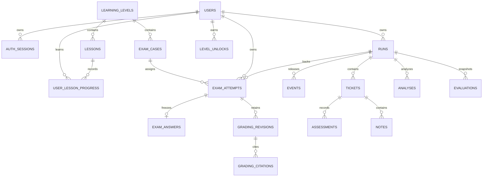

# SOC Learning Lab — SRS ฉบับเริ่มต้น

วันที่ 13 ตุลาคม 2026 · Checklist 01 / SOC-001–002 · **Draft domain contract**

ฉบับนี้รวมข้อกำหนดจาก docs ทั้งหมด ไม่ใช่รายงานว่าระบบทั้งหมดเสร็จแล้ว
ข้อ 04 (14 ต.ค. 2026) เปิด auth/me และ Guest HTTP-event snapshot แล้ว ดู [contract และผลตรวจ](auth-development.md)
ผู้ใช้ยืนยัน registration quota 10 runs/20 AI requests ต่อวัน UTC; ไม่รวมการตัดสินใจ retake/exam
อัปเดตข้อ 02: เพิ่ม native DB foundation/migration/roles และ readiness 200/503 ตาม DB/head/checksums
ดู [local guide](local-development.md); domain schemas/exam policy และ decision register ยังเดิม
Compose build/up, PostgreSQL integration และ persistence ผ่านแล้ว ดู [ผลตรวจข้อ 02](step-02-verification.md)
สิ่งที่ implement ในข้อ 01 มีหน้าเริ่มต้น, API health, worker entrypoint และ tooling เท่านั้น
OpenAPI ที่ตรวจด้วยเครื่องมือได้อยู่ใน [openapi.yaml](openapi.yaml); วิธีเริ่มงานอยู่ใน
[getting-started.md](getting-started.md) และผลตรวจจริงอยู่ใน [step-01-verification.md](step-01-verification.md)

## 1. วัตถุประสงค์ ขอบเขต และแหล่งอ้างอิง

สอนผู้เริ่มต้นอ่านหลักฐาน SOC ด้วยข้อมูลจำลอง เรียน → สอบ → feedback → retake/เลื่อนระดับ
ควบคู่กับ training run, detection, ticket/note, AI/RAG และการทดลอง A/B/C
ไม่ยิงระบบจริง ไม่เชื่อม SIEM/EDR ไม่ให้ AI สั่งปฏิบัติการ และไม่มี public ingestion/upload
`prototype/` เป็น reference เท่านั้น: localStorage, fixture, rubric และบัญชีเดโมไม่ใช่ข้อมูลจริง

แหล่งข้อกำหนดที่อ่าน: [scope](soc-simulation.md), [learning](learning-path.md),
[architecture](architecture.md), [API](api.md), [database](database.md),
[RAG](rag-langchain.md), [CI/CD](ci-cd.md), [plan](development-plan.md),
[alignment](prototype-alignment.md), [checklist](implementation-checklist.md), [index](README.md)
ใช้ checklist กำหนดขอบเขตงานแต่ละครั้ง; Phase 0 ใน roadmap กว้างกว่าข้อ 01
จึงยังไม่ทำ Compose, DB schema/migrations, CI หรือ feature ในข้อ 02 เป็นต้นไป

คำศัพท์: **run** คือรอบปล่อยหลักฐาน; **attempt** คือการสอบหนึ่งเคสที่ผูก run แบบ 1:1;
**submission** คือคำตอบ immutable; **grading revision** คือผลประเมินแต่ละครั้ง;
**finish** คือปิด training เพื่อประเมิน; **submit** คือ freeze คำตอบสอบ;
**final result** ไม่ได้หมายความว่าอนุญาตให้ผู้เรียนอ่าน answer key

Guest อ่าน public metadata/demo; Analyst เข้าถึงรอบตนเอง; Instructor กำกับเฉพาะ assignment
และฝึกรอบตนเองได้; worker/detector ไม่มีสิทธิ์อ่านเฉลย; evaluator/grader มี connection/role แยก
role Instructor เพียงอย่างเดียวไม่ให้สิทธิ์ดูทุกบัญชี

## 2. ช่องว่าง ความขัดแย้ง และข้อสรุป

| จุดที่พบ | หลักฐานเดิม | ข้อสรุป / สถานะ |
|---|---|---|
| Stack ยังไม่เลือก | scope §13 เทียบ architecture §2 และ checklist | ใช้ Next.js App Router/TypeScript, FastAPI/Python, PostgreSQL, SQLAlchemy/asyncpg, Alembic ตามคำสั่งผู้ใช้ |
| Ingestion API / AI ก่อนเปิด ticket | scope §5–6 เทียบ architecture §8–9, api §12 | internal worker/jobs; ไม่มี browser ingestion; detector policy เปิด ticket ได้โดยไม่รอ AI |
| Phase 0 มี DB/CI | plan §2 / ci-cd §2 เทียบ checklist 01–03 | งานนี้เฉพาะข้อ 01; migration จริงข้อ 02 และ CI ข้อ 03 |
| Generic finish/evaluation เปิดเฉลย | api §5/10 เทียบ §16 และ checklist 16 | finish ใช้ training เท่านั้น; exam ใช้ submit ไม่ bypass grading |
| Instructor อ่าน truth ก่อนจบ | api §11 เทียบ exam §16 | **ผู้ใช้ยืนยัน 13 ต.ค.: exam อ่านเฉลยได้หลัง submit เท่านั้น**; training คง assignment + privileged handler + audit เดิม |
| ผู้เรียนอ่าน truth หลัง exam final | api §16 ยังเขียน “ตาม policy” | **ผู้ใช้ยืนยัน: เฉพาะ feedback ตาม rubric ไม่เปิดเฉลยเต็ม**; ทุก projection ต้องใช้ policy เดียวกัน |
| คำตอบหนึ่งหรือหลายรายการ | learning ระบุ 1:N answers; database §14 ใช้ attempt_id PK | หนึ่ง final answer ต่อ attempt/หนึ่งเคสตาม submit API; retake เป็น attempt ใหม่; แก้ความสัมพันธ์เชิงเอกสารให้เป็น 0..1 frozen answer |
| Lock attempt + run ไม่เรียง | database §14 เทียบ run-first §6 และ RAG §8 | ใช้ global ordering §5; ห้าม attempt → run |
| LEARN ID ซ้ำคนละความหมาย | plan LEARN-01–03 เป็น backlog; learning LEARN-01–07 เป็น requirements | ใช้ FR IDs ด้านล่าง; อ้างเดิมพร้อมชื่อเอกสาร ไม่ถือว่า ID สองชุดตรงกัน |
| Exam statuses/result schema | api §16/database §14 | lifecycle และ policy เริ่มต้นอยู่ §4/§8; ยังไม่เปิด endpoint จน implement และผ่าน security/integration tests |

เอกสารเดิมคงรายละเอียดไว้ พร้อมหมายเหตุเชื่อมฉบับนี้ ไม่ใช้ draft schemas เป็นการอนุมัติ
สิทธิ์หรือคะแนนโดยปริยาย OpenAPI ระบุ `x-contract-status` ทุก operation และ `x-schema-status`
สำหรับ schema ร่าง; health, auth/me, Guest HTTP snapshot และ training catalog เป็น approved ตามข้อที่ implement แล้ว

## 3. Training/exam boundary และการ serialize

Server เป็นผู้กำหนด immutable `run.mode=training|exam` และสัมพันธ์ `attempt_id`;
POST /runs รับเฉพาะ public training scenario IDs ไม่รับ mode/attempt/owner/score/passed
exam bank ไม่อยู่ใน `/scenarios` หรือ demo; POST /levels/{level_id}/attempts ตรวจ gate
บทเรียน versioned, level, quota และเลือก exam case ฝั่ง server ใน transaction เดียวกับ run
การรู้ UUID หรือแก้ client state ไม่ทำให้เข้าถึง exam ผ่าน training creation ได้

| Surface | Training | Exam ก่อน submit | Exam หลัง submit |
|---|---|---|---|
| events/detail/search/timeline | released/redacted เท่านั้น | เช่นเดียวกัน; neutral metadata | frozen/released เท่านั้น |
| run/list/overview | clock, counters, metadata | allowlist: id/mode/status/version/elapsed; counters ห้ามแยกตาม severity/label | ยังผ่าน exam projection |
| alerts/tickets | detector explanation, severity และ AI แยกจากคำตอบคน | neutral title, evidence refs, workflow status; ไม่ส่ง detector severity/explanation, suggested severity, label หรือ AI brief | feedback อยู่ result route; ไม่คืน training projection อัตโนมัติ |
| analyses/list/detail/retry/questions/sources | owner + state + quota; revoked policy | ห้าม triage/Ask AI ที่ช่วยตอบ รวม direct endpoint, nested data และ cache | run ถูก freeze แล้ว ไม่เริ่ม Ask AI/retry; grading ใช้เส้นทางแยก |
| audit/history/comments | scoped/redacted | ตัด before/after และข้อความระบบที่ใบ้เฉลย; ห้าม serialize raw audit | feedback ต้องไม่กลายเป็น answer key ทางอ้อม |
| evaluation/export/ground-truth | completed ตามสิทธิ์ | ไม่เปิดผลหรือเฉลย | learner ไม่ได้รับเฉลยเต็ม แม้ run completed; export/evaluation ต้องไม่ใช้ training payload |
| admin truth/review | assignment + access audit; truth ก่อน finish ได้ | exam truth/submission/grading ยังล็อก | Instructor ที่กำกับอ่านผ่าน admin ได้พร้อม audit |

ใช้ explicit allowlist schema แยก exam; **ห้าม serialize training DTO แล้วลบ field บางตัว**
neutral severity ใช้การไม่ส่ง field ไม่เพิ่ม `unrated` เข้า severity enum ของคำตอบ
learner severity ที่กรอกเองไม่ใช่ initial detector severity แต่ final answer อ่านจาก submission หลัง freeze
ไม่มี rubric, threshold, private key, future fixture schedule, exam seed/config hash ที่ย้อนหาโจทย์,
ชื่อไฟล์/exception/context ที่ใบ้ผลใน client, errors, logs หรือ shared retrieval corpus
ก่อน implement ต้องมี leakage tests ทุก surface ในตาราง รวม Instructor ที่ฝึกรอบตนเอง
กฎ exam มี precedence เหนือ completed ของ generic run เสมอ

Training AI และ grading แยกบริการ/DB privileges: triage/retriever ไม่อ่าน private key;
grader อ่าน private key เฉพาะหลัง frozen submission ไม่ใส่ key ใน learner KB หรือ prompt triage
อ้าง evidence เฉพาะ frozen snapshot และ knowledge เฉพาะ frozen retrieval items ของ analysis/attempt
source revoke ทำให้ result=null/withdrawn ทุก projection, citation 410; ไม่เปลี่ยนคะแนนเก่าเงียบ ๆ
provider outage/no_match/invalid citation/ความเห็นขัดแย้งระหว่าง grading → needs_review ไม่ auto-pass

## 4. Lifecycle และ finish/submit

Run state เดิม: `created → running ↔ paused → (resume running)`;
`running → reviewing` เมื่อปล่อยครบ; mutable states → `completing → completed`;
failure จาก nonterminal state → `failed`. created เป็น internal state;
POST training run สำเร็จภายนอกเห็น running หรือ error เท่านั้น
reviewing ยังไม่เปิดเฉลย; completing/completed/failed ห้ามแก้ ticket/note/assessment
Instructor comments ใช้ข้อยกเว้น retention เดิม แต่ต้องตรวจ exam visibility

Training finish: owner/CSRF → lock → ตรวจ version/state → freeze release_seq และ assessment
cutoff ด้วยเวลา DB → enqueue finalize → 202. งานใน cutoff drain สูงสุด 60 วินาที
แล้ว immutable evaluation; AI มาช้าไม่แก้ snapshot. finish ซ้ำ completing/completed
คืน resource เดิม ไม่ต้องตรง version เก่า แต่ยังตรวจเจ้าของ/CSRF
generic finish ของ exam ปฏิเสธ 409 `EXAM_SUBMIT_REQUIRED` โดยไม่สร้าง evaluation/เปิด truth

Attempt lifecycle ร่าง (ชื่อ wire enum ยังต้องยืนยันก่อนข้อ 16):

```text
in_progress --valid submit--> submitted --worker claim--> grading
grading --validated deterministic + grading policy--> finalized
grading --ambiguity/outage/no_match/invalid citation--> needs_review
needs_review --authorized instructor revision--> finalized หรือ needs_review
```

แยก `result.status=pending|passed|failed|needs_review` จาก run.status
`failed` ใน result หมายถึงสอบไม่ผ่าน; run.failed หมายถึงระบบล้มเหลว ไม่ใช่คะแนนศูนย์
run สามารถ completed ขณะ attempt ยัง pending/needs_review ได้ ไม่ทำให้เปิดเฉลยแก่ learner
grading revision append-only; finalized ที่ถูก review ใหม่ไม่เขียนทับ revision เก่า
ผล review ไม่ถอน unlock เดิมตาม policy §8; review mutation ยังไม่เปิดจน implementation พร้อม

Submit: ตรวจ session/owner/CSRF/Idempotency-Key และ version → ตรวจ attempt in_progress,
run ยัง mutable, evidence ที่ต้องใช้ครบตาม rubric และ refs เป็น released events ใน run เดียวกัน
→ insert exam_answers หนึ่งแถวพร้อม content hash/snapshot → freeze run cutoffs/set completing
→ attempt submitted + jobs + audit + idempotency response ใน transaction เดียว
validation fail 422 ไม่มี answer/job/cutoff บางส่วนหลงเหลือ ก่อน evidence ครบห้ามส่ง
เกณฑ์ว่า “ครบ” ต้องมาจาก versioned rubric ที่อนุมัติ ไม่ตัดสินด้วยความยาวเหตุผล
การหยุดเวลา/ปล่อยครบไม่เท่ากับ submit; ไม่ auto-submit คำตอบว่าง

key/body เดิม replay resource เดิมหลังตรวจสิทธิ์; key เดิม/body ต่าง 409;
key ใหม่ขณะ frozen แล้วไม่เขียน answer ใหม่ (ร่าง: 409 ALREADY_SUBMITTED)
สองแท็บต้องมี final answer เดียวด้วย PK(attempt_id), row lock และ transaction
retake สร้าง attempt/run ใหม่และคงประวัติ; ใช้ quota/cooldown/case rotation ตาม §8
นิยาม active attempt และ expiry ใช้ policy §8 ไม่ infer จาก
partial UNIQUE owner WHERE run.status=running ซึ่งเป็นข้อจำกัดคนละเรื่อง

## 5. Transaction และลำดับ lock เดียวกัน

ใช้ READ COMMITTED + explicit locks/CAS/unique constraints; การตรวจสิทธิ์เกิดก่อนอ่าน idempotency
cache และตรวจ state/ownership อีกครั้งใน transaction ใช้ลำดับต่อไปเมื่อ operation แตะแถวชนิดนั้น:

1. user/progression guard (เรียง UUID ถ้ามีหลายคน)
2. idempotency record `(user, method, route including IDs, key)`
3. run (เรียง UUID)
4. attempt (เรียง UUID)
5. ticket → note / analysis / grading revision และ progress/unlock rows ตาม key คงที่
6. quota ledger เรียง `scope_key, period_start` → reservation/component rows
7. insert jobs/audit/response cache แล้ว commit

ใช้เฉพาะ subset ตามงาน ห้ามถือ lock ชั้นหลังแล้วกลับไปชั้นก่อน
create run ไม่มี existing run lock: user guard/idempotency → quota → INSERT run/attempt;
แถวใหม่ยังไม่ visible จน commit จึงไม่ใช่การ lock run ที่เผยอยู่หลัง quota
runner/pause/finish จับ run ก่อน resource; submit/review/grade จับ run ก่อน attempt เสมอ
grade/unlock ของหลาย attempt ในบัญชีเดียวต้อง user guard ก่อน เพื่อ serialize promotion
question/retry จับ run → ticket/analysis → quota; ไม่เพิ่ม ticket version จากการถาม
create/resume ยังต้อง unique constraint หนึ่ง running run ต่อ owner ไม่เปลี่ยนเป็นหนึ่ง mutable run

claim job ใช้ SKIP LOCKED/lease/fencing ใน transaction สั้นแยกก่อน domain transaction;
ไม่ถือ job-row lock แล้วรอ run การ heartbeat/commit ผลตรวจ lease_token ปัจจุบัน
network/AI อยู่นอก transaction เสมอ retry deadlock แบบ bounded สำหรับ idempotent operation
finish lock เดียวกับ release/assessment ทำให้หลังตอบสำเร็จไม่มี evidence/answer ใหม่ข้าม cutoff
ต้องทดสอบบน PostgreSQL จริงในข้อที่เกี่ยวข้อง ไม่อ้างว่า scaffold ตรวจ race นี้แล้ว

## 6. Requirements → use cases → endpoint/screen → acceptance

ทุก endpoint ด้านล่าง (ยกเว้น health) อยู่ใต้ `/api/v1`; health/auth/me/Guest HTTP snapshot และ catalog implement แล้ว ส่วนอื่นยัง draft
แต่ละ operation ใน OpenAPI มี `x-requirements` เชื่อมกลับรหัสนี้; schema ร่างไม่ใช้ generate
production client จนรายละเอียด request/response/authorization ผ่านการตรวจใน feature นั้น

| ID / แหล่งเดิม | Use case / actor, precondition → flow → postcondition | Endpoints / screen | วิธีตรวจรับ (planned ยกเว้น FR-001) |
|---|---|---|---|
| FR-001 / SOC-002 | UC-01 Guest เปิด shell → health; ไม่ต้อง DB | `/health/live`, `/health/ready`, `/` | live 200, ready 503 ก่อน DB foundation; start/build/import/worker check |
| FR-002 / SOC-003 | UC-02 Guest bootstrap → register Analyst → login; logout revoke | `/auth/*`, `/me`, `/me/quota`; Auth | ไม่ auto-login, CSRF/Origin, wrong password generic, expiry 401, disabled/revoked |
| FR-003 / SOC-004/005 | UC-03 Guest อ่าน snapshot/catalog ไม่มี mutation | `/scenarios`, `/demo/*`; Demo | ไม่ enqueue AI, exam bank/future data ไม่หลุด |
| FR-004 / SOC-006/007 | UC-04 Analyst quota ผ่าน → create/pause/resume/finish | `/runs`, `/runs/{run_id}`, controls; Runs | server clock, idempotency/quota race, 409 version, restart ไม่ซ้ำ |
| FR-005 / SOC-008/009 | UC-05 เจ้าของค้น released events/alerts | run `/events`, `/alerts`, `/overview`; Explorer | cursor/filter validation, same-run refs, detector ไม่อ่าน truth |
| FR-006 / SOC-010/013 | UC-06 เจ้าของ mutable run → ticket CRUD/restore/assessment | run `/tickets/*`; Investigation | version race, reason, immutable revisions, soft delete ไม่ลบ denominator |
| FR-007 / SOC-010 | UC-07 ผู้เขียนแก้ note ของตน | ticket `/notes/*`; Notes | cross-run refs/other-author/parent deleted ถูกปฏิเสธ; history คงอยู่ |
| FR-008 / SOC-011/012 | UC-08 training owner อ่าน/retry analysis | run `/analyses/*`; Analysis | snapshot refs, quota, timeout/invalid_output, mode mock/real; exam hints denied |
| FR-009 / SOC-014 | UC-09 training finish → pending → frozen evaluation/export | `/runs/{run_id}/evaluation`, `/ground-truth`, `/export`; owner | owner อ่าน training truth หลัง completed; assigned Instructor อ่านก่อน finish/หลัง completed; cutoff/late result, null metrics เมื่อ denominator=0; exam ใช้ policy แยก |
| FR-010 / SOC-015 | UC-10 assigned Instructor → account/quota/comments/review | operator `app.db.provision`; `/admin/runs*`; Instructor | account/quota/assignment ผ่าน CLI ที่มี audit; unassigned 404; Analyst admin 403; comments แยกจาก assessment/note; exam truth หลัง submit ยังไม่มี endpoint |
| FR-011 / SOC-014 | UC-11 Instructor dataset completed → experiment A/B/C | `POST /admin/runs/{run_id}/experiments`; Experiments | A/B ใช้ detector จริงกับ frozen dataset เดียวกัน; C unavailable จน provider/budget controls พร้อม; metrics แยกจาก human scoring |
| FR-012 / RAG-001–005 | UC-12 mutable training ticket → question → validated citations | ticket `/questions`, analysis `/sources/*`; Ask AI | revocation ทุก projection, retry frozen release, no_match ไม่เรียก chat |
| FR-013 / learning LEARN-01/02 | UC-13 login → onboarding → step lessons → progress | `/learning-path`, `/me/learning-path`, `/lessons/*`; Learning | refresh ไม่หาย, versioned steps/order, completion ไม่เท่ากับผ่านสอบ; ผู้ใช้ยืนยัน 17 ต.ค. 2026 ว่าต้อง login ก่อนอ่าน lesson body (Guest อ่าน metadata/demo เท่านั้น) |
| FR-014 / learning LEARN-03/04 | UC-14 prerequisites ผ่าน → server เลือก case/attempt | `/levels/{level_id}/attempts`, `/attempts/{attempt_id}`; Exam | direct API bypass ไม่ได้, blind serializer ทุก route, demo fixture แยก |
| FR-015 / learning LEARN-05 | UC-15 เจ้าของ evidence ครบ → submit immutable answer | `/attempts/{attempt_id}/submit`; Submit | 422 ไม่ freeze ถ้าไม่ครบ; concurrent submit ได้ answer เดียว; finish bypass ไม่ได้ |
| FR-016 / learning LEARN-06/07 | UC-16 submitted → grading → feedback/review/retake | attempt `/result`, `/admin/attempts/*`; Feedback | outage/ambiguity needs_review; rubric/model/release/snapshot pinned; learner ไม่มี key |
| FR-017 / learning LEARN-07 | UC-17 ผ่านทุกเคส → atomic unlock | grading/review transaction; Learning path | duplicate grading/unlock race; override policy ต้องอนุมัติก่อน; retake ไม่ทับเดิม |

Error/alternative flows ร่วม: session หมด 401; role ไม่พอ 403; resource ไม่อยู่ใน scope 404;
stale version/invalid transition/read-only/idempotency conflict 409; validation 422;
quota 429; dependencies ไม่พร้อม 503. เก็บ draft UI เมื่อ 409; grading pending ไม่แสดงคะแนน 0
AI job fail ยัง GET resource ได้ 200 พร้อม status/error_code ไม่ทำให้ evidence workflow ล้มทั้งหมด
ไม่มี guest mutation นอก auth; Instructor ของคนอื่นใช้ admin routes ไม่ใช้ owner routes

| NFR | เป้าหมาย / วิธีวัด | สถานะ |
|---|---|---|
| NFR-001 Security | cookie HttpOnly/Secure/SameSite=Lax, CSRF+Origin ทุก mutation; owner/assignment; unknown fields forbidden; leakage/cross-run tests ต้องไม่รั่ว | auth/CSRF/owner/assignment tests ผ่านข้อ 04; run/exam tests ยังไม่เริ่ม |
| NFR-002 Performance | read p95 <500ms, 20 concurrent users, 10,000 events/run ไม่รวม AI | target ยังไม่วัด |
| NFR-003 Reliability | at-least-once jobs + dedupe/fencing; reclaim ≤90s; finish drain ≤60s | target ยังไม่ทดสอบ DB |
| NFR-004 Usability | 375/768/1440px, keyboard focus/labels; loading/empty/error, สีมีข้อความกำกับ | auth/Guest ผ่านข้อ 04; catalog ตรวจในข้อ 05; full flows ยังไม่พร้อม |
| NFR-005 Privacy/retention | run child data 30d, account audit 90d (ค่าที่เสนอ); secrets redacted; no learner shared cache | ยังไม่เปิด retention จริง |
| NFR-006 Delivery/recovery | pinned runtimes/locks; contract drift gate; HTTPS same origin; RPO≤15m/RTO≤2h | local scaffold; hosting/restore pending |
| NFR-007 RAG quality | ≥50 Thai/English held-out queries; Recall@5≥.85, supported claims/abstention≥.90; refs ไม่หลุด | targets ไม่ใช่ผลวัด; Gemini/corpus local ได้อนุมัติแล้ว ดูผล pilot ข้อ 14 |

## 7. ข้อมูล ER และ migration boundary

Data dictionary ฉบับเต็ม (ชนิด/nullability/FK/unique/index/retention) อยู่ที่
[database §2–5, §14](database.md) และ [RAG §7](rag-langchain.md) เป็นส่วนหนึ่งของ SRS ฉบับร่าง
UUID PK, timestamptz UTC, mutable version >0, same-run composite FK, append-only revisions
ต้องถูกแปลงเป็น migration ตาม feature ไม่สร้างทุกตารางในข้อ 01; ข้อ 05 เพิ่ม training catalog/private truth เท่านั้น



| Contract delta ที่ต้องเพิ่มเมื่อทำ migration | Constraints / indices |
|---|---|
| runs.mode text NOT NULL | CHECK training/exam; server-set; training create ไม่รับ field นี้ |
| exam_attempts.run_id uuid NOT NULL | UNIQUE + FK runs; owner/mode consistency ใน service transaction |
| exam_answers.attempt_id uuid PK/FK | 0..1 final answer; immutable; evidence refs FK/snapshot validation ภายใน run |
| attempt.state text, version int; submitted_at nullable ก่อน submit | enum ตาม §4 ยัง draft; partial active uniqueness predicate รอ §8 |
| grading revisions/citations | UNIQUE(attempt_id,revision); refs อยู่ frozen snapshot; private key ไม่ออก response |
| level_unlocks | UNIQUE(user_id,level_id); preserve provenance; revoke/override design pending |
| user/progression guard | lock users row ได้ในขั้นแรก; separate guard table เป็นทางเลือกภายหลัง |

Training soft delete เก็บ ticket/evidence/audit และมี restore ก่อน expiry; physical purge เป็น retention
role ต่างหาก ไม่ purge งานยังทำ/unknown reservation; exam retention/feedback redaction ต้องกำหนดก่อน public
PostgreSQL 17.11/digest ผ่าน local integration ตั้งแต่ข้อ 02; production hosting/pgvector compatibility ยังรอข้อ 13/18

## 8. Decision register — ข้อสรุปที่ผู้ใช้มอบหมายให้กำหนด และเรื่องที่ยังค้าง

ข้อ 12 ได้ข้อยืนยันผู้ใช้ 15 ต.ค. 2026: Free Tier/no billing, budget 0 บาท,
global 100 requests/วัน UTC, 200,000 tokens/วัน, 5 requests/rolling minute;
รายผู้ใช้คง 20 requests/วัน. C จริงเป็น operator-triggered bounded synthetic experiment,
คง detection metrics เดียวกับ B; ไม่อนุมัติ rubric หรือ human score เพิ่มจาก policy นี้.

| ID | ต้องตัดสินใจ | กั้นงานใด |
|---|---|---|
| D-01 | **กำหนดค่าเริ่มต้น 17 ต.ค. 2026 ตามที่ผู้ใช้มอบหมาย:** rubric `soc-foundations-v1` มี 4 เกณฑ์ (evidence, analysis, classification, reasoning) คะแนน 0–2 ต่อเกณฑ์; ผ่านเมื่อได้อย่างน้อย 6/8 และเกณฑ์ critical (evidence, analysis) ได้อย่างน้อย 1; หลักฐานต้องเป็น event ที่ release แล้วใน run เดียวกัน. Classification เทียบ private expected severity และ disposition จาก enum `true_positive|false_positive|undetermined`; ไม่เพิ่ม `benign_positive`. Missing/invalid/ambiguous grading เป็น `needs_review`; ห้ามใช้ความยาวข้อความเป็นคะแนน | ใช้เป็น policy เริ่มต้นสำหรับ implementation; ต้องทดสอบ grading ก่อนเปิด exam |
| D-02 | **กำหนดค่าเริ่มต้นที่ผู้ใช้มอบหมาย 18 ต.ค. 2026:** สูงสุด 3 attempt ต่อ case ต่อ rolling 24 ชั่วโมง UTC (ปัจจุบัน 3 cases/level จึงสูงสุด 9 attempts ต่อ level/24 ชั่วโมง); ไม่มี lifetime cap; หลัง failed รอ 1 ชั่วโมง; attempt ที่ไม่ submit หมดอายุใน 24 ชั่วโมงและนับเป็น failed. หนึ่ง active attempt ต่อ user (`in_progress`, `submitted`, `needs_review`); exam ไม่มี learner pause/abort; client ปิดหน้าไม่หยุด expiry. เลือก case ที่มี attempt น้อยที่สุดก่อน แล้วสุ่มเมื่อเท่ากัน; case ที่ครบ 3 attempts ใน window พักจนพ้น window; history/quota/cooldown ตรวจ transactionally | ใช้เป็น baseline สำหรับ implementation; ต้องมี DB tests ยืนยัน retake/cap ก่อนตรวจรับ exam |
| D-03 | **กำหนดค่าเริ่มต้น 17 ต.ค. 2026:** Instructor override ต้องมีเหตุผลและสร้าง grading revision/audit ใหม่เสมอ; การแก้ pass เป็น fail ไม่ถอน level ที่ปลดล็อกแล้วและไม่ย้อนผล attempt ระดับถัดไป; ผลใหม่มีผลกับ promotion ในอนาคต | ใช้กับ review/unlock implementation; no silent recomputation |
| D-04 | **กำหนดค่าเริ่มต้น 17 ต.ค. 2026:** learner เห็น status, คะแนนรวม/รายเกณฑ์, เกณฑ์ทั่วไป, และเฉพาะ evidence refs ที่ตนส่ง; ไม่เห็น expected answer, private case truth, model rationale, rubric hints ที่ผูกกับโจทย์ หรือ citations ที่อาจเปิด answer key; Instructor ใน assignment scope อ่าน submission/truth หลัง submit พร้อม audit | ใช้กับ result/export serializers; ต้องมี leakage regression tests |
| D-05 | เลือก Gemini Free Tier สำหรับ analysis เฉพาะ synthetic training events ใน local (15 ต.ค. 2026); ใช้ Gemini 3.5 Flash-Lite หลัง 2.5 Flash ตอบ 404 สำหรับ project ใหม่; ผู้ใช้ยืนยันเพิ่ม gemini-embedding-2/768 และ corpus 2 เรื่องสำหรับ local ingestion/benchmark วันที่ 16 ต.ค. 2026; วันที่ 17 ต.ค. พัก real-AI quality acceptance; วันที่ 18 ต.ค. สั่งให้เดินหน้า independent review/reconcile usage โดยไม่สั่ง dispatch ใหม่; production privacy/paid mode ยังรอ | local synthetic และ corpus ที่อนุมัติเท่านั้น; เพดาน 0 บาท/100 dispatches/200,000 tokens ต่อ UTC day/5 ต่อ 60 วินาที; provider จริงยัง opt-in และไม่มี real dispatch เพิ่มจนกว่าจะสั่งใหม่ |
| D-06 | approved KB manifest/reviewer, hosting/PostgreSQL/pgvector, domain/registry/backup/release owner | corpus publish/deploy |
| D-07 | learning/exam retention, policy version change ต่อผู้เรียนเก่า และ promotion notification; quota ผู้สมัครใหม่ยืนยันแล้ว 10 runs/20 AI requests ต่อวัน UTC (14 ต.ค. 2026); exam attempt cap/cooldown ใช้ D-02 | public learning rollout |

ไม่มีการถอน unlock ย้อนหลัง และไม่มี AI auto-pass: rubric policy ให้ `needs_review` เมื่อข้อมูลไม่ครบหรือกำกวม; จนกว่าจะมี AI grading ที่ผ่าน benchmark และ policy เพิ่มเติม การตัดสินผลสุดท้ายต้องเป็น deterministic rubric ที่ตรวจสอบได้หรือ Instructor review. Gemini Free Tier ที่ระบุข้างต้นเป็นการตัดสินใจผู้ใช้สำหรับ local synthetic analysis เท่านั้น; วันที่ 16 ต.ค. 2026 ผู้ใช้อนุมัติ embedding/RAG และ benchmark เฉพาะ local corpus สองเรื่องตาม D-05 เพิ่มแล้ว; วันที่ 17 ต.ค. พัก real-AI connection/quality acceptance ไว้ก่อน และวันที่ 18 ต.ค. สั่งทำ independent review/reconciliation โดยยังไม่สั่ง provider dispatch ใหม่; production/paid use ยังไม่อนุมัติ.
ข้อ 05 ใช้ [training-only catalog/seed และ exam default-deny policy](scenario-development.md)
เพื่อปิดช่องก่อนเปิด run/exam จริง; ผู้ใช้มอบหมายให้กำหนด policy baseline D-01–D-04 แล้ว แต่ draft result/attempt schema ยังไม่ approved และ exam features ยังปิดจน implement/test ผ่าน
RAG เปิดต่อ run ด้วย opt-in หลัง publish release; mock ไม่ทดแทนผลจริง
Approval เพิ่ม route: ตกลง policy/schema → เปลี่ยน operation เป็น approved → implement response
allowlist/validation/permission → generated OpenAPI drift + behavior/integration tests → ติ๊ก checklist เฉพาะที่ผ่าน


## ข้อ 13: offline knowledge storage (15 ตุลาคม 2026)

Requirement RAG-001/002 ใช้ operator CLI admit/validate/publish/revoke ใน
`app.knowledge` → kb schema / app.jobs; ไม่มี public ingestion หรือ API route เพิ่ม.
Published release/config pin ใน run_versions เมื่อ SOC_KB_ENABLED=true;
ค่าเริ่มต้น false คง run เก่าที่ไม่ใช้ RAG. Fake profile 16 มิติสำหรับ CI/local เท่านั้น.
ผู้ใช้อนุมัติสองคู่มือทั่วไปใน backend/knowledge/manifest.json สำหรับ local/mock แล้ว.
ดู [คู่มือ/หลักฐานข้อ 13](step-13-verification.md); triage/question/citations อยู่ข้อ 14.


## ข้อ 14 — contract ที่ใช้งานจริงและข้อจำกัด

FR-012 ใช้ `POST /api/v1/runs/{run_id}/tickets/{ticket_id}/questions`,
`GET /api/v1/runs/{run_id}/analyses/{analysis_id}/sources/{retrieval_item_id}`,
analysis list/detail/retry เดิม และ Instructor read-only `/api/v1/admin/runs/{run_id}/analyses/{analysis_id}`
กับ `/sources/{retrieval_item_id}`. Instructor ต้องผ่าน assignment และ access audit.
OpenAPI approved เฉพาะ routes ที่มี implementation; learning/exam routes ยัง draft.

Migration 0013–0016 เพิ่ม frozen `app.retrievals`, `app.retrieval_items`,
`app.analysis_knowledge_refs` และ `app.quota_components` (ชื่อย่อของ component reservation
ใน design). Component ผูก logical analysis หนึ่งชุด ไม่สร้างค่าบริการซ้ำตาม system/user ledger;
parent reservation แต่ละ scope เก็บผลรวมเดียวกัน. Citation refs มี composite FK ถึง analysis/run/item
และ chunk/version; snapshots แก้ไขไม่ได้. Knowledge release/config และคำถามเป็น immutable context.

Backend ตรวจ approved training identity ก่อนอ่าน AI หรือ idempotency response;
current DB ยังปฏิเสธ purpose=exam อยู่แล้ว ไม่อ้างว่า exam/submit endpoint พร้อม.
คำถาม lock run → ticket → quota; finish ใช้ run lock เดียวกัน. Question ไม่แก้ ticket version/assessment.
ก่อน provider/persist ตรวจ revocation; ทุก read รวม replay/export ซ่อนผลที่ใช้ withdrawn context.
การ revoke ไม่แก้ evaluation snapshot หรือ metrics. Snapshot export มี frozen citation metadata/excerpts.

Context policy v1 เลือก outcome events ก่อนแล้วเติมตาม released order ภายใน 4,000 UTF-8 bytes;
คืน `evidence_truncated` กับ `omitted_evidence_ids`. Knowledge context จำกัด 3,000 UTF-8 bytes
และ output 1,200 tokens. Bytes เป็น conservative upper bound ไม่อ้างว่าเป็น native tokenizer count.
Question no_match ไม่ส่ง generation; provider/retrieval outage ไม่แก้ assessment/หยุด detector.
Global AI capacity หมดทำให้ automatic analysis เป็น quota_exceeded แต่ ticket/detection ยัง commit.

Gemini ใช้ StructuredAnalysisProvider extension ของ adapter เดิม ผ่าน LangChain Core 1.6.10;
ไม่มี agent tools/SQL/web browsing/tracing. CI ใช้ fake profiles/generation เท่านั้น.
Real pilot กับผลที่ยังไม่ผ่าน quality targets อยู่ใน [รายงานข้อ 14](step-14-verification.md).


ข้อ 14 เพิ่มเติม (16 ต.ค. 2026): generation จริงมี Gemini model-tokenizer preflight รวม system/schema
และ conservative full-request window 16k/output 1200; evidence/KB มี byte cap ที่เข้มกว่าเป็นด่านแรก.
Count request ใช้ shared request/rate cap เดียวกับ embedding/chat แต่ counted input length ไม่ใช่ generation usage.
Calibration ใหม่สร้าง release ใหม่ ไม่ update policy/run pin เดิม; token/latency telemetry อยู่ migration 0017.
เกณฑ์คุณภาพยังต้องมีผู้ตรวจยืนยัน relevance/grounding ดู [คู่มือผู้ตรวจ](step-14-review-guide.md).
Retrieval v2 ที่ได้ TH Recall@5 0.95 เป็น developer-label measurement ยังไม่ใช่ full paired answer acceptance.


## FR-001 Google login extension — user-approved 2026-10-16

Password registration ยังคงไม่ auto-login ข้อยกเว้น Google verified identity ใหม่สร้าง Analyst พร้อม quota 10 runs/20 logical AI requests ต่อวัน UTC และออก opaque SOC session ทันที Existing email ไม่ auto-merge; เจ้าของต้อง password login แล้ว reauthenticate เพื่อ explicit link Google อีเมลเดียวกันหนึ่งครั้ง เก็บ issuer/sub เป็น unique identity กับ user ID เดิม ไม่ให้ email/domain กำหนด Instructor หรือย้าย ownership/quota Google-only account ไม่มี password login; unlink/password enrollment ยังไม่อยู่ในขอบเขต

Mapping: GET `/api/v1/auth/google/status`, POST `/api/v1/auth/google/start` และ GET `/api/v1/auth/google/callback` ตาม OpenAPI approved; callback single-use browser/session-bound 5 นาที พร้อม nonce/PKCE ตรวจ signature/audience/issuer/expiry/verified email และออก session ใหม่เมื่อสำเร็จ Provider failure ไม่กระทบ password login; disabled user เข้าไม่ได้ Identity transaction advisory guard มาก่อน user/session locks การ consume flow อยู่ transaction แยกก่อน external IO ไม่มี transaction ค้างรอ Google และต้องตรวจ session/expiry ซ้ำก่อนผูกบัญชี
